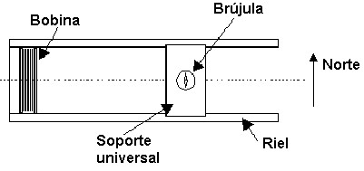
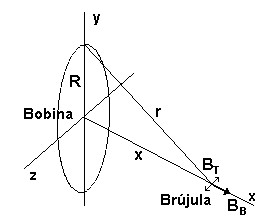

# Campo de inducción magnética — informe del grupo 6: fundamentos


UNIVERSIDAD TECNOLOGICA NACIONAL

FACULTAD REGIONAL RESISTENCIA

TRABAJO DE LABORATORIO Nº 7

TEMA: CAMPO DE INDUCCIÓN MAGNÉTICA

## OBJETIVO

Determinación de la componente horizontal del campo magnético terrestre mediante
el método de la brújula de tangentes. Análisis del campo magnético creado por
una bobina circular

## FUNDAMENTOS TEÓRICOS

Una brújula es una aguja imantada que puede girar libremente en torno a un eje
vertical que posee en su centro y tiene la propiedad de orientarse respecto de
una dirección que coincide aproximadamente con el Norte geográfico. Esto
demuestra la existencia del campo magnético terrestre, de modo que la Tierra se
comporta como un gigantesco imán. En cada punto próximo a la superficie
terrestre queda definido el campo $`\vec{B}`$ que varía, en función del punto,
en módulo y dirección. El ángulo que este campo forma con el plano horizontal se
llama *inclinación magnética* El ángulo formado por la componente horizontal del
campo magnético con la verdadera dirección Norte–Sur esto es con la dirección
del meridiano del lugar, se llama *declinación magnética*. En esta experiencia
se determinará el valor de la componente horizontal del campo magnético
terrestre Bh.

El instrumento que se va a emplear se llama ***magnetómetro***, el cual está
compuesto por una bobina circular, cuyas dimensiones se conocen (N: número de
vueltas, R: radio medio, Imax: corriente máxima que soporta) y una brújula
convencional. Ambos elementos están montados sobre un soporte universal que
permite mantener alineado el centro de la bobina con la brújula, a lo largo de
distintas posiciones que puede tomar la brújula cuando esta se desplaza a lo
largo de rieles pertenecientes al soporte (ver figura 1).

Si se coloca el magnetómetro en la dirección Este-Oeste, de modo que la brújula
se orienta naturalmente en la dirección Norte–Sur quedando perpendicular a los
rieles.

Cuando se coloca un cuerpo de momento magnético $`\vec{m}`$ en un campo
magnético $`\vec{B}`$ sobre se ejerce un momento de fuerza dado por

```math
\vec{M}=\vec{m}\wedge\vec{B}\qquad(1)
```

Como la brújula tiene un momento magnético, estará sometida a dos campos
magnéticos: el terrestre y el de la bobina, cuando por esta circule una
corriente I., por lo tanto cada uno ejercerá un momento de fuerza sobre la aguja
magnética que intentará girarla, en concordancia con (1), en equilibrio será

```math
\vec{M}_B-\vec{M}_T=0\quad\Rightarrow\quad M_B=M_T\qquad(2)
```

```math
mB_B\cos\theta=mB_T\mathop{\mathrm{sen}}\nolimits\theta\qquad(3)
```

siendo θ el ángulo que forma la aguja con la dirección perpendicular a los
rieles ( es decir el Norte).

```math
B_B\cos\theta=B_T\mathop{\mathrm{sen}}\nolimits\theta\qquad(4)
```

Haciendo pasaje de términos resulta

```math
B_T=B_B\frac{\cos\theta}{\mathop{\mathrm{sen}}\nolimits\theta}=\frac{B_B}{\mathop{\mathrm{tg}}\nolimits\theta}\qquad(5)
```

donde BT es la componente horizontal del campo magnético terrestre, BB es el
campo creado por la bobina en la posición donde está la brújula.



Haciendo la suposición que la intensidad del campo de la bobina es constante en
toda la región ocupada por la aguja magnética, entonces se puede calcular la
intensidad del campo mediante

```math
B_B=\frac{\mu_o INR^2}{(R^2+x^2)^{3/2}}\qquad(6)
```

Donde

```math
\mu_o=4\pi10^{-7}\mathrm{mKg}\mathrm{s}^{2}\mathrm{A}^{-2}
```

N es el número de las espiras de la bobina, R es el radio medio de la bobina e I
es la intensidad de corriente que circula por ella, x es la distancia entre el
centro de la bobina y el eje de la aguja magnética.



La (5) entonces puede escribirse

```math
B_T=\frac{B_B}{\mathop{\mathrm{tg}}\nolimits\theta}=K\frac I{r^3}\frac1{\mathop{\mathrm{tg}}\nolimits\theta}\qquad(7)
```

donde

```math
K=\mu_o NR^2
```

y

```math
r=\sqrt{R^2+x^2}
```

```math
B_T\mathop{\mathrm{tg}}\nolimits\theta=K\frac I{r^3}\qquad(8)
```

## Procedencia y criterios de transcripción

- Original: `2015/L7 Brujula G6 A corregir.docx`. SHA-256:
  `f8b78ccaea4e2a0a6e03331360824f66be2d1899b3f1ead31f65c2335da0960f`. Páginas
  1–2 y comienzo de 3 hasta (8), antes de materiales, del PDF normalizado con
  LibreOffice de nueve páginas; no es paginación original DOCX.
- Pandoc con medios, inspección XML y Poppler contrastados con las páginas
  renderizadas. Las ecuaciones son texto fragmentado con caracteres Symbol,
  superíndices y líneas VML; no son objetos OMML. Se verificaron visualmente
  fracciones, raíz y letras, conservando la numeración (1)–(8).
- Se restituyen espacios entre palabras pegadas y se recompone el orden de
  lectura de fragmentos de ecuaciones, sin cambiar palabras ni fórmulas. El DOCX
  tiene una maquetación superpuesta y texto rojo; no se interpreta como control
  de cambios: no hay inserciones, eliminaciones ni comentarios XML.
- El objetivo y gran parte de la teoría aparecen en rojo, incluyendo (1), (6) y
  la definición de μo. Se conservan como contenido de la versión a corregir. Las
  observaciones finales sobre arreglar la teoría se transcriben con el cierre
  del informe, no se aplican como instrucciones de edición.
- Se mantiene la ausencia de un factor 2 en el denominador de (6), K sin ese
  factor y s con exponente positivo en μo. No se sustituyen por expresiones
  físicas corregidas. Las líneas verticales junto a (2) en LibreOffice son
  bordes de columnas de la maquetación, no barras de módulo del texto XML.
- Se preservan «sobre se ejerce», «I.,» y el final sin punto tras inclinación
  magnética. La carpeta 2015 no acredita una fecha de estas páginas.
- Restan materiales, técnica, cuestionario, datos, resultados y cierre del
  informe. Esta nota no les atribuye cobertura.
