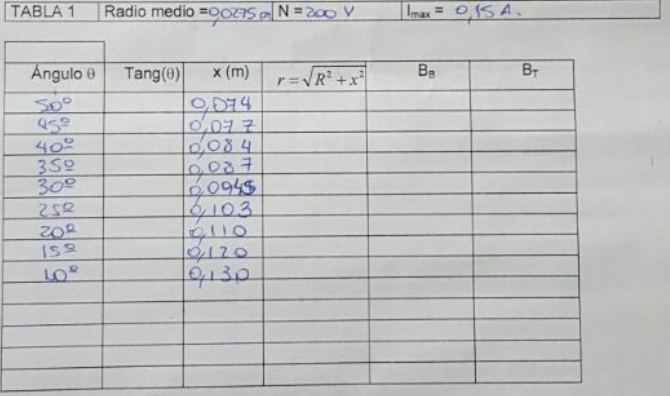

# Campo de inducción magnética — informe del grupo 6: hoja manuscrita

UNIVERSIDAD TECNOLÓGICA NACIONAL

FACULTAD REGIONAL RESISTENCIA

CÁTEDRA: FÍSICA II

TRABAJO DE LABORATORIO Nº 7

OBJETIVO: Determinación de la componente horizontal del campo magnético
terrestre mediante el método de la brújula de tangentes. Análisis del campo
magnético creado por una bobina circular

## HOJA DE DATOS

CURSO: ISI A

FECHA: 16/06/16

## 1.- Recolección de datos

TABLA 1

Radio medio = 0,0275 m

N = 200 V

Imax = 0,15 A.

<table>
<thead>
<tr><th>Ángulo θ</th><th>Tang(θ)</th><th>X (m)</th><th>r</th><th>BB</th><th>BT</th></tr>
</thead>
<tbody>
<tr><td>50°</td><td></td><td>0,074</td><td></td><td></td><td></td></tr>
<tr><td>45°</td><td></td><td>0,077</td><td></td><td></td><td></td></tr>
<tr><td>40°</td><td></td><td>0,084</td><td></td><td></td><td></td></tr>
<tr><td>35°</td><td></td><td>0,087</td><td></td><td></td><td></td></tr>
<tr><td>30°</td><td></td><td>0,09[ilegible]</td><td></td><td></td><td></td></tr>
<tr><td>25°</td><td></td><td>0,103</td><td></td><td></td><td></td></tr>
<tr><td>20°</td><td></td><td>0,110</td><td></td><td></td><td></td></tr>
<tr><td>15°</td><td></td><td>0,120</td><td></td><td></td><td></td></tr>
<tr><td>10°</td><td></td><td>0,130</td><td></td><td></td><td></td></tr>
<tr><td></td><td></td><td></td><td></td><td></td><td></td></tr>
<tr><td></td><td></td><td></td><td></td><td></td><td></td></tr>
<tr><td></td><td></td><td></td><td></td><td></td><td></td></tr>
<tr><td></td><td></td><td></td><td></td><td></td><td></td></tr>
<tr><td></td><td></td><td></td><td></td><td></td><td></td></tr>
</tbody>
</table>

La cuarta columna está encabezada por la expresión

```math
r=\sqrt{R^2+x^2}
```



## Procedencia y límites de lectura

- Original: `2015/L7 Brujula G6 A corregir.docx`. SHA-256:
  `f8b78ccaea4e2a0a6e03331360824f66be2d1899b3f1ead31f65c2335da0960f`. Página 6
  del PDF normalizado con LibreOffice de nueve páginas. La fotografía
  incorporada tiene su propio número de página 1; no se confunde con el 6 de la
  copia normalizada.
- OCRmyPDF en español sobre una copia de esta página, con OCR forzado por el
  encabezado y número de página que ya poseen texto. Pandoc conserva el JPEG; el
  texto manuscrito se cotejó visualmente en la fotografía y ampliación, no se
  dedujo de la tabla mecanografiada posterior.
- Se conservan nueve filas con ángulo/distancia y cinco filas completamente
  vacías; las columnas Tang, r, BB y BT están vacías en todas las filas. Una
  línea gruesa separa las nueve primeras de las cinco restantes. La celda vacía
  encima de Ángulo es un espacio de formulario, no otra medición.
- La distancia de 30° tiene una cifra final retocada, sin lectura inequívoca: se
  conserva «0,09[ilegible]» y el recorte. No se sustituye por 0,094 de la tabla
  mecanografiada de página 7. Hace falta una copia más nítida para cerrar esta
  cifra. Los ceros finales de 0,110, 0,120 y 0,130 se preservan.
- Se mantiene «N = 200 V» tal como se lee en la hoja, sin interpretarlo como una
  tensión ni cambiarlo a «espiras». La fecha del campo es 16/06/16 y junto a la
  firma docente consta 16/06/2016; la carpeta 2015 no acredita su año.
- Se omiten explícitamente nombres y firmas manuscritos, incluida la firma
  docente. El recorte publicado contiene únicamente las tablas. Se conserva el
  original íntegro en OneDrive y la copia verificada en caché.

[Resultados mecanografiados](brujula-informe-grupo-6-resultados.md).
