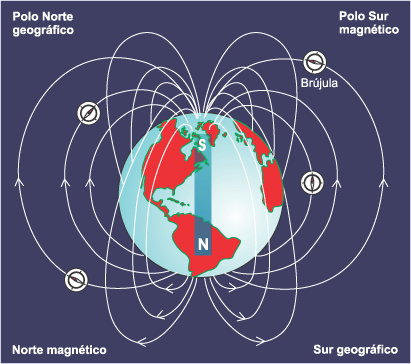

# Campo de inducción magnética — informe del grupo 6: respuestas y conclusión

1\)

1\) La brújula utiliza una aguja imantada para señalar el norte magnético
terrestre. Su funcionamiento se basa en el magnetismo terrestre, por lo que
señala el sur magnético que corresponde con el norte geográfico.

Cuando una brújula se mueve desde el polo sur magnético al polo norte magnético,
esta varia en sentido contrario a las agujas del reloj debido a que una de las
agujas de la brújula esta imantada de manera tal que apunta al campo magnético
más cercano (norte o sur magnético).

2\) Las diferencias entre el norte geográfico (meridianos Norte y Sur del mapa) y
norte magnético (hacia el cual señala la punta roja de la flecha de la brújula)
se le denomina declinación. Para hacer un uso correcto de la brújula es
necesario saber el ángulo de declinación de la posición que quiero conocer.

3\) El momento magnético de una aguja imantada representa la propiedad física que
corresponde al magnetismo existente en la aguja, es el vector, momento dipolar
magnético. En el SI las unidades en las que se mide es en Amper por metro
cuadrado ($`\mathrm A.\mathrm m^2`$).

## Conclusión

A partir del cuestionario, logramos determinar que la brújula funciona gracias a
la aguja imantada que posee y esta sufre fenómenos magnéticoscausados por los
polos magnéticos terrestres.

Además, dichos campos magnéticos dependen de la posición y su tangente
trigonométrica que se observan cuando la brújula se encuentra en el eje
horizontal (mismo campo magnético del polo sur y norte magnético) y sobre los
polos magnéticos, que se interpreta como una tangente infinita.

## Observaciones de la versión a corregir

**Falta la caratula con la foto del grupo.**

**Arreglar la parte teórica ya que así como está no se entiende.**

## Procedencia y criterios de transcripción

- Original: `2015/L7 Brujula G6 A corregir.docx`. SHA-256:
  `f8b78ccaea4e2a0a6e03331360824f66be2d1899b3f1ead31f65c2335da0960f`. Páginas
  8–9 del PDF normalizado con LibreOffice de nueve páginas; la paginación
  pertenece a esa copia, no al DOCX.
- Pandoc y XML cotejados con Poppler y ambas páginas renderizadas. Se conservan
  el «1)» anterior a la figura y la numeración 1)–3) de respuestas, la
  conclusión y las dos observaciones finales en rojo y negrita. Son texto
  original de la versión, no instrucciones aplicadas por quien transcribe.
- Se conserva el GIF incorporado sin convertirlo en una captura estática. El
  texto alternativo del DOCX registra su procedencia como
  `http://newton.cnice.mec.es/materiales_didacticos/campmag/images/Mundo.gif`;
  se utiliza la copia incluida en el original, sin descargarla de ese enlace.
- Se conservan «varia», «esta imantada», «Amper por metro cuadrado» junto con
  A.m² y «magnéticoscausados». Las afirmaciones sobre polos, giro, campos y
  tangente se transcriben como respuestas de sus autores, sin validarlas ni
  sustituirlas por respuestas corregidas.
- No se añade una portada ni una foto que el archivo no contiene. El año
  corresponde a la carpeta; estas páginas no tienen fecha impresa.

[Cuestionario original](brujula-informe-grupo-6-tecnica-cuestionario.md).
