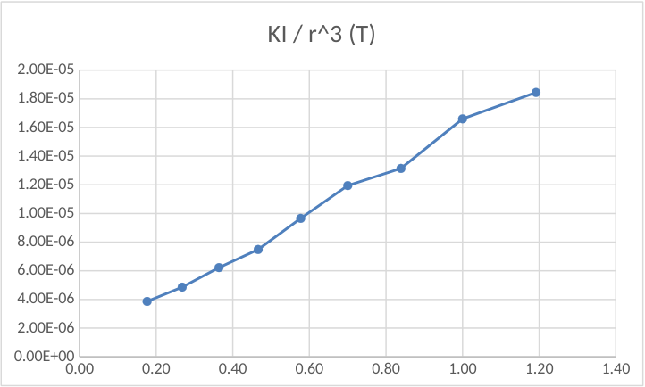

# Campo de inducción magnética — informe del grupo 6: resultados

<table>
<thead>
<tr><th>Radio medio= 0,0275 m</th><th>N = 200 v</th><th>Imax= 0,15 A</th><th>Bt Prom=1,72E-05</th></tr>
</thead>
</table>

| Angulo (°) | tang(°) | x(m) | r(m) | Bb(T) | Bt(T) |
| -- | -- | -- | -- | -- | -- |
| 50 | 1,19 | 0,074 | 0,079 | 1,84E-05 | 1,55E-05 |
| 45 | 1,00 | 0,077 | 0,082 | 1,66E-05 | 1,66E-05 |
| 40 | 0,84 | 0,084 | 0,088 | 1,31E-05 | 1,57E-05 |
| 35 | 0,70 | 0,087 | 0,091 | 1,19E-05 | 1,71E-05 |
| 30 | 0,58 | 0,094 | 0,098 | 9,66E-06 | 1,67E-05 |
| 25 | 0,47 | 0,103 | 0,107 | 7,49E-06 | 1,61E-05 |
| 20 | 0,36 | 0,110 | 0,113 | 6,23E-06 | 1,71E-05 |
| 15 | 0,27 | 0,120 | 0,123 | 4,86E-06 | 1,82E-05 |
| 10 | 0,18 | 0,130 | 0,133 | 3,87E-06 | 2,19E-05 |

Gráfico de kl/r^3 En Función de tan

| Tang(°) | KI / r^3 (T) |
| -- | -- |
| 1,19 | 1,84E-05 |
| 1,00 | 1,66E-05 |
| 0,84 | 1,31E-05 |
| 0,70 | 1,19E-05 |
| 0,58 | 9,66E-06 |
| 0,47 | 7,49E-06 |
| 0,36 | 6,23E-06 |
| 0,27 | 4,86E-06 |
| 0,18 | 3,87E-06 |

## Procedencia y observaciones

- Original: `2015/L7 Brujula G6 A corregir.docx`. SHA-256:
  `f8b78ccaea4e2a0a6e03331360824f66be2d1899b3f1ead31f65c2335da0960f`. Página 7
  del PDF normalizado con LibreOffice de nueve páginas; la paginación pertenece
  a esa copia de revisión.
- Pandoc/Poppler y tablas XML cotejados con la página renderizada. Se conservan
  los cuatro datos de cabecera, las nueve filas y seis columnas de resultados, y
  las nueve filas de la tabla de dos columnas incorporada como EMF.
- Se preservan E-05/E-06, comas decimales, ceros finales y «Angulo» sin tilde.
  La cabecera dice «N = 200 v» y «Bt Prom=1,72E-05» sin unidad final; no se
  interpretan ni se corrigen. El título del gráfico dice «kl/r^3», mientras la
  figura y su tabla usan «KI / r^3 (T)».
- El gráfico es un objeto nativo del DOCX, contrastado con sus datos XML; se
  conserva mediante recorte renderizado, sin redibujarlo. No contiene una línea
  de ajuste ni ecuación de tendencia; se mantienen los nueve puntos unidos,
  ejes, graduaciones y título originales.
- La tabla asociada al gráfico repite los valores de tang y Bb; no se cambia por
  Bt ni se recalculan datos. No se añaden el ajuste por cuadrados mínimos ni la
  propagación de errores solicitados en la técnica, ausentes en esta página y en
  el cierre del informe.
- El encabezado institucional repetido está conservado en el apunte de
  fundamentos. No consta fecha en esta página; 2015 corresponde a la carpeta.

[Técnica y cuestionario](brujula-informe-grupo-6-tecnica-cuestionario.md).
[Respuestas y conclusión](brujula-informe-grupo-6-respuestas-conclusion.md).
