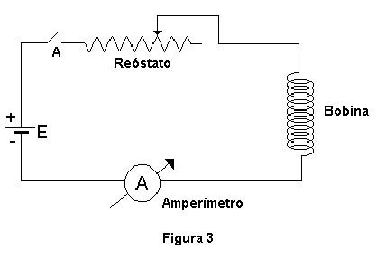
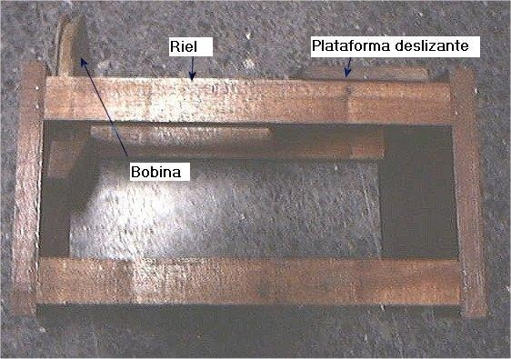
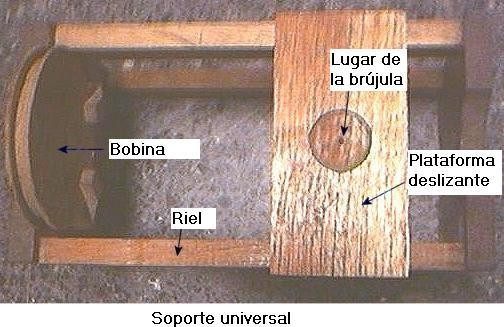

# Campo de inducción magnética — informe del grupo 6: técnica y cuestionario

## MATERIALES UTILIZADOS

1. Fuente de alimentación de CC.
1. Amperímetro.
1. Reóstato.
1. Bobina.
1. Brújula.
1. Soporte universal.

## TÉCNICA OPERATORIA

1\. Registre el valor del radio medio R de la bobina, el número de espiras N y el
valor de la corriente máxima que soporta la bobina.

2\. Arme el circuito de la Figura 3, adecue convenientemente el valor de la
resistencia del reóstato para que la corriente que circule no supere la
corriente máxima que soporta la bobina.

3\. Coloque la brújula lo más cerca posible de la bobina.

4\. Antes de conectar el circuito verifique la escala del amperímetro si es
compatible con la corriente máxima que soporta la bobina, luego conecte el
circuito, cerrando el interruptor A.

4\. Aumente la distancia de la brújula a la bobina, x1, de tal forma que la
desviación de la aguja vaya disminuyendo en 5° hasta llegar a 10°. Registre en
la hoja de datos la posición x para cada caso.

5\. Calcule el valor de BB usando la (6).

6\. Empleando (7) calcule el BT para cada ángulo

7\. Calcule el BT promedio.

8\. Grafique $`(KI/r^3)`$ en función de la tgθ para la serie de valores medidos.

9\. Aplique el método de cuadrados mínimos para obtener la pendiente y a partir
de ella BT

10\. Aplique propagación de errores y determine $`\Delta B_T`$, admita que
$`\Delta r\sim1\mathrm{mm}`$ y $`\Delta\theta\sim2^\circ`$.

## CUESTIONARIO

1\. Hacer un esquema de las líneas de inducción magnética terrestre. A partir de
este esquema, explicar cómo se comportaría una brújula de inclinación al ser
trasladada desde el polo Sur magnético al polo norte magnético ¿Cuál será la
definición de estos polos?

2\. ¿Indica la brújula de declinación la dirección del Norte geográfico? ¿Qué
información complementaria necesitamos para hacer un uso correcto de una
brújula?

3\. ¿Qué representa el momento magnético $`\vec{m}`$ de una aguja imantada? ¿En
qué unidades se mide?

## BIBLIOGRAFÍA

Eisberg R. y Lerner L. “Física: Fundamentos y Aplicaciones” Vol I y II Ed.
McGraw-Hill

Serway R “Física” Vol II Ed. McGraw-Hill

Sears Física Universitaria 6ta ed. Addison Wesley

Zahn M. “Teoria Electromagnética” Ed. McGraw-Hill

Kip A. “Fundamentos de Electricidad y Magnetismo” Ed. McGraw-Hill

Gettys y otros Física clásica y moderna Ed. McGraw-Hill

Girón, Manuel Practicas de laboratorio de Fisica General Compañía Editorial
Continental SA

## Procedencia y criterios de transcripción

- Original: `2015/L7 Brujula G6 A corregir.docx`. SHA-256:
  `f8b78ccaea4e2a0a6e03331360824f66be2d1899b3f1ead31f65c2335da0960f`. Página 3
  desde materiales, y páginas 4–5 completas del PDF normalizado con LibreOffice
  de nueve páginas; la paginación corresponde a esa copia.
- Pandoc con medios y XML contrastados con las tres páginas renderizadas y
  Poppler. Se restituyen espacios entre palabras pegadas sin cambiar su texto.
  Las tres figuras JPEG se extraen del DOCX y se conservan sin redibujar.
- Se mantienen los dos pasos numerados 4, x1 y x en sus lugares, y la
  disposición del paso 9, cuyo BT estaba separado en otra celda. Los pasos 5–9
  aparecen dentro de una tabla de maquetación; aquí se mantiene su orden.
- Materiales, pasos, gran parte del cuestionario y bibliografía aparecen en
  rojo; se identifican como texto original de esta versión, no como
  instrucciones nuevas. La primera parte de la pregunta 2 está en negro y su
  continuación en rojo. No se resuelven las preguntas ni se realizan mediciones
  nuevas.
- Se conserva «Teoria» y «Practicas» sin tilde en las referencias, así como el
  contenido bibliográfico sin agregar ediciones o datos externos.
- Los encabezados institucionales repetidos y números de página de la copia
  normalizada no se duplican en el cuerpo; el encabezado está conservado en el
  apunte de fundamentos. No consta fecha en estas páginas.
- Restan hoja manuscrita, resultados y respuestas del informe en páginas 6–9.

[Fundamentos](brujula-informe-grupo-6-fundamentos.md).
