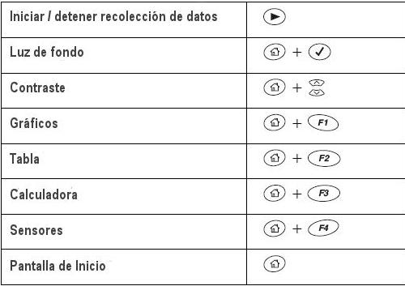

<!-- markdownlint-disable MD060 -->

# Trabajo práctico Nº 17: Calorimetria

Universidad Tecnologica Nacional. Facultad Regional Resistencia. Cátedra: Física
II.

TEMA: CALORIMETRIA

## Objeto de la experiencia

- Determinar el equivalente en agua de un calorímetro y el calor específico de
  un sólido

## Materiales

Para la realización de ambas experiencias se necesitan los siguientes
materiales:

- Un recipiente de telgopor para helado de medio kilo (o también de kilo) que se
  usará como calorímetro. Por tal razón se realizará en la tapa dos pequeñas
  perforaciones para el sensor de temperatura y el agitador
- Un trozo de alambre para construir un agitador,
- Un datalogger Pasco Xplorer GLX con dos sensores de temperatura Pasco
- Un trozo de material cuyo calor específico se quiere determinar
- Un termo y un calentador eléctrico
- Hilo para sujetar el sensor al cuerpo, y poder movilizarlo.
- Balanza de precisión.

## 1- Determinación del equivalente en agua de un calorímetro

### Introducción

El recipiente donde se realizan las experiencias en las que se producen
variaciones de calor se llama calorímetro. Se trata de un recipiente que
contiene el líquido en el que se va a estudiar la variación del calor y cuyas
paredes y tapa deben aislarlo al máximo del exterior.

El "equivalente en agua del calorímetro " es la cantidad de agua que absorbe o
desprende el mismo calor que el calorímetro y sus accesorios.

En esta experiencia se busca determinar el equivalente en agua del calorímetro
como experiencia previa a la determinación del calor específico de un sólido en
la parte 2 de este trabajo práctico.

En este caso se analiza el balance de energía que ocurre hasta alcanzar el
equilibrio térmico entre el agua que se encuentra en el calorímetro y el propio
calorímetro, agitador y termómetro (CAT) ambos a temperatura ambiente y el agua
calentada hasta alcanzar una temperatura previamente definida. Como el calor
específico del agua es conocido y considerando que CAT es de agua, la única
incógnita es cuanto vale esa masa ficticia de agua (k) que intercambia la misma
cantidad de calor que el CAT.

### Procedimiento

En un calorímetro de mezclas (recipiente de telgopor), se coloca una masa M de
agua a una temperatura Ti del ambiente. Por otro lado se calienta a una
temperatura conocida T una masa m de agua y luego se la vierte en el calorímetro
y se agita suavemente el recipiente hasta que alcance el equilibrio térmico a la
temperatura Tf.

Entonces, el calor que cede la masa m de agua caliente tiene que ser igual al
calor que absorbe el calorímetro de mezclas y el agua M. Por lo tanto:

```math
Q_{\mathrm{abs}}=-Q_{\mathrm{ced}}
```

donde:

```math
Q_{\mathrm{abs}}=(M c_{\mathrm{H2O}}+m_c.c_c+m_t.c_t+m_a.c_a).(T_f-T_i)
```

```math
Q_{\mathrm{ced}}=m c_{\mathrm{H2O}}(T-T_f)
```

con:

$`m_c`$ = masa del calorímetro, $`c_c`$ = calor específico del calorímetro

$`m_t`$ = masa del sensor de temperatura, $`c_t`$ = calor específico del sensor
de temperatura

$`m_a`$ = masa del agitador y. $`c_a`$ = calor específico del agitador.

$`c_{\mathrm{H2O}}`$ = calor específico del agua

$`T_f`$ = Temperatura final del calorímetro

$`T_i`$ = Temperatura inicial del calorímetro.

T = Temperatura inicial de la masa m de agua

Si llamamos k al equivalente en agua del calorímetro, donde:

```math
k=(m_c.c_c+m_t.c_t+m_a.c_a)/c_{\mathrm{H2O}}
```

entonces:

```math
k=[m(T-T_f)/(T_f-T_i)]-M
```

(1)

### Recomendaciones generales

- Consultar con el docente la forma más segura de trabajo y las precauciones que
  se deben tomar para evitar problemas y accidentes.
- Tener todos los elementos antes de iniciar las experiencias.
- Discutir y estimar todas las posibles fuentes de errores de todas las
  mediciones que se efectúan.
- Anotar todos los datos con sus correspondientes errores.

### Pasos de la Experiencia para la determinación del equivalente en agua k

1. Tomar el recipiente de telgopor (calorímetro), pesarlo en la balanza y
   etiquetarlo con el valor de su masa.
1. Llenar hasta aproximadamente la mitad de su altura con agua corriente y
   volverlo a pesar. La diferencia entre esta cantidad y la del punto 1, nos da
   la masa M de agua. Sumergir el sensor de temperatura en el interior del
   líquido del recipiente
1. Calentar agua en un termo hasta un valor de aproximadamente 80 C (se lo puede
   determinar con el datalogger).
1. Iniciar la recolección de datos con el datalogger.
1. Verter parte del agua caliente en el calorímetro teniendo cuidado de no
   llenarlo. Este procedimiento debe realizarse lo más rápido posible para
   evitar pérdidas de calor.
1. Registrar la evolución de temperatura en función del tiempo hasta que ambas
   puntas sensoras registren la misma temperatura Tf. Usar el agitador para
   uniformar la temperatura.
1. Determinar nuevamente el peso de este recipiente y por diferencia se obtiene
   la masa m del agua caliente

### Actividades de la primera experiencia

- Exportar los datos experimentales en un pendrive. Con los datos obtenidos
  anteriormente hacer una gráfica de temperatura vs tiempo. Recordar que en
  algunas planillas de cálculo la coma es usada en lugar del punto decimal.
- Discutir la forma de la gráfica obtenida y averiguar o discutir con el docente
  la forma más conveniente de determinar los valores de Ti y Tf.

Analice las unidades de k según formula (1)

## 2 – Determinación del calor específico de un sólido

### Introducción de la segunda experiencia

Ahora usamos el equivalente obtenido para obtener con precisión el calor
específico de un sólido.

Si a un calorímetro de equivalente en agua k conocido y con una cierta cantidad
$`m_1`$ de agua en su interior a temperatura $`T_1`$ se le introduce una masa
$`m_2`$ de un material a temperatura $`T_2`$ cuyo calor específico se desconoce,
siendo $`T_1\lt T_2`$ se tiene:

```math
Q_{\mathrm{abs}}=-Q_{\mathrm{ced}}
```

donde:

```math
Q_{\mathrm{abs}}=(m_1+k)c_{\mathrm{H2O}}.(T_f-T_1)
```

```math
Q_{\mathrm{ced}}=m_2 c(T_2-T_f)
```

con c = calor específico del material desconocido, se tiene que:

```math
c=[(m_1+k)c_{\mathrm{H2O}}.(T_f-T_1)]/m_2(T_2-T_f)
```

### Pasos de la Experiencia para la determinación del calor específico de un sólido

1. Llenar el recipiente cuya k se determinó en la experiencia anterior con agua
   hasta algo menos de la mitad en altura.
1. Pesar el recipiente. La diferencia entre esta cantidad y su masa ya
   determinada da la masa $`m_1`$ de agua.
1. Determinar la masa $`m_2`$ del cuerpo cuyo calor específico se quiere
   determinar.
1. Usando dos sensores de temperatura, colocar una de ellas en el calorímetro y
   la otra sujetarla al cuerpo. No usar el cable para sujetar el cuerpo, sino
   emplee un hilo.
1. Colocar con cuidado el cuerpo en el interior del termo el cual contiene agua
   hirviendo y empezar a registrar la temperatura con el datalogger.
1. Cuando el cuerpo llegue al equilibrio térmico, registrar la temperatura
   $`T_2`$ del mismo.
1. Sacar el cuerpo del recipiente y sumergirlo en el calorímetro. Dejar que la
   temperatura de ambos sensores lleguen al mismo valor $`T_f`$.

### Actividades de la segunda experiencia

- Con los datos obtenidos anteriormente hacer una gráfica de temperatura vs
  tiempo.
- Discutir la forma de la gráfica obtenida y averiguar o discutir con el docente
  la forma más conveniente de determinar los valores de $`T_1`$ y $`T_2`$.
- Determinar el valor de c con su correspondiente error (comparar de tabla).
- Repetir la experiencia cambiando de material.

## Bibliografía

- [Simulación de la determinación del calor específico de un sólido](http://www.sc.ehu.es/sbweb/fisica/estadistica/otros/calorimetro/calorimetro.htm#Actividades).

## Teclas de acceso rápido del datalogger Pasco Xplorer GLX



| Operación | Teclas representadas en la figura |
| -- | -- |
| Iniciar / detener recolección de datos | ▶ |
| Luz de fondo | Inicio (casa) + ✓ |
| Contraste | Inicio (casa) + flechas arriba/abajo |
| Gráficos | Inicio (casa) + F1 |
| Tabla | Inicio (casa) + F2 |
| Calculadora | Inicio (casa) + F3 |
| Sensores | Inicio (casa) + F4 |
| Pantalla de Inicio | Inicio (casa) |

## Procedencia y transcripción

Fuente: `2015/FISICA II - EXPERIENCIAS DE LABORATORIOS.pdf`, páginas 94–97,
cotejadas completas. Se conservan las dos experiencias de siete pasos,
materiales, recomendaciones, actividades, balances de calor y tabla gráfica
original de ocho accesos del GLX. La tabla textual de teclas explica los iconos
sin reemplazar la imagen. Véase
[el inventario de fuentes](../../../resources/2015/fuentes.md).

Se mantiene Qabs = −Qced junto con los signos de las expresiones posteriores,
«80 C» sin agregar un símbolo de grado, «agitador y.», «una de ellas» y
«comparar de tabla». La fórmula final de c conserva la barra inclinada seguida
de m2(T2−Tf), sin añadir paréntesis de agrupación no impresos. No se corrigen
signos, unidades ni resultados del original.
