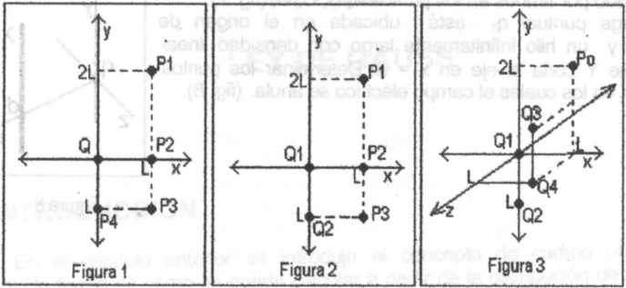
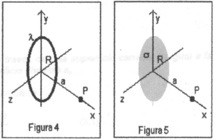
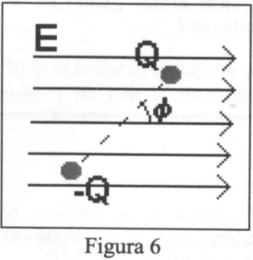
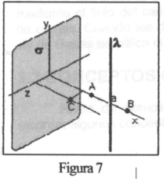
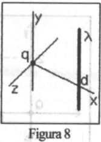

# Campo eléctrico: guía identificada como 2011

Fuente: `2015/guia de problemas 2011.pdf`, páginas 5–6 de 31. SHA-256:
`5a5ae8ac33a7a3d14d854623015ef14bc0af3dae1651c013aed06567e28a8bca`.

Extracción pdftotext y cotejo visual de ambas páginas, con ampliaciones para
símbolos y exponentes. Nueve preguntas, doce problemas y ocho figuras en cinco
archivos, conservadas como apéndice del original. El año 2011 pertenece al
nombre del archivo.

## Cuestionario

**1.** Conocido el campo eléctrico es posible calcular la fuerza sobre una
carga. también a partir de la Ley de Coulomb eso es posible, entonces, ¿Cuál es
la ventaja de definir campo eléctrico?

**2.** ¿Qué propiedades debe tener la carga de prueba en la definición de campo
eléctrico?.

**3.** ¿Qué tipo de función es el campo eléctrico? ¿Por qué?

**4.** Las líneas de fuerzas nunca se cruzan ¿porqué?

**5.** Es posible que exista campo eléctrico en el vacío?

**6.** En un campo uniforme se colocan un protón y un electrón. Compare la
fuerza eléctrica que actúa sobre cada una de ellas Compare las aceleraciones.

**7.** Como se puede distinguir en forma experimental un campo eléctrico de uno
gravitatorio?

**8.** Dibuje las líneas de fuerzas existen entre dos cargas de igual magnitud y
signo contrario. Repita la gráfica considerando que la carga positiva se duplico
el valor

**9.** Una carga negativa se coloca en una región del espacio donde existe un
campo eléctrico uniforme orientado verticalmente hacia arriba ¿Cuál es la
dirección de la fuerza que experimenta la partícula?

## Problemas

### Problema 1

Calcule el campo eléctrico creado por una carga puntual ubicada en el origen de
un sistema de referencia, en los puntos $`P_1`$, $`P_2`$, $`P_3`$, $`P_4`$
(figura 1). L = 1cm Q = $`10^9`$ C.

### Problema 2

Calcule el campo eléctrico creado por dos cargas puntuales en los puntos:
$`P_1`$, $`P_2`$, $`P_3`$,(ver figura2 ), L = l cm, $`Q_1`$ = $`10^9`$ C.
$`Q_2`$ = -$`10^9`$ C

### Problema 3

Para la distribución de cargas puntuales de la figura 3 Determine el campo
eléctrico er el punto Po. Datos:$`Q_1`$ = $`10^{-9}`$ C, $`Q_2`$ = 2.$`10^{-9}`$
, $`Q_3`$ = -2.$`10^{-9}`$ C, $`Q_4`$ = -.$`10^{-9}`$ C y a = 2 cm

### Problema 4

Calcule el campo eléctrico creado por a)Una varille muy larga con densidad de
carga uniforme $`\lambda`$ una distancia a de la misma. b)Un plano infinito con
densidad de carga superficial de carga $`\sigma`$ a una distancia a del mismo.

### Problema 5

Calcule el campo eléctrico creado por un anillo de radio R con densidad lineal
de carga $`\lambda`$,, en un punto P como muestra la fig 4. Considere dos casos
en el resultado final: a) a=0 b) $`R\lt\lt a`$.

### Problema 6

Calcule el campo eléctrico creado por un disco de radio R con densidad
superficial de carga $`\sigma`$ en un punto P, como muestra la hg 5.

### Problema 7

Se lanza una partícula de carga $`Q_o`$ y masa m con velocidad $`V_o`$ en una
región donde existe un campo eléctrico uniforme E. Analice el movimiento de la
partícula si: a) $`V_o`$ es paralala a E y en el mismo sentido. b) $`V_o`$ es
paralela a E y en sentido contrario c) $`V_o`$ es perpendicular a E y d) cuando
forma un ángulo $`\alpha`$ a con E.

### Problema 8

En el espacio comprendido entre dos láminas planas y paralelas cargadas con
cargas iguales y opuestas existe un campo eléctrico uniforme. Un electrón es
abandonado en reposo sobre la lámina cargada negativamente llega a la superficie
de la lámina opuesta, situada a 2 un de distancia de la primera, al cabo de
$`1{,}5\cdot10^8`$ s. a) Calcule la intensidad del campo eléctrico. b) Obtenga
la velocidad del electrón cuando llega a la segunda lámina.

### Problema 9

Calcule el campo eléctrico creado por un dipolo en : a) puntos equidistantes de
ambas cargas. b) puntos sobre la recta que une ambas cargas y fuera de ellas. c)
puntos sobre la recta que une ambas cargas y entre ellas.

### Problema 10

Un dipolo que tiene un momento dipolar $`p=Q.a`$ C.m, forma un ángulo $`\phi`$,
con la dirección de un campo eléctrico uniforme E (ver fig. 6). a) Calcule el
par que actúa sobre el dipolo. b)Calcule el trabajo necesario para invertir la
orientación del dipolo desde su posición de equilibrio, paralelo al campo, a la
opuesta.

### Problema 11

Un plano infinito tiene una distribución superficial de carga (yz), en sus

proximidades se encuentra un hilo infinito con densidad lineal de carga.
Determine el campo eléctrico creado por ambos en los puntos A, B,Cy D, fig. 7).

### Problema 12

Una carga puntual $`q_1`$ está ubicada en el origen de coordenadas y un hilo
infinitamente largo con densidad lineal paralelo al eje Y corta el eje en x = d.
Determinar los puntos sobre eje X en los cuales el campo eléctrico se anula (
figura 8).

## Figuras

Figuras 1, 2 y 3.

Figuras 4 y 5.

Figura 6.

Figura 7.

Figura 8.

## Observaciones de fidelidad

- Los problemas 1 y 2 imprimen exponentes positivos 9; el 8 imprime exponente
  positivo 8 y distancia «2 un». Se conservaron tras comprobar ampliaciones.
- El problema 3 imprime «er el punto Po», Q4 con signo menos y punto antes de la
  potencia, y no expresa unidad después del valor de Q2; no se completan.
- Se conserva «paralala», «ángulo α a» y la omisión de símbolos de densidad de
  carga en los enunciados 11 y 12; los diagramas muestran etiquetas adicionales,
  conservadas como imágenes.
- No se resuelven ejercicios ni se armonizan datos con otras versiones.
