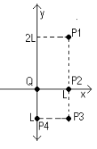
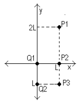
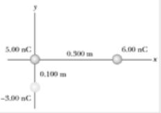
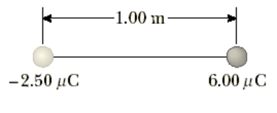
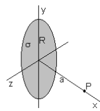
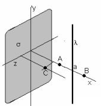
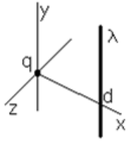
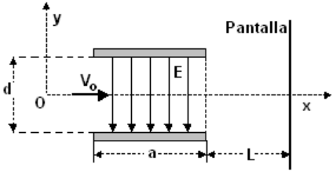

# Guía de problemas: campo eléctrico

Fuente: `2015/GUIA DE PROBLEMAS PROPUESTOS 1ra parte.pdf`, páginas 7–9 de 24,
hasta antes de la guía de Gauss en página 9. SHA-256:
`efac01b619f48d06286a725a5a7ccc8de7b6baffb2a931515c9dba28ae7e5e5b`.

Extracción pdftotext y recuperación visual de tres ecuaciones; cotejo de las
tres páginas renderizadas. Nueve preguntas, trece problemas y once figuras.

## Cuestionario

**1.** Conocido el campo eléctrico es posible calcular la fuerza sobre una
carga. también a partir de la Ley de Coulomb eso es posible, entonces, ¿Cuál es
la ventaja de definir campo eléctrico?

**2.** ¿Qué propiedades debe tener la carga de prueba en la definición de campo
eléctrico?.

**3.** ¿Qué tipo de función es el campo eléctrico? ¿Por qué?

**4.** Las líneas de fuerzas nunca se cruzan ¿porqué?

**5.** Es posible que exista campo eléctrico en el vacío?

**6.** En un campo uniforme se colocan un protón y un electrón. Compare la
fuerza eléctrica que actúa sobre cada una de ellas Compare las aceleraciones.

**7.** Como se puede distinguir en forma experimental un campo eléctrico de uno
gravitatorio?

**8.** Dibuje las líneas de fuerzas existen entre dos cargas de igual magnitud y
signo contrario. Repita la gráfica considerando que la carga positiva se duplico
el valor

**9.** Una carga negativa se coloca en una región del espacio donde existe un
campo eléctrico uniforme orientado verticalmente hacia arriba ¿Cuál es la
dirección de la fuerza que experimenta la partícula?

## Problemas

### Problema 1

Calcule el campo eléctrico creado por una carga puntual ubicada en el origen de
un sistema de referencia, en los puntos P1, P2, P3, P4 (ver figura). L = 1 cm Q
= $`10^{-9}`$ C



### Problema 2

Calcule el campo eléctrico creado por dos cargas puntuales en los puntos : P1,
P2, P3 (ver figura 2).L = 0.01 m, Q1 = $`10^{-9}`$ C, Q2 = - $`10^{-9}`$ C



### Problema 3

Tres cargas puntuales están dispuestas como se muestra en la figura. (a)
Encontrar el vector de campo eléctrico que las cargas 6.00 nC y -3.00 nC crean
en el origen. (b) Hallar el vector de fuerza sobre la carga de 5.00 nC.



### Problema 4

Determinar la magnitud y la dirección del campo eléctrico que va a equilibrar el
peso de (a) un electrón y (b) un protón?

### Problema 5

Un objeto que tiene una carga neta de 24,0 μC se coloca en un campo eléctrico
uniforme de 610 N / C dirigido verticalmente. ¿Cuál es la masa de este objeto si
"flota'' en el campo?

### Problema 6

En la figura, determinar el punto (que no sea infinito) en la que el campo
eléctrico es cero



### Problema 7

Demuestre que el campo eléctrico creado por una varilla delgada muy larga, con
densidad de carga lineal uniforme +λ a una distancia a de la misma es igual a

```math
E=\frac{\lambda}{2\pi\varepsilon_o a}
```

En la dirección radial.

### Problema 8

Demuestre que el campo eléctrico creado por una placa plana muy grande, con
densidad de carga superficial uniforme +σ a una distancia a de la misma es igual
a

```math
E=\frac{\sigma}{2\varepsilon_o}
```

Con dirección perpendicular al plano de la carga saliente

### Problema 9

Demuestre que el campo eléctrico creado por un disco de radio R con densidad
superficial de carga σ en un punto P, como muestra la figura

```math
E_x=\frac{\sigma}{2\cdot\varepsilon_o}\left(1-\frac{a}{\sqrt{a^2+R^2}}\right)
```



### Problema 10

Un plano infinito tiene una distribución superficial de carga σ, en sus
proximidades se encuentra un hilo infinito con densidad lineal de carga λ.
Determine el campo eléctrico creado por ambos en los puntos A, B, C, (ver
figura).



### Problema 11

Una carga puntual q está ubicada en el origen de coordenadas y un hilo
infinitamente largo con densidad lineal λ paralelo al eje Y corta el eje en x =
d. Determinar los puntos sobre el eje X en los cuales el campo eléctrico se
anula. (ver figura).



### Problema 12

Entre dos placas conductoras paralelas existe un campo eléctrico uniforme E =
$`16\cdot10^4`$ N/C, las placas están separadas una distancia d = 0.08 m y
tienen un ancho a = 0.02m, como muestra la figura. En esa región, ingresa un
electrón con velocidad Vo = $`4\cdot10^7`$ m/s

Determine la desviación respecto de su dirección original y la velocidad en el
instante que sale de las placas paralelas. Determine la desviación respecto de
su dirección original cuando incide sobre la pantalla (L = 0.2 m).



### Problema 13

Para las siguientes distribucones de cargas dibuje las lineas de fuerzas del
campo eléctrico


## Nota de transcripción

Se conservan los datos y erratas de los enunciados, incluidos «distribucones», y
las etiquetas originales de los diagramas. El enunciado del problema 12 continúa
en la página 9. No se resuelven ejercicios.
