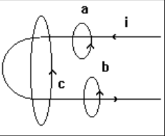
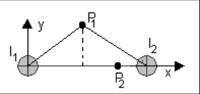
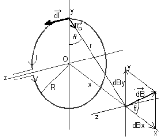
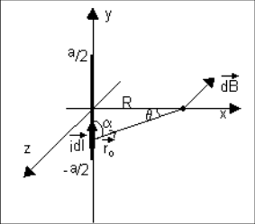
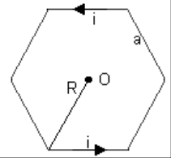
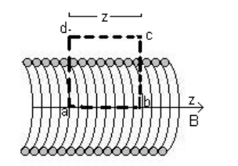
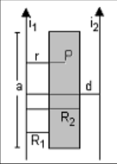

# Campo de inducción magnética: guía identificada como 2011

Fuente: `2015/guia de problemas 2011.pdf`, páginas 22–23 de 31. SHA-256:
`5a5ae8ac33a7a3d14d854623015ef14bc0af3dae1651c013aed06567e28a8bca`.

Extracción pdftotext, recuperación visual de ecuación y vectores, y cotejo de
ambas páginas. Trece preguntas, diez problemas y siete archivos gráficos,
incluida la figura del cuestionario. El año 2011 pertenece al nombre del
archivo.

## Cuestionario

**1.** ¿Cómo se genera y se detecta un campo magnético artificial?

**2.** En la expresión de la ley de Biot y Savart hay pares de vectores que son
mutuamente perpendiculares, ¿cuáles son?

**3.** Indique gráficamente el campo $`\vec B`$ producido por un hilo conductor
recto, que porta una corriente, a una distancia r del mismo.

**4.** Escriba la expresión de la fuerza de un elemento de corriente en un campo
magnético. Si el campo es producido por otro elemento de corriente, escriba la
expresión de la fuerza sobre éste en forma vectorial. Represente gráficamente la
situación anterior.

**5.** ¿Cómo es la fuerza de interacción entre dos elementos de corriente rectos
si los mismos son de igual sentido. Repita la pregunta, pero, con elementos de
corriente de sentido contrario.

**6.** Establezca las diferencias entre las fuerzas entre los elementos de
corriente y la Ley de Coulomb para cargas aisladas.

**7.** Enuncie la ley de Gauss del magnetismo. Dé el significado físico de la
ley anterior.

**8.** Pruebe que no existe el monopolo magnético a partir de la pregunta
anterior, emplee para ello un imán recto.

**9.** Enuncie y exprese matemáticamente la Ley de Ampere.

**10.** Aplique cualitativamente la Ley de Ampere para las tres trayectorias
mostradas en la figura. Indique el $`\overrightarrow{dl}`$ en cada caso.

**11.** Un alambre recto largo transporta una corriente i, ¿Cuánto vale la
circulación de B en: a) una trayectoria circular que encierra al alambre; b) una
trayectoria arbitraria que encierra al alambre; c)una trayectoria arbitraria que
no encierra al alambre. ?

**12.** ¿Puede definir una función escalar, equivalente al potencial eléctrico,
para el caso magnético? Justifique.

**13.** Exprese la Ley de Ampere en forma generalizada y en forma diferencial.



## Problemas

### Problema 1

Calcule el campo de inducción magnética debido a la corriente que pasa por un
hilo rectilíneo muy largo.

### Problema 2

Dos conductores filiformes paralelos separados una distancia d = 2 cm conducen
corrientes iguales i =1 A en el mismo sentido. Determine el campo B para los
puntos $`P_1`$(1, 1) y $`P_2`$(1.5, 0), medidos en cm (ver figura 1P)



Figura 1P.

### Problema 3

Una espira circular de alambre de radio R que lleva una corriente I, como la que
muestra la figura 2P. Calcúlese el campo de inducción magnética en un punto P
del eje a una distancia x del centro de la espira.

### Problema 4

Dos espiras circulares iguales de radio R, con eje coincidente, con la
circulación de la corriente en el mismo sentido están separadas una distancia
2R, determinar el campo de inducción a lo largo del eje, si I = 2 A y R = 5 cm



Figura 2P.

### Problema 5

Un segmento de alambre de longitud a (figura 3P) conduce una corriente i.
Demuestre que el campo B asociado con el segmento, a una distancia R del
segmento, sobre un plano bisector perpendicular, tiene la magnitud dada por:

```math
B=\frac{\mu_oia}{2\pi\cdot R\cdot(a^2+4\cdot R^2)^{1/2}}
```



Figura 3P.

### Problema 6

Dada una espira en forma de hexágono (figura 4P) por la que circula una
corriente i. Calcular el campo B en el centro de la misma.



Figura 4P.

### Problema 7

Empleando la ley de Ampere calcule la intensidad del campo magnético en el eje
de un solenoide muy largo, figura 5P.



Figura 5P.

### Problema 8

Por un conductor cilíndrico macizo, de radio R = 1 mm, circula una densidad de
corriente $`J=C.r`$ ($`\mathrm{A/m^2}`$) con $`0\lt r\lt R`$. Determinar a) el
valor y las unidades de la constante C si la corriente total que transporta el
conductor es 0,3 A. b) el campo de inducción magnética en el interior y el
exterior del conductor.

### Problema 9

Dos conductores rectilíneos muy largos están separados 20 cm. La corriente que
lleva cada uno es $`i_1`$ = 5 A, $`i_2`$ =10 A y tienen el mismo sentido. Ver
figura 6P Calcular: a)El campo de inducción magnética en un punto situado en el
plano de ambos conductores y a igual distancia de ellos. b) El flujo que
atraviesa el área rayada, sabiendo que cada lado del rectángulo dista 5 cm del
conductor más próximo, tiene un ancho de 5 cm y 20 cm largo



Figura 6P.

### Problema 10

Calcular el flujo del campo magnético creado por un alambre que conduce una
corriente i muy largo a través de una superficie cilíndrica de radio R, coaxial
con el hilo.

## Nota de transcripción

Las preguntas coinciden con la versión ya cotejada, pero esta selección tiene
diez problemas consecutivos, incluida la espira hexagonal y el hilo finito. Se
conservan sus datos, diagramas y ecuación del problema 5 sin resolver ejercicios
ni completar datos desde otras versiones.
