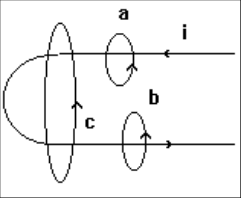
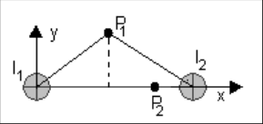
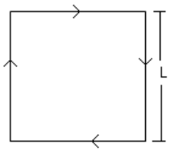
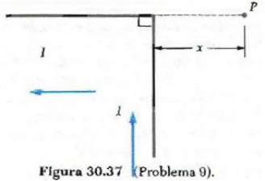
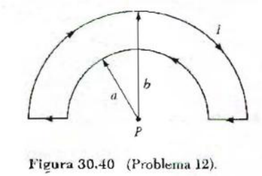
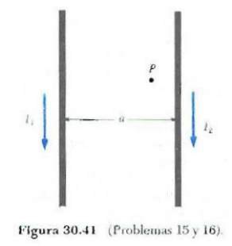
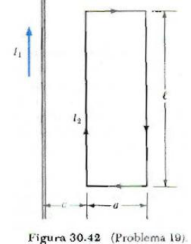
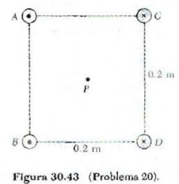
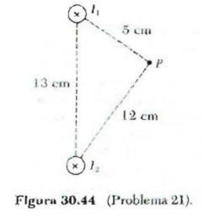
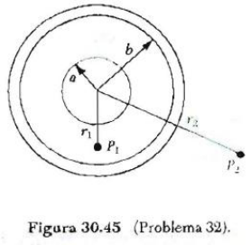

# Campo de inducción magnética: propiedades

Fuente: `2015/GUIA DE PROBLEMAS PROPUESTOS 2da parte.pdf`, sección de páginas
4–6 de 13, hasta antes del título de inducción electromagnética. SHA-256:
`e2452f4b287c4401d9902c425f82a9caaab0bb7dd7c877c724934eb2bed5a9fa`.

Extracción pdftotext y cotejo visual de las tres páginas. Trece preguntas,
catorce problemas de numeración discontinua y diez figuras, incluida la del
cuestionario.

## Cuestionario

**1.** ¿Cómo se genera y se detecta un campo magnético artificial?

**2.** En la expresión de la ley de Biot y Savart hay pares de vectores que son
mutuamente perpendiculares, ¿cuáles son?

**3.** Indique gráficamente el campo $`\vec B`$ producido por un hilo conductor
recto, que porta una corriente, a una distancia r del mismo.

**4.** Escriba la expresión de la fuerza de un elemento de corriente en un campo
magnético. Si el campo es producido por otro elemento de corriente, escriba la
expresión de la fuerza sobre éste en forma vectorial. Represente gráficamente la
situación anterior.

**5.** ¿Cómo es la fuerza de interacción entre dos elementos de corriente rectos
si los mismos son de igual sentido. Repita la pregunta, pero, con elementos de
corriente de sentido contrario.

**6.** Establezca las diferencias entre las fuerzas entre los elementos de
corriente y la Ley de Coulomb para cargas aisladas.

**7.** Enuncie la ley de Gauss del magnetismo. Dé el significado físico de la
ley anterior.

**8.** Pruebe que no existe el monopolo magnético a partir de la pregunta
anterior, emplee para ello un imán recto.

**9.** Enuncie y exprese matemáticamente la Ley de Ampere.

**10.** Aplique cualitativamente la Ley de Ampere para las tres trayectorias
mostradas en la figura. Indique el $`\overrightarrow{dl}`$ en cada caso.

**11.** Un alambre recto largo transporta una corriente i, ¿Cuánto vale la
circulación de B en: a) una trayectoria circular que encierra al alambre; b) una
trayectoria arbitraria que encierra al alambre; c)una trayectoria arbitraria que
no encierra al alambre. ?

**12.** ¿Puede definir una función escalar, equivalente al potencial eléctrico,
para el caso magnético? Justifique.

**13.** Exprese la Ley de Ampere en forma generalizada y en forma diferencial.

## Problemas

### Problema 1

Calcule la magnitud del campo magnético en un punto a 100 cm de un conductor
largo y delgado que lleva una corriente de 1 A. A qué distancia del conductor la
magnitud del campo magnético resultante es igual :$`10^{-4}`$ T?

### Problema 2

Dos conductores filiformes paralelos separados una distancia d = 2 cm conducen
corrientes iguales i =1 A en el mismo sentido. Determine el campo B para los
puntos $`P_1`$(1, 1) y $`P_2`$(1.5, 0), medidos en cm (ver figura 1P)

### Problema 5

Un conductor que forma un cuadrado de longitud de lado L = 0.4 m lleva una
corriente I=10ª (Fig. 30.36).Calcule la magnitud y dirección del campo magnético
en el centro del cuadrado.

### Problema 8

¿De cuántas vueltas deberá ser una bobina circular delgada de radio 0.1 m para
que una corriente de 10 A produzca un campo magnético de $`3\times10^{-3}`$ T en
su centro?

### Problema 9

Determine la magnitud del campo en un punto P que está a una distancia x de la
esquina de un alambre infinitamente largo que forma un ángulo recto, como se
muestra en la figura 30 .37. El alambre lleva una corriente estable.

### Problema 12

Utilice la ley de Biot-Savart para calcular la magnitud y la dirección del campo
magnético en el punto P localizado en el centro de círculos concéntricos de
radios a = 5 cm y b = 8 cm (Fig. 30.40) cuando una corriente I = 2 A se mantiene
en el circuito de la espira

### Problema 15

Dos conductores largos paralelos, separados por una distancia a = 10 cm, llevan
corrientes en la misma dirección, Si $`I_1`$ = 5 A e $`I_2`$ = 8 A, ¿cuál es la
fuerza por unidad de longitud sobre cada alambre debida al otro?

### Problema 16

Para el arreglo de conductores paralelos descrito en el problema 15 y mostrado
en la figura 30.4 1, calcule la magnitud y la dirección del campo magnético en
el punto P localizado a 2 cm a la izquierda del conductor con corriente $`I_2`$.

### Problema 19

Para el arreglo de la figura 30.42, la corriente en el conductor largo y recto
es de $`I_1`$ = 5 A y está colocado en el mismo plano de la espira rectangular,
la cual lleva una corriente $`I_2`$ = 10 A. Las dimensiones son c = 0.1m, a =
0.15 m y L = 0.15 m. Encuentre la magnitud y la dirección de la fuerza total
ejercida sobre la espira rectangular por el campo magnético del conductor recto
que lleva corriente.

### Problema 20

Cuatro conductores largos y paralelos la misma corriente de 5 A. Una vista del
extremo de los conductores se muestra en la figura 30.43. La dirección de la
corriente es hacia afuera de la hoja en los puntos A y B (indicados por puntos)
hacia adentro de la hoja en los puntos E y D (indicados por cruces). Calcule la
magnitud y la dirección del campo en el punto P, localizado en el centro del
cuadrado de lado 0.2 m.

### Problema 21

Dos conductores largos paralelos llevan corrientes $`I_1`$= 3A e $`I_2`$=3A,
ambas dirigidas hacia el interior de la hoja, figura 30.44. Los conductores
están separados por una distancia de 13 cm. Determine la magnitud y la dirección
del campo magnético resultante en e l punto P, localizado 5 cm desde $`I_1`$ y a
12 cm desde $`I_2`$

### Problema 28

Un conductor cilíndrico de radio R = 2.5 cm lleva una corriente I = 2.5 A a lo
largo de su longitud, esta corriente está uniformemente distribuida a través del
área de la sección trasversal del conductor. Calcule el campo magnético en el
punto medio a lo largo del radio del conductor (es decir, en $`r=R/2`$).

### Problema 31

Un paquete compacto de 100 alambres rectos largos y aislados forman un cilindro
de radio R = 0.5 cm. a) Si cada alambre lleva una corriente de 2 A, ¿cuál es la
magnitud y la dirección de la fuerza por unidad de longitud que actúa sobre un
alambre localizado a 2 cm del centro del paquete? b) Sería mayor o menor la
fuerza que experimenta un alambre externo del paquete comparada con la de un
alambre que estuviera a 2 cm del centro?

### Problema 32

Considere un arreglo coaxial con un alambre de radio a a lo largo del eje de un
cascarón cilíndrico de radio b, como en la figura 30.45. La corriente está
dirigida hacia adentro de la página a lo largo del centro del alambre y regresa
hacia afuera de la página a lo largo del cascarón cilíndrico. Si I = 5 A, a =
0.6 cm y b = 1.2 cm, calcule el campo magnético: a) en el punto $`P_1`$ a una
distancia $`r_1`$ = 1 cm y b) en el punto $`P_2`$, a una distancia $`r_2`$ = 2.4
cm del centro del alambre.

## Observaciones de fidelidad

- El problema 5 imprime I=10ª; se conserva sin sustituir la letra elevada por
  una unidad supuesta.
- El problema 20 dice puntos E y D, mientras la figura rotula C y D; se conserva
  la discrepancia.
- Se conservan c y L en los datos del problema 19, aunque la figura utiliza otra
  etiqueta, y los números de problemas originales.
- La figura 30.41 se comparte entre problemas 15 y 16; las flechas de corriente
  y el punto P se conservan.
