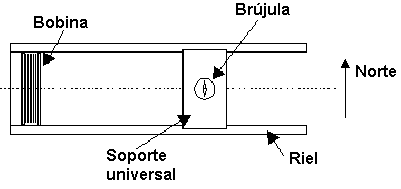
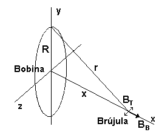
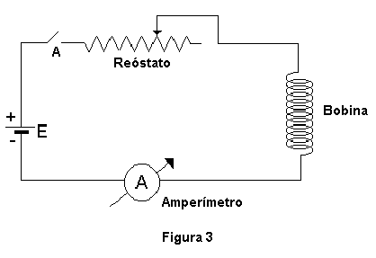
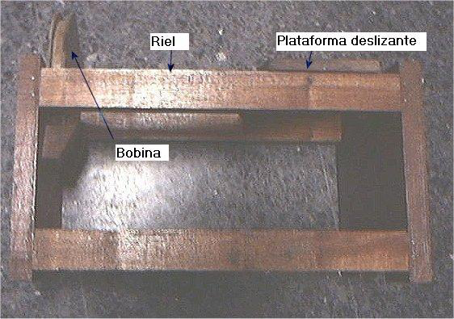
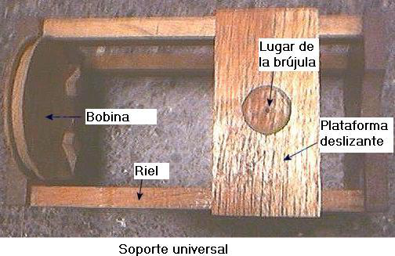

<!-- markdownlint-disable MD060 -->

# Trabajo de laboratorio Nº 7: Campo de inducción magnética (compilado)

Universidad Tecnologica Nacional. Facultad Regional Resistencia. Cátedra: Física
II.

TEMA: CAMPO DE INDUCCIÓN MAGNÉTICA

**OBJETO DE LA EXPERIENCIA:** Determinación de la componente horizontal del
campo magnético terrestre mediante el método de la brújula de tangentes.
Análisis del campo magnético creado por una bobina circular

**FUNDAMENTOS TEÓRICOS:** Una brújula es una aguja imantada que puede girar
libremente en torno a un eje vertical que posee en su centro y tiene la
propiedad de orientarse respecto de una dirección que coincide aproximadamente
con el Norte geográfico. Esto demuestra la existencia del campo magnético
terrestre, de modo que la Tierra se comporta como un gigantesco imán. En cada
punto próximo a la superficie terrestre queda definido el campo $`\vec B`$ que
varía, en función del punto, en módulo y dirección. El ángulo que este campo
forma con el plano horizontal se llama _inclinación magnética_ El ángulo formado
por la componente horizontal del campo magnético con la verdadera dirección
Norte – Sur esto es con la dirección del meridiano del lugar, se llama
_declinación magnética._ En esta experiencia se determinará el valor de la
componente horizontal del campo magnético terrestre Bh.

El instrumento que se va a emplear se llama **_magnetómetro_** , el cual está
compuesto por una bobina circular, cuyas dimensiones se conocen ( N: número de
vueltas, R: radio medio, Imax: corriente máxima que soporta) y una brújula
convencional. Ambos elementos están montados sobre un soporte universal que
permite mantener alineado el centro de la bobina con la brújula, a lo largo de
distintas posiciones que puede tomar la brújula cuando esta se desplaza a lo
largo de rieles pertenecientes al soporte (ver figura 1).

Si se coloca el magnetómetro en la dirección Este - Oeste, de modo que la
brújula se orienta naturalmente en la dirección Norte – Sur quedando
perpendicular a los rieles.

Cuando se coloca un cuerpo de momento magnético $`\vec m`$ en un campo magnético
$`\vec B`$ sobre se ejerce un momento de fuerza dado por

```math
\vec M=\vec m\wedge\vec B
```

(1)

Como la brújula tiene un momento magnético, estará sometida a dos campos
magnéticos: el terrestre y el de la bobina, cuando por esta circule una
corriente I., por lo tanto cada uno ejercerá un momento de fuerza sobre la aguja
magnética que intentará girarla, en concordancia con (1), en equilibrio será

```math
\vec M_B-\vec M_T=0\quad\Rightarrow\quad|\vec M_B|=|\vec M_T|
```

(2)

```math
mB_B\cos\theta=mB_T\mathop{\mathrm{sen}}\nolimits\theta
```

(3)

siendo $`\theta`$ el ángulo que forma la aguja con la dirección perpendicular a
los rieles ( es decir el Norte).

```math
B_B\cos\theta=B_T\mathop{\mathrm{sen}}\nolimits\theta
```

(4)

Haciendo pasaje de términos resulta

```math
B_T=B_B\frac{\cos\theta}{\mathop{\mathrm{sen}}\nolimits\theta}=\frac{B_B}{\mathop{\mathrm{tg}}\nolimits\theta}
```

(5)

donde BT es la componente horizontal del campo magnético terrestre, BB es el
campo creado por la bobina en la posición donde está la brújula.



Haciendo la suposición que la intensidad del campo de la bobina es constante en
toda la región ocupada por la aguja magnética, entonces se puede calcular la
intensidad del campo mediante

```math
B_B=\frac{\mu_o I N R^2}{(R^2+x^2)^{3/2}}
```

(6)

Donde $`\mu_o=4\pi10^{-7}\mathrm{m\,Kg\,s^2\,A^{-2}}`$ , N es el número de las
espiras de la bobina, R es el radio medio de la bobina e I es la intensidad de
corriente que circula por ella, x es la distancia entre el centro de la bobina y
el eje de la aguja magnética.

La (5) entonces puede escribirse



```math
B_T=\frac{B_B}{\mathop{\mathrm{tg}}\nolimits\theta}=K\frac I{r^3}\frac1{\mathop{\mathrm{tg}}\nolimits\theta}
```

(7)

```math
B_T\mathop{\mathrm{tg}}\nolimits\theta=K\frac I{r^3}
```

(8)

donde $`K=\mu_o NR^2`$ y $`r=\sqrt{R^2+x^2}`$

## **MATERIALES UTILIZADOS:**

**1.** Fuente de alimentación de CC.

**2.** Amperímetro.

**3.** Reóstato.

**4.** Bobina.

**5.** Brújula.

**6.** Soporte universal.



## **TÉCNICA OPERATORIA:**

**1.** Registre el valor del radio medio R de la bobina, el número de espiras N
y el valor de la corriente máxima que soporta la bobina.

**2.** Arme el circuito de la Figura 3, adecue convenientemente el valor de la
resistencia del reóstato para que la corriente que circule no supere la
corriente máxima que soporta la bobina.

**3.** Coloque la brújula lo más cerca posible de la bobina.

**4.** Antes de conectar el circuito verifique la escala del amperímetro si es
compatible con la corriente máxima que soporta la bobina, luego conecte el
circuito, cerrando el interruptor A.

**5.** Aumente la distancia de la brújula **a** la bobina, x1, de tal forma que
la desviación de la aguja vaya disminuyendo en $`5^\circ`$ hasta llegar a
$`10^\circ`$. Registre en la hoja de datos la posición x para cada caso.

TABLA 1. Radio medio =  N =  $`I_{max}`$ =

| Ángulo $`\theta`$ | $`\mathop{\mathrm{Tang}}\nolimits(\theta)`$ | x (m) | $`r=\sqrt{R^2+x^2}`$ | $`B_B`$ | $`B_T`$ |
| -- | -- | -- | -- | -- | -- |
|  |  |  |  |  |  |

**6.** Calcule el valor de BB usando la (6).

**7.** Empleando (7) calcule el BT para cada ángulo

**8.** Calcule el BT promedio.

**9.** Grafique $`(KI/r^3)`$ en función de la
$`\mathop{\mathrm{tg}}\nolimits\theta`$ para la serie de valores medidos.

**10.** Aplique el método de cuadrados mínimos para obtener la pendiente y a
partir de ella BT

**11.** Aplique propagación de errores y determine $`\Delta B_T`$ , admita que
$`\Delta r\sim1\mathrm{\,mm}`$ y $`\Delta\theta\sim2^\circ`$.





## **CUESTIONARIO:**

**1.** Hacer un esquema de las líneas de inducción magnética terrestre. A partir
de este esquema, explicar como se comportaría una brújula de inclinación al ser
trasladada desde el polo Sur magnético al polo norte magnético ¿Cuál será la
definición de estos polos?

**2.** ¿Indica la brújula de declinación la dirección del Norte geográfico? ¿Qué
información complementaria necesitamos para hacer un uso correcto de una
brújula?

**3.** Qué representa el momento magnético $`\vec m`$ de una aguja imantada? ¿En
qué unidades se mide?

## Bibliografía

Eisberg R. y Lerner L. “Física :Fundamentos y Aplicaciones” Vol. I y II Ed.
McGraw-Hill

Serway R “Física” Vol II Ed. McGraw-Hill

Sears Física Universitaria 6ta ed. Addison Wesley

Zahn M. “Teoría Electromagnética” Ed. McGraw-Hill

Kip A. “Fundamentos de Electricidad y Magnetismo” Ed. McGraw-Hill

Gettys y otros Física clásica y moderna Ed. McGraw-Hill

Girón, Manuel Prácticas de laboratorio de Física General Compañía Editorial
Continental SA

## Trabajo de laboratorio Nº 7: Hoja de datos

TEMA: Brújula Tangente.

<table>
<tr><th rowspan="4">CURSO:</th><th rowspan="8">GRUPO Nº:</th><th colspan="2">INTEGRANTES</th></tr>
<tr><th>NOMBRE Y APELLIDO</th><th>FIRMA</th></tr>
<tr><td></td><td></td></tr>
<tr><td></td><td></td></tr>
<tr><th rowspan="4">FECHA:</th><td></td><td></td></tr>
<tr><td></td><td></td></tr>
<tr><td></td><td></td></tr>
<tr><td></td><td></td></tr>
</table>

TABLA 1. Radio medio =  N =  $`I_{max}`$ =

| Ángulo $`\theta`$ | $`\mathop{\mathrm{Tang}}\nolimits(\theta)`$ | x (m) | $`r=\sqrt{R^2+x^2}`$ | $`B_B`$ | $`B_T`$ |
| -- | -- | -- | -- | -- | -- |
|  |  |  |  |  |  |
|  |  |  |  |  |  |
|  |  |  |  |  |  |
|  |  |  |  |  |  |
|  |  |  |  |  |  |
|  |  |  |  |  |  |
|  |  |  |  |  |  |
|  |  |  |  |  |  |
|  |  |  |  |  |  |
|  |  |  |  |  |  |
|  |  |  |  |  |  |
|  |  |  |  |  |  |
|  |  |  |  |  |  |
|  |  |  |  |  |  |

FIRMA DEL PROFESOR:

## Procedencia y diferencias de versión

Fuente: `2015/FISICA II - EXPERIENCIAS DE LABORATORIOS.pdf`, páginas40–45,
cotejadas completas. Se conservan cinco figuras, ocho ecuaciones numeradas, seis
materiales, once pasos y tres preguntas; tabla de una lectura en la técnica y
catorce en la hoja. Las celdas de identificación se mantienen combinadas. Los
pequeños rectángulos vacíos sobre el primer encabezado no agregan lecturas.
Véase [el inventario de fuentes](../../../resources/2015/fuentes.md).

El compilado numera los pasos1–11 sin repetir4, y su hoja dice «Brújula
Tangente» con campos de grupo, nombres y firmas; se conserva como versión
distinta del cuadernillo individual. Se mantienen el denominador de(6) sin
añadir2, K sin añadir1/2, las unidades deμo con s² y los operadores tg/Tang. Los
delimitadores de(6) se superponen sobre R²; el término R²+x² consta en la capa
textual y se cotejó ampliado. No se corrigen datos ni se resuelven preguntas.
