# Guía de problemas: capacidad y dielectrico

Fuente: `2015/GUIA DE PROBLEMAS PROPUESTOS 1ra parte.pdf`, sección capacidad de
páginas 13–15 de 24. SHA-256:
`efac01b619f48d06286a725a5a7ccc8de7b6baffb2a931515c9dba28ae7e5e5b`.

Extracción pdftotext y cotejo visual de las tres páginas. Once preguntas,
catorce problemas y once figuras, incluidas figuras compuestas.

## Cuestionario

**1.** Si en un condensador la carga se duplica ¿qué sucede con la diferencia de
potencial entre sus electrodos?

**2.** Un condensador tiene sus terminales conectadas a una batería ¿qué sucede
con la carga en el condensador si se desconecta de la batería?¿qué pasa si,
ahora se conectan entre si las terminales del condensador?

**3.** Un condensador plano de área A y separación entre placas d está conectado
a una batería. Se lo desconecta de la batería ¿qué pasa con la carga y el
potencial si se separan las placas al doble de la separación inicial? ¿se
modifica el valor del campo eléctrico entre las placas?

**4.** Dos condensadores idénticos se pueden conectar en serie o en paralelo,
bajo una misma diferencia de potencial, ¿cuál de las asociaciones alcanza mayor
carga? ¿Y porqué?

**5.** ¿Cuál es la diferencia entre un conductor y un dieléctrico? ¿Y cuando se
sumergen en un campo eléctrico?

**6.** En el caso de un dieléctrico con dipolos eléctricos permanentes, la
presencia de un campo eléctrico ¿qué provoca?

**7.** En un campo eléctrico no uniforme un cuerpo dieléctrico, sin exceso de
carga, experimenta una fuerza neta ¿por qué?

**8.** ¿Cómo se define el vector polarización? ¿Qué relación tiene con el campo
eléctrico aplicado en un dieléctrico?

**9.** ¿Qué representa la componente normal de P a la superficie del
dieléctrico?

**10.** ¿Qué son las cargas de polarización?

**11.** ¿Cómo se define el vector desplazamiento eléctrico D? ¿Qué representa su
componente normal?

## Problemas

### Problema 1

Calcular la capacidad de una esfera metálica cargada de radio R, que se
encuentra aislada. Analice el resultado. Determine la capacidad eléctrica de la
Tierra (R = 5400 km).

### Problema 2

Un condensador de placas paralelas tiene un área de placa de 100
$`\mathrm{cmP}^{2\mathrm P}`$ y una capacidad de 7pF. ¿Cuál es la separación
entre las placas?

### Problema 3

Cuando se aplica una diferencia de potencial de 500 V entre las placas de un
condensador de placas paralelas, estas tiene una densidad de carga de 400
nC/$`\mathrm{mP}^{2\mathrm P}`$ ¿Cuál es el espacio entre ellas?

### Problema 4

Calcule la capacidad de un condensador plano de superficie cuadrada, si la
longitud del lado es 1 cm y la separación entre las placas 1m m. Calcule de
nuevo la capacidad si a) cambia al doble el lado y deja fija la separación. b)
cambia al doble la separación y deja fijo el lado. Haga un análisis de los
resultados.

### Problema 5

Para los circuitos de las figuras determinar la capacidad equivalente si C=10μF

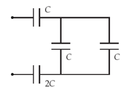

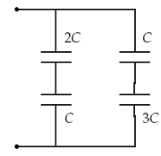

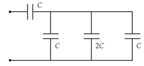

### Problema 6

Determinar la carga en cada capacitor si $`V_o`$=24V y $`C_1`$=$`C_3`$=10 μF
$`C_2`$=$`C_4`$=15 μF

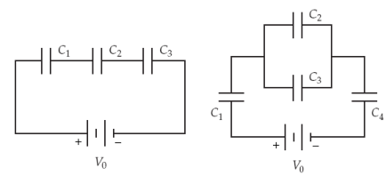

### Problema 7

Determinar la energía almacenada en cada capacitor si $`V_o`$=12V y
$`C_1`$=$`C_3`$=22 μF $`C_2`$=$`C_4`$=10 μF

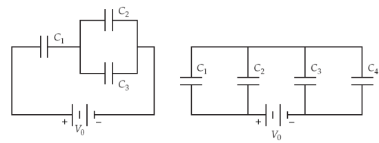

### Problema 8

En el circuito de la figura inicialmente los capacitores están descargados. a)
Se conecta el interruptor A y se mantiene el interruptor B abierto. Analice esta
situación y calcule la carga en $`C_1`$. b) Se desconecta el interruptor A y se
conecta el interruptor B. Calcule la carga en cada capacitor Datos $`V_o`$=24V y
$`C_1`$=22 μF $`C_2`$= 10 μF

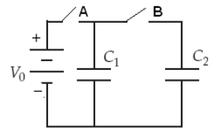

### Problema 9

¿Cuál es la intensidad de los campos E, D y P a una distancia r = 100 mm de una
carga puntual de Q = 1μC en un medio infinito de a) aire. b) un dieléctrico con
que $`\varepsilon_r`$ = 9 ?

### Problema 10

Una carga puntual (q =$`10\mathrm P^{-6}\,{}^{\mathrm P}\mathrm C`$) está en el
centro de una esfera dieléctrica ($`\varepsilon_{\mathrm B1\mathrm B r}`$ = 9)
de radio R = 1 cm, la que a su vez se halla rodeada por otro medio dieléctrico
($`\varepsilon_{\mathrm B2\mathrm B r}`$ = 4). Determine la intensidad de los
campos E, D y P para $`r\lt R`$ y $`r\gt R`$. y la densidad superficial de
cargas de polarización en la superficie de separación.

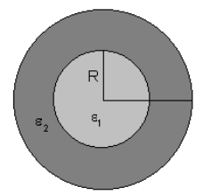

### Problema 11

En un condensador de placas paralelas se colocan dos medios dieléctricos (1 y 2
) como muestra la figura determine el valor de la capacidad.

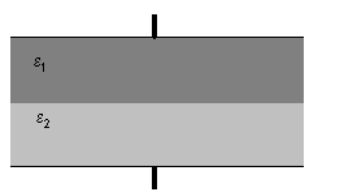

### Problema 12

En un condensador de placas cuadradas paralelas de lado L se colocan dos medios
dieléctricos ($`\varepsilon_{\mathrm B1\mathrm B}`$ y
$`\varepsilon_{\mathrm B2\mathrm B}`$ ) como muestra la figura determine el
valor de la capacidad.

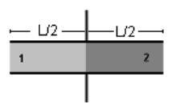

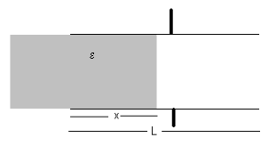

### Problema 13

Un cable coaxial tiene una capacidad de 75 pF/m, su conductor externo un
diámetro interno 0.9 cm y está lleno de polietileno ($`\varepsilon_r`$ = 2.2)
¿Cuál es el diámetro del conductor interno?

### Problema 14

Un condensador está construido mediante el intercalado de placas planas como
muestra la figura. La separación entre las placas adyacentes es 0.5 cm y el área
efectiva de las placas es de 5 $`\mathrm{cmP}^{2\mathrm P}`$. Ignorando los
efectos de bordes, Calcule la capacidad de la unidad, considerando que entre
placas existe un dieléctrico de constante dieléctrica relativa K = 2.

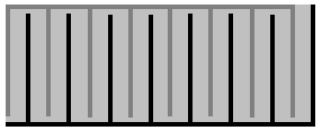

## Observaciones de fidelidad

- Se conservan las P y B impresas junto a exponentes y subíndices; no se
  eliminan como si fueran fallos de extracción.
- El problema 4 escribe «1m m» y el 6 divide la unidad μF mediante una figura
  flotante: aquí se reúne la unidad con su valor.
- Se conservan ambos diagramas próximos al problema 12; no se completan valores
  ni se resuelven ejercicios.
