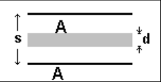
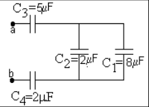
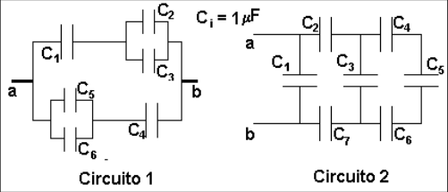

# Capacidad: guía identificada como 2011

Fuente: `2015/guia de problemas 2011.pdf`, páginas 12–13 de 31. SHA-256:
`5a5ae8ac33a7a3d14d854623015ef14bc0af3dae1651c013aed06567e28a8bca`.

Extracción pdftotext y cotejo visual de ambas páginas. Siete preguntas, nueve
problemas y tres archivos de figuras, el último con dos circuitos. El año 2011
pertenece al nombre del archivo.

## Cuestionario

**1.** Si en un condensador la carga se duplica ¿qué sucede con la diferencia de
potencial entre sus electrodos?

**2.** Un condensador tiene sus terminales conectadas a una batería ¿qué sucede
con la carga en el condensador si se desconecta de la batería?¿qué pasa si,
ahora se conectan entre si las terminales del condensador?

**3.** Un condensador plano de área A y separación entre placas d está conectado
a una batería. Se lo desconecta de la batería ¿qué pasa con la carga y el
potencial si se separan las placas al doble de la separación inicial? ¿se
modifica el valor del campo eléctrico entre las placas?

**4.** Dos condensadores idénticos se pueden conectar en serie o en paralelo,
bajo una misma diferencia de potencial, ¿cuál de las asociaciones alcanza mayor
carga? ¿Y porqué?

**5.** La carga neta en un condensador es siempre cero, entonces ¿qué almacena
el condensador?

**6.** ¿Cuántas asociaciones posibles se pueden hacer con tres condensadores de
valores diferentes?

**7.** ¿Por qué es peligroso tocar las terminales de un condensador de alto
voltaje aún después de desconectarse de la fuente de voltaje?

## Problemas

### Problema 1

Calcule la capacidad de una esfera metálica cargada de radio R, que se encuentra
aislada. Analice el resultado. Determine la capacidad eléctrica de la Tierra,
suponiendo que es una esfera de radio aproximado a 5800Km.

### Problema 2

Calcule la capacidad de: a) un condensador plano. b) un condensador esférico. c)
un condensador cilíndrico.

### Problema 3

Calcule la capacidad de un condensador plano de superficie cuadrada, si la
longitud del lado es 1 cm y la separación entre las placas 1mm. Calcule de nuevo
la capacidad si a) cambia al doble el lado y deja fija la separación. b) cambia
al doble la separación y deja fijo el lado. Haga un análisis de los resultados.

### Problema 4

Una plancha conductora de espesor d y área A se introduce en el espacio entre
las placas de un condensador plano cuya separación es s y área A como se muestra
en la figura 1.¿Cuál es el valor de la capacidad del sistema?

Figura 1.

### Problema 5

Un condensador esférico tiene radio interno $`R_1`$ = 1 cm y radio externo
$`R_2`$ = 2 cm, calcule la capacidad. Repita el cálculo si el radio externo es
$`R_2`$ = 1.1 cm, y analice el resultado comparándolo con la capacidad de un
condensador plano.

### Problema 6

Considere un condensador plano con una de sus placas móviles, inicialmente se
encuentra cargado y aislado. Si se separan las placas al doble de la distancia
original, ¿cuál es el nuevo valor del potencial y del campo? Haga el balance
energético entre los dos estados.

### Problema 7

Considere un condensador plano con una de sus placas móviles que se encuentra
conectado a una fuente de diferencia de potencial constante, si se acercan las
placas a la mitad de la distancia original. Encuentre la expresión de la carga y
del campo en la nueva configuración. Haga el balance energético entre los dos
estados

### Problema 8

Considere el conjunto de condensadores del circuito que se observa en la figura
2\. a) Encuentre la capacidad equivalente entre los puntos a y b. b) Determine la
carga en cada condensador cuando la diferencia de potencia entre a y b es de 20
V

Figura 2.

### Problema 9

Calcular la capacidad de cada uno de los siguientes circuitos si la capacidad de
cada condensador es 1 $`\mu\mathrm F`$. Determine la carga en cada condensador
cuando la diferencia de potencia entre a y b es de 10 V

## Observaciones de fidelidad

Se conserva el radio terrestre de 5800Km del problema 1 y «diferencia de
potencia» en los problemas 8 y 9. El problema 9 imprime 1μF; se recuperó μ desde
la página, porque faltaba en el texto extraído. No se resuelven ejercicios.
