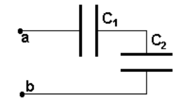
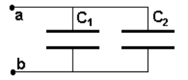
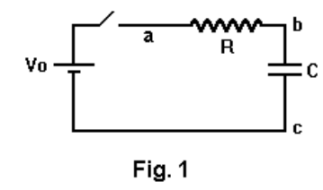
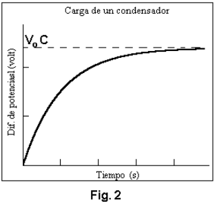
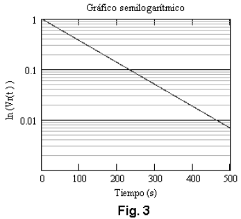
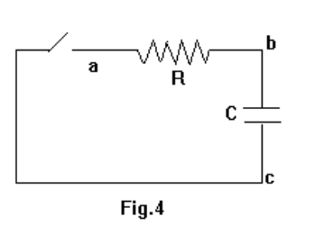
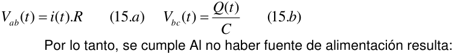
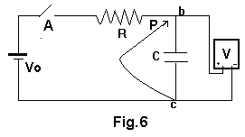
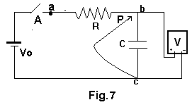

<!-- markdownlint-disable MD060 -->

# Trabajo de laboratorio Nº 3: Estudio del regimen transitorio del circuito RC

Universidad Tecnologica Nacional. Facultad Regional Resistencia. Cátedra: Física
II.

a) Medida de la capacidad de un condensador electrolítico

b) Asociación de condensadores: capacidad equivalente

**OBJETIVOS:** Consiste en medir la diferencia de potencial sobre el capacitor
en función del tiempo durante los procesos de carga y descarga de un capacitor
conectado en serie con una resistencia eléctrica y una fuente de alimentación
CC.

**FUNDAMENTOS TEÓRICOS** : Un capacitor está formado por dos conductores
separados por un medio material no conductor _._ Idealmente el capacitor
almacena energía eléctrica en forma de campo eléctrico entre los conductores.

Cada conductor recibe el nombre de electrodo, cuando a uno de los electrodo se
le agrega una carga eléctrica en el otro se induce la misma cantidad pero de
signo distinto estableciéndose un campo eléctrico. Si se aumenta la carga en el
capacitor, la diferencia de potencial entre sus electrodos se incrementa en
forma proporcional. La relación entre la carga total _Q_ en uno de sus
electrodos y la diferencia de potencial _V_ entre los electrodos es siempre una
constante denominada capacidad del elemento, que se expresa como

```math
C=\frac{Q}{V}
```

(1)

la capacidad _C_ se expresa en faradios. La capacidad de un capacitor depende de
la geometría de los conductores que forman las placas del capacitor y del medio
material que las separa.

## **Asociación de condensadores**

a) Asociación en Serie de dos condensadores

Capacidad equivalente

```math
\frac1{C_e}=\frac1{C_1}+\frac1{C_2}
```

(2)



b) Asociación en Paralelo de dos condensadores

Capacidad equivalente

```math
C_e=C_1+C_2
```

(3)



### **a) Análisis del Circuito: Proceso de carga**



En el circuito de la figura 1, cuando se cierra en interruptor, si inicialmente
el condensador está descargado es decir Q( t = 0 ) = 0 se cumple la siguiente
ecuación

```math
V_o=i(t)R+\frac{Q(t)}C
```

(4)

El primer miembro de la ecuación es la fuerza electromotriz $`V_o`$ de la fuente
de alimentación. La diferencia de potencial en la resistencia es $`i(t)R`$ y en
el condensador $`\frac{Q(t)}C`$. Considerando que la corriente eléctrica i(t) se
puede escribir en términos de la carga como $`i(t)=\frac{dQ}{dt}`$. La ecuación
(4) se expresa como, una ecuación diferencial de primer orden, lineal e
inhomogénea con coeficientes constantes

```math
R\frac{dQ(t)}{dt}+\frac{Q(t)}C=V_o
```

(5)

ordenándola se tiene

```math
\frac{dQ(t)}{dt}+\frac{Q(t)}{RC}=\frac{V_o}R
```

(6)

Teniendo en cuenta las condiciones iniciales del proceso de carga, la solución
completa de la (6) es :

```math
Q(t)=V_o\cdot C\cdot\left(1-e^{-\frac{t}{R\cdot C}}\right)
```

(7)



La representación gráfica de Q(t) durante el proceso de carga se muestra en la
figura 2. En la gráfica se observa que el valor de la carga tiende
asintóticamente al valor: $`Q_{Lim}=V_o\cdot C`$ para valores de tiempos
grandes.

Para determinar la diferencia de potencial entre los bornes del condensador;
debe emplearse la ec. (1) entonces:

```math
V_{bc}(t)=\frac{Q(t)}C=V_o\cdot\left(1-e^{-\frac{t}{R\cdot C}}\right)
```

(8)

La representación gráfica de Vbc(t) es análoga a Q(t) salvo en el factor
constante 1/C, y para valores de tiempos grandes la diferencia de potencial
sobre el condensador tiende asintóticamente el valor de la fuente Vo **.**

El producto R.C que está en el denominador del exponente tiene dimensiones de
tiempo y recibe el nombre de constante de tiempo

```math
\tau=R\cdot C
```

(9)

Si $`t=\tau`$ en (8) resulta:

```math
V_{bc}(\tau)=V_o\cdot(1-e^{-1})=0{,}63\cdot V_o
```

(11)

de modo que la constante de tiempo $`\tau`$ representa el tiempo que tarda el
condensador en alcanzar el 63% de su diferencia de potencial ( o bien su carga)
final de equilibrio. Otro procedimiento de representación gráfica es operando
sobre (8) resulta

```math
\frac{V_{bc}(t)}{V_o}-1=-e^{-\frac{t}{R\cdot C}}\quad\Rightarrow\quad 1-\frac{V_{bc}(t)}{V_o}=e^{-\frac{t}{R\cdot C}}
```

(12)



Si $`v_R(t)=1-\frac{V_{bc}(t)}{V_o}`$ entonces
$`v_R(t)=e^{-\frac{t}{R\cdot C}}`$

Tomando ln en ambos miembros y aplicando propiedades de ln resulta

```math
\ln[v_R(t)]=-\frac{t}{R\cdot C}
```

(13)

Si se hace una representación gráfica semilogarítmica, en las ordenadas
$`\ln[v_R(t)]`$ y en las abscisas como se muestra en la figura 3. Constituye una
recta con pendiente negativa cuyo valor es

```math
m=-\frac1{R\cdot C}
```

(14)

**De modo que conociendo la pendiente y el valor de la resistencia R, se puede
determinar el valor de la capacidad C del condensador.**



b) **Análisis del Circuito: Proceso de descarga:**

**Si se considera el circuito de la figura 4, con el condensador C inicialmente
cargado, es decir t = 0, Q = Qo, en estas condiciones se cierra el interruptor
A**

**Las diferencias de potencial instantáneas sobre cada elemento de circuito
son:**

```math
V_{ab}(t)=i(t)\cdot R
```

(15.a)

```math
V_{bc}(t)=\frac{Q(t)}C
```

(15.b)



Por lo tanto, se cumple Al no haber fuente de alimentación resulta:

```math
V_{ab}(t)+V_{bc}(t)=0
```

(16)

Reemplazando resulta

```math
i(t)\cdot R+\frac{Q(t)}C+0
```

(17)

La ecuación anterior puede escribirse como:

```math
\frac{dq}{dt}+\frac{q}{RC}=0
```

(18)

cuya solución con las condiciones iniciales establecidas resulta:

```math
Q(t)=Q_o\cdot e^{-\frac{t}{R\cdot C}}
```

(19)

De (19) surge que la carga decrece exponencialmente con el tiempo debiendo
transcurrir un tiempo infinitamente largo para que el condensador se descargue
totalmente.

La fig. 5 muestra la representación gráfica de la ecuación (19)

La diferencia de potencial en el condensador será :

```math
V_{bc}(t)=\frac{Q(t)}C=\frac{Q_o}C\cdot e^{-\frac{t}{R\cdot C}}
```

(20)

si $`V_o=\frac{Q_o}C`$ el valor de la diferencia de potencial en el instante
inicial y $`t=\tau=RC`$ entonces

```math
V_{bc}(\tau)=V_o\cdot e^{-\frac{\tau}{R\cdot C}}=V_o\cdot e^{-1}=0.37\cdot V_o
```

(21)

En este caso, la constante de tiempo del circuito representa el tiempo que tarda
el condensador en reducir su diferencia de potencial ( o su carga ) a un 37% de
su valor inicial.

Obsérvese que la (20) es posible escribirla de igual forma que la (13), se deja
como ejercicio.

## Material a utilizar

Fuente de alimentación de **CC** . Plaqueta con circuito **_RC_** . Voltímetro.
Cables de Conexión.

Cronómetro.

## Técnica operatoria



De teoría desarrollada, tanto en el proceso de carga, como en el de descarga se
demostró que la diferencia de potencial sobre el condensador varía según las
expresiones (8), (13) y (20), por tanto se obtendrán esas variaciones V(t) en
forma experimental. A partir de las gráficas y conociendo el valor de la
resistencia, R, se puede determinar el valor de la capacidad, C, del condensador
mediante la relación (9) de donde:

```math
C=\frac\tau R
```

(19)

## **1.- Desarrollo de la experiencia del proceso de carga**

1.1.- Arme el circuito de la figura 6 empleando la plaqueta provista por la
cátedra, conecte respetando la polaridad del condensador. Registre los valores
de fuente de alimentación, de la resistencia R y de la capacidad C en la tabla
1\.

1.2.- Verifique que el condensador está completamente descargado conectando el
voltímetro entre sus bornes, en caso contrario, cierre el circuito conectando la
punta P en el punto b para lograrlo (Figura 6).

1.3.- Para hacer una serie lecturas de diferencia de potencial, cierre el
interruptor A y registre los valores del voltímetro cada 10 seg. en una tabla
(tabla 1).

## Tabla 1: Proceso de carga

<table>
<tr><td>Fuente de alimentación CC</td><td colspan="5"></td></tr>
<tr><td>Resistencia</td><td colspan="5"></td></tr>
<tr><td>Capacidad</td><td colspan="5"></td></tr>
<tr><td></td><td colspan="5">Series de lecturas</td></tr>
<tr><td>Tiempo (en segundos)</td><td>V (voltio)</td><td>V (voltio)</td><td>V (voltio)</td><td>V (voltio)</td><td>Promedio</td></tr>
<tr><td>0</td><td>0</td><td>0</td><td>0</td><td>0</td><td></td></tr>
<tr><td>10</td><td></td><td></td><td></td><td></td><td></td></tr>
<tr><td></td><td></td><td></td><td></td><td></td><td></td></tr>
</table>

1.4.- Cuando el voltímetro mida el mismo valor más de 30 s ( tres lecturas
consecutivas), no haga más lecturas.

1.5.- Repita el procedimiento cuatro veces.

1.6.- Agrega al circuito un condensador en serie con el que ya está y repita el
procedimiento



1.7.- Agrega al circuito un condensador en paralelo con el que ya está y repita
el procedimiento

### **2.- Desarrollo de la experiencia del proceso de descarga**

2.1.- Arme el circuito de la figura 7 empleando la plaqueta provista por la
cátedra, conecte respetando la polaridad del condensador. Registre los valores
de fuente de alimentación, de la resistencia R y de la capacidad C en la tabla
2\.

2.2.- Verifique que el condensador está completamente cargado conectando el
voltímetro entre sus bornes, en caso contrario, cierre el circuito conectando la
punta P en el punto b para lograrlo (Figura 7).

2.3.- Para hacer una serie lecturas de diferencia de potencial, cierre el
interruptor A y que el condensador queda cargado registre este valor Vo, abra el
interruptor A y conecte la punta P al punto a del circuito y registre los
valores del voltímetro cada 10 seg. en una tabla de datos (tabla 2).

## Tabla 2: Proceso de descarga

<table>
<tr><td>Fuente de alimentación CC</td><td colspan="5"></td></tr>
<tr><td>Resistencia</td><td colspan="5"></td></tr>
<tr><td>Capacidad</td><td colspan="5"></td></tr>
<tr><td></td><td colspan="5">Series de lecturas</td></tr>
<tr><td>Tiempo (en segundos)</td><td>V (voltio)</td><td>V (voltio)</td><td>V (voltio)</td><td>V (voltio)</td><td>Promedio</td></tr>
<tr><td>0</td><td></td><td></td><td></td><td></td><td></td></tr>
<tr><td>10</td><td></td><td></td><td></td><td></td><td></td></tr>
<tr><td></td><td></td><td></td><td></td><td></td><td></td></tr>
</table>

2.4.- Cuando el voltímetro mida el mismo valor más de 30 s ( tres lecturas
consecutivas), no haga más lecturas.

2.5.- Repita el procedimiento cuatro veces.

### **3.- Procesamiento de datos**

2.1.- Para cada instante de tiempo se tiene cuatro lecturas, calcule el promedio
y registre en la tabla 3 .

### Tabla 3: Proceso de carga

| T(seg) | V(voltios) | $`V_r(t)=1-V(t)/Vo`$ |
| -- | -- | -- |
| 0 | 0 | 1 |
| 10 | .... | ..... |

3.2.- Grafique V(t) y en un gráfico semilogarítmo ln[Vr(t)].

3.3.- Determine de la gráfica V(t) la constante de tiempo, $`\tau`$ , ubicando
la abscisa correspondiente al instante t cuya ordenada es _V_ = 0,63 _Vo_ (donde
Vo es el valor de la diferencia de potencial que tiende asintóticamente la ddp
sobre el condensador).

3.3.- Con el valor de $`\tau`$ obtenido determine el valor de la capacidad, C,
por medio de la (9) **.**

3.4.- Determine el error porcentual de la constante de tiempo, $`\tau`$ ,
tomando como valor teórico de la misma el obtenido por empleo de la (9) **,**
donde los valores de la resistencia R y el condensador C son datos por el
fabricante de los mismos.

3.5.- Determine el error porcentual de la capacidad (haciendo propagación de
errores en (19)) tomando $`\tau`$ y $`\Delta\tau`$ los valores obtenidos en el
ítem anterior y la información de la tolerancia de la resistencia $`\Delta R`$
indicada por el fabricante.

```math
\Delta C=\left|\frac{\Delta\tau}R\right|+\left|\frac\tau{R^2}\Delta R\right|
```

```math
E\%=\frac{\Delta C}C*100
```

3.6.- A partir de la tabla 2 y tomando el ln[Vr(t)] aplique una regresión lineal
y determine si se ajusta a una recta y el valor del coeficiente lineal (ver
expresión 14) y a partir de este y del valor de la resistencia determine el
valor de C

3.7 Repita el procesamiento de datos con las tablas de datos obtenidas con las
asociaciones en serie y en paralelo.

### Bibliografía

Eisberg R. y Lerner L. “Física :Fundamentos y Aplicaciones” Vol I y II Ed.
McGraw-Hill Serway R “Física” Vol I y II Ed. McGraw-Hill Sears F´sica
Universitaria 6<sup>ta</sup> ed. Addison Wesley Zahn M. “Teoria
Electromagnética” Ed. McGraw-Hill Kip A. “Fundamentos de Electricidad y
Magnetismo” Ed. McGraw-Hill Gettys y otros Física clásica y moderna Ed.
McGraw-Hill.

## Trabajo de laboratorio Nº 3: Hoja de datos

**TEMA** : **ESTUDIO DEL REGIMEN TRANSITORIO DEL CIRCUITO RC a) Medida de la
capacidad de un condensador electrolítico b) Asociación de condensadores:
capacidad equivalente**

### Hoja de datos

| CURSO | FECHA | INTEGRANTES |
| -- | -- | -- |
|  |  | 1.- |
|  |  | 2.- |
|  |  | 3.- |
|  |  | 4.- |

## Tabla 1: Proceso de carga

<table>
<tr><td>Fuente de alimentación CC</td><td colspan="5"></td></tr>
<tr><td>Resistencia</td><td colspan="5"></td></tr>
<tr><td>Capacidad</td><td colspan="5"></td></tr>
<tr><td></td><td colspan="5">Series de lecturas</td></tr>
<tr><td>Tiempo (en segundos)</td><td>V (voltio)</td><td>V (voltio)</td><td>V (voltio)</td><td>V (voltio)</td><td>Promedio</td></tr>
<tr><td>0</td><td>0</td><td>0</td><td>0</td><td>0</td><td></td></tr>
<tr><td>10</td><td></td><td></td><td></td><td></td><td></td></tr>
<tr><td></td><td></td><td></td><td></td><td></td><td></td></tr>
<tr><td></td><td></td><td></td><td></td><td></td><td></td></tr>
<tr><td></td><td></td><td></td><td></td><td></td><td></td></tr>
<tr><td></td><td></td><td></td><td></td><td></td><td></td></tr>
<tr><td></td><td></td><td></td><td></td><td></td><td></td></tr>
<tr><td></td><td></td><td></td><td></td><td></td><td></td></tr>
<tr><td></td><td></td><td></td><td></td><td></td><td></td></tr>
<tr><td></td><td></td><td></td><td></td><td></td><td></td></tr>
<tr><td></td><td></td><td></td><td></td><td></td><td></td></tr>
<tr><td></td><td></td><td></td><td></td><td></td><td></td></tr>
<tr><td></td><td></td><td></td><td></td><td></td><td></td></tr>
<tr><td></td><td></td><td></td><td></td><td></td><td></td></tr>
<tr><td></td><td></td><td></td><td></td><td></td><td></td></tr>
<tr><td></td><td></td><td></td><td></td><td></td><td></td></tr>
</table>

Cálculo teórico de la constante de tiempo: Determinación de la constante de
tiempo (método gráfico): Determinación de la capacidad:

## Tabla 1.1: Proceso de carga: asociación serie

<table>
<tr><td>Fuente de alimentación CC</td><td colspan="5"></td></tr>
<tr><td>Resistencia</td><td colspan="5"></td></tr>
<tr><td>Capacidad C1</td><td colspan="5"></td></tr>
<tr><td>Capacidad C2</td><td colspan="5"></td></tr>
<tr><td></td><td colspan="5">Series de lecturas</td></tr>
<tr><td>Tiempo (en segundos)</td><td>V (voltio)</td><td>V (voltio)</td><td>V (voltio)</td><td>V (voltio)</td><td>Promedio</td></tr>
<tr><td>0</td><td>0</td><td>0</td><td>0</td><td>0</td><td></td></tr>
<tr><td>10</td><td></td><td></td><td></td><td></td><td></td></tr>
<tr><td></td><td></td><td></td><td></td><td></td><td></td></tr>
<tr><td></td><td></td><td></td><td></td><td></td><td></td></tr>
<tr><td></td><td></td><td></td><td></td><td></td><td></td></tr>
<tr><td></td><td></td><td></td><td></td><td></td><td></td></tr>
<tr><td></td><td></td><td></td><td></td><td></td><td></td></tr>
<tr><td></td><td></td><td></td><td></td><td></td><td></td></tr>
<tr><td></td><td></td><td></td><td></td><td></td><td></td></tr>
<tr><td></td><td></td><td></td><td></td><td></td><td></td></tr>
<tr><td></td><td></td><td></td><td></td><td></td><td></td></tr>
<tr><td></td><td></td><td></td><td></td><td></td><td></td></tr>
<tr><td></td><td></td><td></td><td></td><td></td><td></td></tr>
<tr><td></td><td></td><td></td><td></td><td></td><td></td></tr>
</table>

Cálculo teórico de la constante de tiempo: Determinación de la constante de
tiempo (método gráfico): Determinación de la capacidad equivalente:

## Tabla 1.2: Proceso de carga: asociación paralelo

<table>
<tr><td>Fuente de alimentación CC</td><td colspan="5"></td></tr>
<tr><td>Resistencia</td><td colspan="5"></td></tr>
<tr><td>Capacidad C1</td><td colspan="5"></td></tr>
<tr><td>Capacidad C2</td><td colspan="5"></td></tr>
<tr><td></td><td colspan="5">Series de lecturas</td></tr>
<tr><td>Tiempo (en segundos)</td><td>V (voltio)</td><td>V (voltio)</td><td>V (voltio)</td><td>V (voltio)</td><td>Promedio</td></tr>
<tr><td>0</td><td>0</td><td>0</td><td>0</td><td>0</td><td></td></tr>
<tr><td>10</td><td></td><td></td><td></td><td></td><td></td></tr>
<tr><td></td><td></td><td></td><td></td><td></td><td></td></tr>
<tr><td></td><td></td><td></td><td></td><td></td><td></td></tr>
<tr><td></td><td></td><td></td><td></td><td></td><td></td></tr>
<tr><td></td><td></td><td></td><td></td><td></td><td></td></tr>
<tr><td></td><td></td><td></td><td></td><td></td><td></td></tr>
<tr><td></td><td></td><td></td><td></td><td></td><td></td></tr>
<tr><td></td><td></td><td></td><td></td><td></td><td></td></tr>
<tr><td></td><td></td><td></td><td></td><td></td><td></td></tr>
<tr><td></td><td></td><td></td><td></td><td></td><td></td></tr>
<tr><td></td><td></td><td></td><td></td><td></td><td></td></tr>
<tr><td></td><td></td><td></td><td></td><td></td><td></td></tr>
<tr><td></td><td></td><td></td><td></td><td></td><td></td></tr>
</table>

Cálculo teórico de la constante de tiempo: Determinación de la constante de
tiempo (método gráfico): Determinación de la capacidad equivalente:

## Tabla 2: Proceso de descarga

<table>
<tr><td>Fuente de alimentación CC</td><td colspan="5"></td></tr>
<tr><td>Resistencia</td><td colspan="5"></td></tr>
<tr><td>Capacidad</td><td colspan="5"></td></tr>
<tr><td></td><td colspan="5">Series de lecturas</td></tr>
<tr><td>Tiempo (en segundos)</td><td>V (voltio)</td><td>V (voltio)</td><td>V (voltio)</td><td>V (voltio)</td><td>Promedio</td></tr>
<tr><td>0</td><td>0</td><td>0</td><td>0</td><td>0</td><td></td></tr>
<tr><td>10</td><td></td><td></td><td></td><td></td><td></td></tr>
<tr><td></td><td></td><td></td><td></td><td></td><td></td></tr>
<tr><td></td><td></td><td></td><td></td><td></td><td></td></tr>
<tr><td></td><td></td><td></td><td></td><td></td><td></td></tr>
<tr><td></td><td></td><td></td><td></td><td></td><td></td></tr>
<tr><td></td><td></td><td></td><td></td><td></td><td></td></tr>
<tr><td></td><td></td><td></td><td></td><td></td><td></td></tr>
<tr><td></td><td></td><td></td><td></td><td></td><td></td></tr>
<tr><td></td><td></td><td></td><td></td><td></td><td></td></tr>
<tr><td></td><td></td><td></td><td></td><td></td><td></td></tr>
<tr><td></td><td></td><td></td><td></td><td></td><td></td></tr>
<tr><td></td><td></td><td></td><td></td><td></td><td></td></tr>
<tr><td></td><td></td><td></td><td></td><td></td><td></td></tr>
<tr><td></td><td></td><td></td><td></td><td></td><td></td></tr>
<tr><td></td><td></td><td></td><td></td><td></td><td></td></tr>
</table>

Cálculo teórico de la constante de tiempo: Determinación de la constante de
tiempo (método gráfico): Determinación de la capacidad:

## Nota de transcripción

Se conserva la numeración de ecuaciones con salto de (9) a (11), repetición de
(19), el signo +0 en (17), la repetición de 3.3 y 2.1 en procesamiento. Figuras
6 y 7 recuperadas de los objetos originales del PDF que PyMuPDF4LLM omitió. Se
conservan todas las filas vacías de las hojas, incluidas las continuaciones de
páginas 9 y 11; no se agregan lecturas.

[Procedencia y comprobaciones](../../../resources/2015/fuentes.md).
