# Circuitos eléctricos: guía identificada como 2011

Fuente: `2015/guia de problemas 2011.pdf`, páginas 16–19 de 31. SHA-256:
`5a5ae8ac33a7a3d14d854623015ef14bc0af3dae1651c013aed06567e28a8bca`.

Extracción pdftotext, recuperación visual de símbolos y cotejo de las cuatro
páginas. Veinte preguntas, dieciséis problemas, gráfica del cuestionario y trece
figuras de problemas. El año 2011 pertenece al nombre del archivo.

## Cuestionario

**1.** ¿Cómo aplica la ecuación de continuidad a los distintos regímenes de
comente eléctrica?

**2.** Se ha comprobado que debe existir un campo eléctrico en el interior de m
conductor para que circule corriente a través de él, como se compatibiliza este
hecho, con la conclusión en electrostática que el campo debe ser cero en el
interior de un conductor.

**3.** Dos conductores del mismo material y de la misma longitud, con sección
distinta se conectan a la misma diferencia de potencial. ¿Por cuál ellos pasaré
la menor corriente?

**4.** Dos lámparas incandescentes cuyos filamentos son capaces de disipar 25 W
y 60 W cuado trabajan a 220 volt ¿cuál de los dos filamentos tiene mayor
resistencia?

**5.** Se aplica una diferencia de potencial V a un hilo de cobre de diámetro d
y longitud 1 ¿qué consecuencia tiene sobre la velocidad de los portadores de
carga? Si a) Se duplica longitud del hilo b) Se duplica el diámetro del hilo c)
Se duplica la diferencia de potencial V.

**6.** ¿Cuáles de las siguientes muestras tiene mayor conductividad eléctrica?
a. Agua de mar b. Agua purificada. c. Una solución de NaOH al 5 %. d. Una
solución de HCI al 10 %.

**7.** La resistividad de un material es función de la velocidad de los
portadores de carga?

**8.** En la gráfica se presenta la corriente en función de{ a diferencia de
potencial aplicada sobre los extremos de dos cilindros del mismo diámetro largo
de materiales homogéneos distintos ¿cuál de ellos responde a la ley de Ohm?
Justifique la respuesta.

**9.** ¿Bajo qué condiciones es posible sustituir un conjunto de resistencias
asociadas por una resistencia equivalente?

**10.** Como conectaría dos resistencia de modo que la resistencia equivalente
sea menor que las resistencia individuales?. Justiflque con un ejemplo.

**11.** En un circuito eléctrico ¿Que significan nudo, rama y malla?

**12.** Enuncie la ley de nudos. ¿Qué ley física la justifica? Dé la ecuación
correspondiente.

**13.** Enuncie la ley de mallas. ¿Qué argumento emplea para justificarla?

**14.** Cual es la diferencia entre una resistencia de carga y una resistencia
interna?

**15.** ¿Cuántas ecuaciones de nudo son linealmente independiente en un
circuito?

**16.** En una red se pueden establecer que existen 5 nudos, 7 ramas y 10
mallas, con esta información es posible conocer el número de corrientes de la
red? En caso afirmativo explique claramente e indique el número de corrientes

**17.** Mediante un agente externo se logra disminuir la corriente a través de
una batería cuya fem es $`\varepsilon`$ y su resistencia interna r. ¿Esto hace
que necesariamente aumente o disminuya la diferencia de potencial entre las
terminales de la batería?. Explicar la respuesta.

**18.** ¿Por qué la resistencia de un amperímetro debe ser muy pequeña y la de
un voltímetro muy grande?

**19.** ¿Cómo se conecta un voltímetro a un circuito? ¿y un amperímetro?

**20.** ¿Cuál es la diferencia entre fem y ddp?

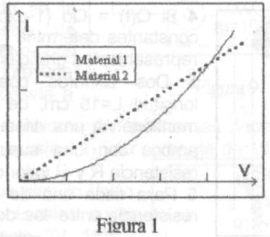

## Problemas

### Problema 1

Una barra de cobre de sección transversal rectangular de 20 mm por 80 mm y largo
2 m de tiene aplicada una diferencia de potencial de 50 mV entre sus extremos.
Hallar las siguientes cantidades y dar las unidades en cada caso: a) la
resistencia R de la barra, b) la corriente, 1 c) la densidad de corriente J, d)
el campo eléctrico E, e) la potencia perdida P en la barra, f) la energía
perdida por hora, g) la velocidad de los portadores de carga.

### Problema 2

Si la densidad corriente es $`\vec j=3yz\vec i`$ hallar la corriente 1 a través
de una superficie cuadrada de 2 rn de lado con un extremo en el origen y los
otros en (0, 2 ,0), (0, 0, 2) y (0, 2, 2).(Figura 1).

### Problema 3

Un cable de sección circular y diámetro 1 cm tiene una densidad de corriente
$`J(r)=A.r`$, donde A es una constante y $`0\lt r\lt R`$, como se muestra en la
figura 2. Si 1a corriente total es 1 amp. Determine el valor de la constante A

### Problema 4

Si $`Q(t)=Q_o\{1-\exp(-t/RC)`$ donde Qo, R y C son constantes determine la
expresión de la corriente, haga la representación gráfica de Q(t) y de I(t).

### Problema 5

Dos cilindros coaxiales conductores perfectos de longitud L = 15 cm, de radio
interior a = 0.25 cm y exterior b = 0.5 cm se mantienen a una diferencia de
potencial V = 12 volt , se llena el espacio entre ambos con una sustancia de
resistividad $`\rho=400\,\Omega.\mathrm m`$. Determinar la resistencia R y el
valor de la corriente.

### Problema 6

Para cada una de las geometrías mostradas en la figura 4P, calcular la
resistencia entre las dos placas conductoras perfectas cuadradas de lado L,
entre las cuales hay dos materiales de corductividades $`\sigma_1`$ y
$`\sigma_2`$ , , suponer una separación entre placas d.

### Problema 7

Un campo eléctrico de 2.1 kV/m se a aplica un elemento de plata
($`\rho=1.59\,10^{-8}\,\Omega.\mathrm m`$ ) de sección transversal uniforme.
Calcule a) la densidad de corriente J b) la velocidad de los electrones libres.

### Problema 8

Determine el valor de la resistencia equivalente de los circuitos de la figura
5\.

### Problema 9

En el circuito de la figura 6, determinar las corrientes y la diferencia de
potencial $`V_b-V_a`$ . Los valores de las resistencias, en Ω., son R1 = 25, R2
= 20, R3 = 10, R = 15,.los valores de las fuentes, son E1 = 10 V, E2 = 15 V y E3
= 10 V

### Problema 10

En el circuito de la figura 7, está conectado un condensador de 1~tF, determine
la carga del mismo. Los valores de las resistencias, en Ω, son R1=15, R2=25,
R3=20, R4=15, R5 = 30, R6 = 30. Los valores de las fuentes, en voltios, son E 1
= 24, E2 =10, E3 = 18 y E4 = 18. La capacidad 1 $`\mu\mathrm F`$.

### Problema 11

Determine las corrientes en cada resistencia, para el circuito de la figura 8

### Problema 12

Un circuito básico de un amperímetro está mostrado en la figura 9. El
galvanómetro de bobina móvil empleado tiene una resistencia $`r_g=10\,\Omega`$ y
para una corriente de 0.01 A. se desvía a fondo de escala. Hallar los valores de
resistencias necesarias para que se desvíe a fondo de escala con una corriente
de 10 A, l A y 0.1 A

### Problema 13

La figura 10 muestra un circuito típico de un voltímetro de tres escalas cuyas
entradas podrán medir hasta 3V, 15V y 150V. El galvanómetro de bobina móvil
empleado tiene una resistencia $`r_9=10\,\Omega`$ y para una corriente de 0.001
A se desvía a fondo de escala. Hallar los valores de las resistencias indicadas
para que, en cada caso, se desvíe a fondo de la escala.

### Problema 14

Encuentre la relación entre $`V_e`$, $`V_s`$ y la corriente de entrada $`I_1`$
en el circuito de la figura 11 .

### Problema 15

Un potenciómetro es un circuito que se utiliza para medir la fuerza
electromotriz de una fuente por comparación con una fuerza electromotriz de una
fuente de referencia. Un circuito típico es el mostrado en la figura 12, donde
el punto b representa un contacto deslizable entre los puntos a y c. Esta
versión de potenciómetro se llama potenciómetro de alambre-deslizable, la
resistencia variables un alambre. Plantee las ecuaciones de Krchhoff del
circuito y encuentre una relación entre las fem. de las fuentes cuando el
potenciómetro es balanceado ( $`i_9=0`$ ).

### Problema 16

El circuito de la figura 13 es un puente de Wheastone, donde se reemplazaron dos
resistencias por resistencias de alambre $`R_{ab}`$ y $`R_{bc}`$ , este
dispositivo sirve para medir con exactitud resistencias desconocidas. El
principio de funcionamiento es muy simple se varía el contacto b, hasta que no
circule corriente por el galvanómetro, en estas condiciones se dice que el
puente está balanceado, de esta manera se cumple una relación entre las
resistencias que permite calcular la Rx. Plantee las ecuaciones de Kirchhoff del
circuito, imponga la condición de $`i_g=0`$ y encuentre la relación mencionada.

## Figuras de los problemas

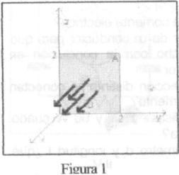

Figura 1.

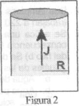

Figura 2.

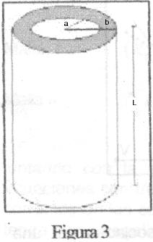

Figura 3.

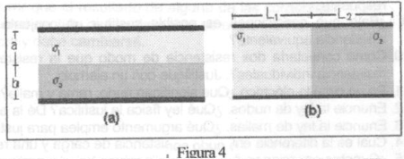

Figura 4.

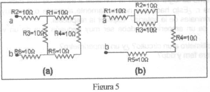

Figura 5.

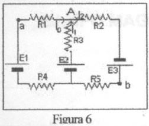

Figura 6.

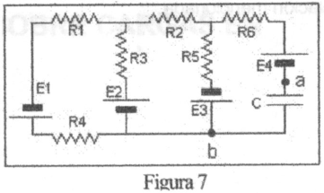

Figura 7.

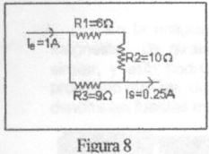

Figura 8.

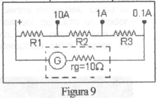

Figura 9.

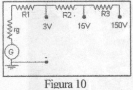

Figura 10.

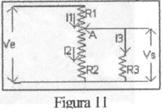

Figura 11.

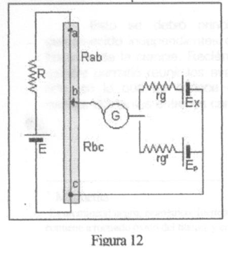

Figura 12.

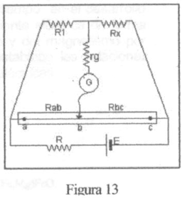

Figura 13.

## Observaciones de fidelidad

- Esta versión incluye la pregunta de conductividad de soluciones y numera
  veinte preguntas sin salto. Se conservan «comente», «m conductor», «longitud
  1», «de{ a», «corductividades», «Krchhoff» y «Wheastone».
- El problema 4 abre una llave sin cerrarla; el 9 da R=15 sin subíndice y no
  enumera todas las resistencias del dibujo. No se completan datos.
- El problema 10 imprime «1~tF» y después «1μF». Se conserva i9 del problema 15
  e ig del 16. No se resuelven ejercicios.
