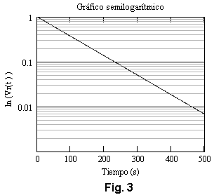
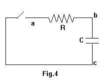
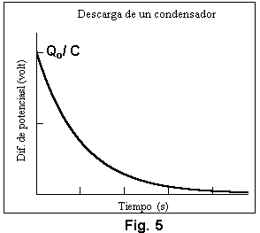
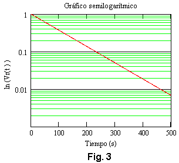

# Circuitos RC — informe del grupo 6: descarga y técnica operatoria

## Representación semilogarítmica



Si $`v_R(t)=1-\frac{V_{\mathrm{bc}}(t)}{V_o}`$ entonces

```math
v_R(t)=e^{-\frac{t}{R.C}}
```

Tomando ln en ambos miembros y aplicando propiedades de ln resulta

```math
\ln[v_R(t)]=-\frac{t}{R.C}\qquad(13)
```

Si se hace una representación gráfica semilogarítmica, en las ordenadas
$`\ln[v_R(t)]`$ y en las abscisas como se muestra en la figura 3. Constituye una
recta con pendiente negativa cuyo valor es

```math
m=-\frac1{R.C}\qquad(14)
```

De modo que conociendo la pendiente y el valor de la resistencia R, se puede
determinar el valor de la capacidad C del condensador.

## b) Análisis del Circuito: Proceso de descarga



Si se considera el circuito de la figura 4, con el condensador C inicialmente
cargado, es decir $`t=0,\ Q=Q_o`$, en estas condiciones se cierra el interruptor
A

Las diferencias de potencial instantáneas sobre cada elemento de circuito son:

```math
V_{\mathrm{ab}}(t)=i(t).R\qquad(15.a)\qquad V_{\mathrm{bc}}(t)=\frac{Q(t)}C\qquad(15.b)
```

Por lo tanto, se cumple Al no haber fuente de alimentación resulta:

```math
V_{\mathrm{ab}}(t)+V_{\mathrm{bc}}(t)=0\qquad(16)
```

Reemplazando resulta

```math
i(t).R+\frac{Q(t)}C+0\qquad(17)
```

La ecuación anterior puede escribirse como:

```math
\frac{dq}{dt}+\frac q{RC}=0\qquad(18)
```

cuya solución con las condiciones iniciales establecidas resulta:

```math
Q(t)=Q_o.e^{-\frac{t}{R.C}}\qquad(19)
```

De (19) surge que la carga decrece exponencialmente con el tiempo debiendo
transcurrir un tiempo infinitamente largo para que el condensador se descargue
totalmente.

La fig. 5 muestra la representación gráfica de la ecuación (19)



La diferencia de potencial en el condensador será :

```math
V_{\mathrm{bc}}(t)=\frac{Q(t)}C=\frac{Q_o}C.e^{-\frac{t}{R.C}}\qquad(20)
```

si $`V_o=\frac{Q_o}C`$ el valor de la diferencia de potencial en el instante
inicial y $`t=\tau=RC`$ entonces

```math
V_{\mathrm{bc}}(\tau)=V_o.e^{-\frac{\tau}{R.C}}=V_o.e^{-1}=0.37.V_o\qquad(21)
```

En este caso, la constante de tiempo del circuito representa el tiempo que tarda
el condensador en reducir su diferencia de potencial ( o su carga ) a un 37% de
su valor inicial.

Obsérvese que la (20) es posible escribirla de igual forma que la (13), se deja
como ejercicio.

## MATERIAL A UTILIZAR

Fuente de alimentación de CC.

Plaqueta con circuito RC.

Voltímetro.

Cables de Conexión.

Cronómetro.

## TÉCNICA OPERATORIA


De teoría desarrollada, tanto en el proceso de carga, como en el de descarga se
demostró que la diferencia de potencial sobre el condensador varía según las
expresiones (8), (13) y (20), por tanto se obtendrán esas variaciones V(t) en
forma experimental. A partir de las gráficas y conociendo el valor de la
resistencia, R, se puede determinar el valor de la capacidad, C, del condensador
mediante la relación (9) de donde:

```math
C=\frac\tau R\qquad(19)
```

## Procedencia y alcance de este lote

- Original: `2015/L3 Capacidad G6 Aprobado.pdf`, páginas 4–5 de 14. SHA-256:
  `586d5b26477b67b780929d52df3b218c54dca4ddfe6702e5f6e9d17b0ee5d320`.
- Cátedra Física II, grupo 6. El año 2015 corresponde a la carpeta; estas dos
  páginas no tienen fecha impresa.
- PyMuPDF4LLM contrastado con pdftotext -layout y ambas páginas renderizadas
  mediante Poppler. Todas las fórmulas cotejadas visualmente. Cuatro figuras
  originales extraídas del PDF, con sus etiquetas.
- La ecuación (17) termina en «+0» y no tiene signo igual: se conserva, sin
  convertirla en una ecuación corregida. También se conservan q minúscula en
  (18), Q mayúscula en (19), el punto decimal de 0.37 y la repetición del número
  (19) para la expresión de C.
- La gráfica 3 rotula ln(vR(t)) aunque sus marcas verticales sean 1, 0.1 y 0.01;
  no se sustituye ni se recalcula. El ejercicio referido a (20) y (13) queda sin
  resolver.
- Continúa
  [el lote de fundamentos y carga](circuitos-rc-informe-grupo-6-fundamentos-carga.md).
  La hoja de datos y los resultados se transcriben en los apuntes siguientes.

## Navegación del informe

[Anterior](circuitos-rc-informe-grupo-6-fundamentos-carga.md).
[Siguiente](circuitos-rc-informe-grupo-6-hoja-datos.md).

## Versión DOCX «A corregir 2»

El original `2015/L3 Capacidad G6 A corregir 2.docx`, SHA-256
`a8e1063ebff8c151f9a7a2d6d5dcf798a13ef08c9282a61fdc5bd0985ab184ec`, se cotejó
también con Pandoc, sus objetos de ecuación y una copia PDF de LibreOffice de 15
páginas. La paginación siguiente pertenece a esa copia normalizada, no al DOCX.

Las páginas 4–6 de la copia normalizada se cotejaron completas para este apunte:
representación semilogarítmica, descarga, materiales y técnica operatoria.
Coinciden las expresiones (13)–(21), incluido el «+0» sin igual de (17) y la
repetición de (19) para C, además de las figuras 4–6 y sus etiquetas. El DOCX
también destaca en negrita las condiciones iniciales y la frase «Las diferencias
de potencial instantáneas sobre cada elemento de circuito son:». La figura 5
aparece desplazada antes de (15); su contenido se conserva. Este cotejo no
atribuye cobertura a los resultados posteriores del DOCX.

La figura 3 de esta versión conserva cuadrícula verde y recta roja:



El párrafo final de ese tramo aparece destacado en negrita:

**De modo que conociendo la pendiente y el valor de la resistencia R, se puede
determinar el valor de la capacidad C del condensador.**
