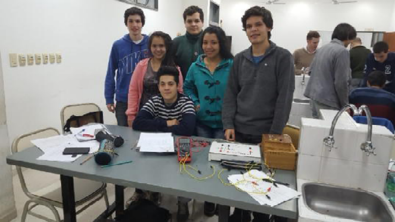
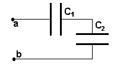
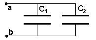
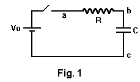
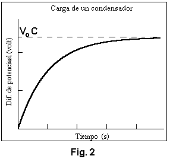

# Circuitos RC — informe del grupo 6: fundamentos y carga

## LABORATORIO N°3: CIRCUITOS RC



CARRERA: INGENIERIA EN SISTEMAS DE LA INFORMACIÓN

CATEDRA: FISICA II

GRUPO N°: 6

INTEGRANTES:

- CARDOZO, Edgar Oscar
- DIEZ, Gabriel Fernando
- FERREYRA, Eduardo
- MATIJASEVIC, Emerson Gabriel
- PREZ, Milagros
- RAMIREZ, Joselina

## ESTUDIO DEL REGIMEN TRANSITORIO DEL CIRCUITO RC

a) Medida de la capacidad de un condensador electrolítico

b) Asociación de condensadores: capacidad equivalente

OBJETIVOS: Consiste en medir la diferencia de potencial sobre el capacitor en
función del tiempo durante los procesos de carga y descarga de un capacitor
conectado en serie con una resistencia eléctrica y una fuente de alimentación
CC.

FUNDAMENTOS TEÓRICOS: Un capacitor está formado por dos conductores separados
por un medio material no conductor. Idealmente el capacitor almacena energía
eléctrica en forma de campo eléctrico entre los conductores.

Cada conductor recibe el nombre de electrodo, cuando a uno de los electrodo se
le agrega una carga eléctrica en el otro se induce la misma cantidad pero de
signo distinto estableciéndose un campo eléctrico. Si se aumenta la carga en el
capacitor, la diferencia de potencial entre sus electrodos se incrementa en
forma proporcional. La relación entre la carga total Qen uno de sus electrodos y
la diferencia de potencial V entre los electrodos es siempre una constante
denominada capacidad del elemento, que se expresa como

```math
C=\frac QV\qquad(1)
```

la capacidad Cse expresa en faradios. La capacidad de un capacitor depende de la
geometría de los conductores que forman las placas del capacitor y del medio
material que las separa.

## Asociación de condensadores

a) Asociación en Serie de dos condensadores

Capacidad equivalente

```math
\frac1{C_e}=\frac1{C_1}+\frac1{C_2}\qquad(2)
```



b) Asociación en Paralelo de dos condensadores

Capacidad equivalente

```math
C_e=C_1+C_2\qquad(3)
```



## a) Análisis del Circuito: Proceso de carga



En el circuito de la figura 1, cuando se cierra en interruptor, si inicialmente
el condensador está descargado es decir $`Q(t=0)=0`$ se cumple la siguiente
ecuación

```math
V_o=i(t)R+\frac{Q(t)}C\qquad(4)
```

El primer miembro de la ecuación es la fuerza electromotriz $`V_o`$ de la fuente
de alimentación. La diferencia de potencial en la resistencia es $`i(t)R`$ y en
el condensador $`\frac{Q(t)}C`$.

Considerando que la corriente eléctrica i(t) se puede escribir en términos de la
carga como $`i(t)=\frac{dQ}{dt}`$. La ecuación (4) se expresa como, una ecuación
diferencial de primer orden, lineal e inhomogénea con coeficientes constantes

```math
R\frac{dQ(t)}{dt}+\frac{Q(t)}C=V_o\qquad(5)
```

ordenándola se tiene

```math
\frac{dQ(t)}{dt}+\frac{Q(t)}{RC}=\frac{V_o}R\qquad(6)
```

Teniendo en cuenta las condiciones iniciales del proceso de carga, la solución
completa de la (6) es :

```math
Q(t)=V_o.C.\left(1-e^{-\frac{t}{R.C}}\right)\qquad(7)
```



La representación gráfica de Q(t) durante el proceso de carga se muestra en la
figura 2. En la gráfica se observa que el valor de la carga tiende
asintóticamente al valor: $`Q_{\mathrm{Lim}}=V_o.C`$ para valores de tiempos
grandes.

Para determinar la diferencia de potencial entre los bornes del condensador;
debe emplearse la ec. (1) entonces:

```math
V_{\mathrm{bc}}(t)=\frac{Q(t)}C=V_o.\left(1-e^{-\frac{t}{R.C}}\right)\qquad(8)
```

La representación gráfica de $`V_{\mathrm{bc}}(t)`$ es análoga a Q(t) salvo en
el factor constante 1/C, y para valores de tiempos grandes la diferencia de
potencial sobre el condensador tiende asintóticamente el valor de la fuente
$`V_o`$.

El producto R.C que está en el denominador del exponente tiene dimensiones de
tiempo y recibe el nombre de constante de tiempo

```math
\tau=R.C\qquad(9)
```

Si $`t=\tau`$ en (8) resulta:

```math
V_{\mathrm{bc}}(\tau)=V_o.(1-e^{-1})=0{,}63.V_o\qquad(11)
```

de modo que la constante de tiempo τ representa el tiempo que tarda el
condensador en alcanzar el 63% de su diferencia de potencial ( o bien su carga)
final de equilibrio. Otro procedimiento de representación gráfica es operando
sobre (8) resulta

```math
\frac{V_{\mathrm{bc}}(t)}{V_o}-1=-e^{-\frac{t}{R.C}}\quad\Rightarrow\quad1-\frac{V_{\mathrm{bc}}(t)}{V_o}=e^{-\frac{t}{R.C}}\qquad(12)
```

## Procedencia y alcance de este lote

- Original: `2015/L3 Capacidad G6 Aprobado.pdf`, páginas 1–3 de 14. SHA-256:
  `586d5b26477b67b780929d52df3b218c54dca4ddfe6702e5f6e9d17b0ee5d320`.
- Cátedra Física II, Ingeniería en Sistemas de la Información, grupo 6.
  Integrantes según la portada. El año 2015 corresponde a la carpeta; estas tres
  páginas no tienen fecha impresa.
- PyMuPDF4LLM contrastado con pdftotext -layout y las tres páginas renderizadas
  mediante Poppler. Las ecuaciones se transcribieron y cotejaron visualmente.
  Cuatro figuras extraídas del PDF; la fotografía de portada, dividida en bandas
  inline, se conserva renderizando solo el rectángulo de la foto.
- Se conserva la numeración original: después de (9) aparece (11), sin (10).
  También se mantienen «Qen», «Cse», «uno de los electrodo» y «se cierra en
  interruptor». No se corrige la gráfica: su título dice «Carga de un
  condensador», su eje vertical «Diferencia de potencial (volt)» y la asíntota
  está rotulada Vo C.
- Este lote termina en (12); la continuación semilogarítmica y de descarga está
  en el siguiente apunte.

## Navegación del informe

[Siguiente](circuitos-rc-informe-grupo-6-descarga-tecnica.md).

## Versión DOCX «A corregir 2»

El original `2015/L3 Capacidad G6 A corregir 2.docx`, SHA-256
`a8e1063ebff8c151f9a7a2d6d5dcf798a13ef08c9282a61fdc5bd0985ab184ec`, se cotejó
también con Pandoc, sus objetos de ecuación y una copia PDF de LibreOffice de 15
páginas. La paginación siguiente pertenece a esa copia normalizada, no al DOCX.

Las páginas 1–4, hasta (12), reproducen el texto científico, las ecuaciones y
figuras de este apunte. La portada del DOCX agrega el campo **AÑO: 2016**,
ausente de la portada del PDF aprobado. Se registra como dato de esta versión,
sin cambiar el año de carpeta ni el contenido de la otra fuente.
