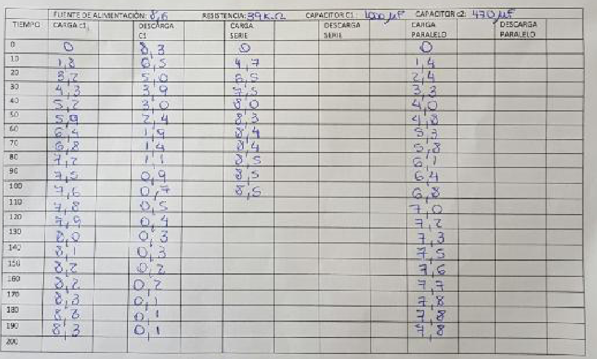

# Circuitos RC — informe del grupo 6: hoja manuscrita de datos

TRABAJO DE LABORATORIO Nº 3

TEMA: ESTUDIO DEL REGIMEN TRANSITORIO DEL CIRCUITO RC

HOJA DE DATOS

CURSO: I.S.I. “A”

GRUPO Nº: 6

FECHA: 19/05/16

FUENTE DE ALIMENTACIÓN: 8,6

RESISTENCIA: 39 kΩ

CAPACITOR C1: 1000 µF

CAPACITOR C2: 470 µF

## Mediciones manuscritas

<table>
<thead>
<tr><th>TIEMPO</th><th>CARGA C1</th><th></th><th>DESCARGA C1</th><th></th><th>CARGA SERIE</th><th></th><th>DESCARGA SERIE</th><th></th><th>CARGA PARALELO</th><th></th><th>DESCARGA PARALELO</th><th></th></tr>
</thead>
<tbody>
<tr><td>0</td><td>0</td><td></td><td>8,3</td><td></td><td>0</td><td></td><td></td><td></td><td>0</td><td></td><td></td><td></td></tr>
<tr><td>10</td><td>1,8</td><td></td><td>6,5</td><td></td><td>4,7</td><td></td><td></td><td></td><td>1,4</td><td></td><td></td><td></td></tr>
<tr><td>20</td><td>3,2</td><td></td><td>5,0</td><td></td><td>6,5</td><td></td><td></td><td></td><td>2,4</td><td></td><td></td><td></td></tr>
<tr><td>30</td><td>4,3</td><td></td><td>3,9</td><td></td><td>7,5</td><td></td><td></td><td></td><td>3,3</td><td></td><td></td><td></td></tr>
<tr><td>40</td><td>5,2</td><td></td><td>3,0</td><td></td><td>8,0</td><td></td><td></td><td></td><td>4,0</td><td></td><td></td><td></td></tr>
<tr><td>50</td><td>5,9</td><td></td><td>2,4</td><td></td><td>8,3</td><td></td><td></td><td></td><td>4,8</td><td></td><td></td><td></td></tr>
<tr><td>60</td><td>6,4</td><td></td><td>1,9</td><td></td><td>8,4</td><td></td><td></td><td></td><td>5,3</td><td></td><td></td><td></td></tr>
<tr><td>70</td><td>6,8</td><td></td><td>1,4</td><td></td><td>8,4</td><td></td><td></td><td></td><td>5,8</td><td></td><td></td><td></td></tr>
<tr><td>80</td><td>7,2</td><td></td><td>1,1</td><td></td><td>8,5</td><td></td><td></td><td></td><td>6,1</td><td></td><td></td><td></td></tr>
<tr><td>90</td><td>7,5</td><td></td><td>0,9</td><td></td><td>8,5</td><td></td><td></td><td></td><td>6,4</td><td></td><td></td><td></td></tr>
<tr><td>100</td><td>7,6</td><td></td><td>0,7</td><td></td><td>8,5</td><td></td><td></td><td></td><td>6,8</td><td></td><td></td><td></td></tr>
<tr><td>110</td><td>7,8</td><td></td><td>0,5</td><td></td><td></td><td></td><td></td><td></td><td>7,0</td><td></td><td></td><td></td></tr>
<tr><td>120</td><td>7,9</td><td></td><td>0,4</td><td></td><td></td><td></td><td></td><td></td><td>7,2</td><td></td><td></td><td></td></tr>
<tr><td>130</td><td>8,0</td><td></td><td>0,3</td><td></td><td></td><td></td><td></td><td></td><td>7,3</td><td></td><td></td><td></td></tr>
<tr><td>140</td><td>8,1</td><td></td><td>0,3</td><td></td><td></td><td></td><td></td><td></td><td>7,5</td><td></td><td></td><td></td></tr>
<tr><td>150</td><td>8,2</td><td></td><td>0,2</td><td></td><td></td><td></td><td></td><td></td><td>7,6</td><td></td><td></td><td></td></tr>
<tr><td>160</td><td>8,2</td><td></td><td>0,2</td><td></td><td></td><td></td><td></td><td></td><td>7,7</td><td></td><td></td><td></td></tr>
<tr><td>170</td><td>8,3</td><td></td><td>0,1</td><td></td><td></td><td></td><td></td><td></td><td>7,8</td><td></td><td></td><td></td></tr>
<tr><td>180</td><td>8,3</td><td></td><td>0,1</td><td></td><td></td><td></td><td></td><td></td><td>7,8</td><td></td><td></td><td></td></tr>
<tr><td>190</td><td>8,3</td><td></td><td>0,1</td><td></td><td></td><td></td><td></td><td></td><td>7,8</td><td></td><td></td><td></td></tr>
<tr><td>200</td><td></td><td></td><td></td><td></td><td></td><td></td><td></td><td></td><td></td><td></td><td></td><td></td></tr>
</tbody>
</table>

## Procedencia y criterios de transcripción

- Original: `2015/L3 Capacidad G6 Aprobado.pdf`, página 6 de 14. SHA-256:
  `586d5b26477b67b780929d52df3b218c54dca4ddfe6702e5f6e9d17b0ee5d320`.
- La fecha del campo es 19/05/16; junto a la firma docente también consta
  19/05/2016. La carpeta 2015 no acredita el año de esta hoja.
- OCRmyPDF con español sobre una copia de esta página y extracción Poppler;
  cotejo visual de todas las celdas contra el original ampliado. El OCR no
  recupera de forma fiable la escritura: los valores se transcribieron por
  lectura visual, no por recálculo ni copia de las tablas posteriores.
- Se conservan 21 filas, de 0 a 200, y las 13 columnas físicas: tiempo, seis
  columnas de mediciones y seis columnas intercaladas sin título. No se inventa
  una función para las columnas sin título.
- Descarga serie y descarga paralelo están vacías en toda la hoja. La carga
  serie termina en 100; los demás casilleros posteriores quedan vacíos. La fila
  200 solo tiene el tiempo impreso. Los blancos no significan cero.
- Se conservan comas decimales y ceros finales manuscritos, por ejemplo 8,0, 5,0
  y 7,0. El encabezado no especifica unidad para TIEMPO ni para la fuente de
  alimentación; no se agregan unidades a esos campos.
- Se omiten nombres manuscritos y firmas de los campos nominales. Los autores
  declarados en la portada figuran en
  [el primer lote del informe](circuitos-rc-informe-grupo-6-fundamentos-carga.md).
  Los recortes publicados solo contienen encabezado institucional y tabla.
- Las tablas y cálculos de páginas 7–14 están cotejados por separado en los
  apuntes de resultados; esta hoja no los sustituye.

## Navegación del informe

[Anterior](circuitos-rc-informe-grupo-6-descarga-tecnica.md).
[Siguiente](circuitos-rc-informe-grupo-6-resultados-carga-c1.md).

## Versión DOCX «A corregir 2»

La página 7 de la copia normalizada con LibreOffice del original
`2015/L3 Capacidad G6 A corregir 2.docx`, SHA-256
`a8e1063ebff8c151f9a7a2d6d5dcf798a13ef08c9282a61fdc5bd0985ab184ec`, contiene la
misma hoja fotografiada. Se cotejaron visualmente el encabezado, los valores y
las 21 filas con sus 13 columnas, incluidos los blancos y ceros finales.
Coinciden la fecha 19/05/16 y la anotación docente 19/05/2016. Se conserva la
transcripción anterior y el mismo criterio explícito de omitir nombres
manuscritos y firmas; no se duplica la fotografía completa. Esta paginación
corresponde al PDF normalizado de 15 páginas, no al DOCX.
