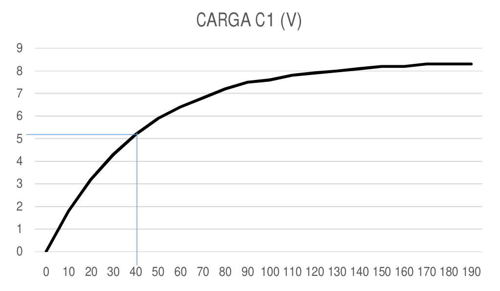
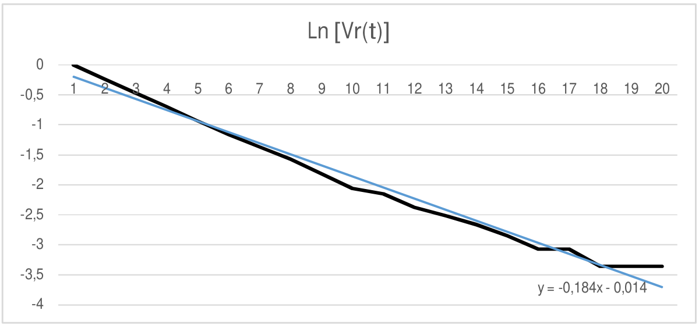

# Circuitos RC — informe del grupo 6: resultados de carga C1

## Proceso de Carga

Datos:

Fuente de Alimentación CC: $`8{,}6\,\mathrm V`$.

Resistencia $`R_t:39000`$.

Capacidad $`C_t:1000\,\mu\mathrm F`$.

| Tiempo | CARGA C1 (V) | $`\mathrm{Vr}=1-\mathrm{Vt}/\mathrm{Vo}`$ | $`\mathrm{Ln}[\mathrm{Vr}(t)]`$ |
| -- | -- | -- | -- |
| 0 | 0 | 1 | 0 |
| 10 | 1,8 | 0,791 | -0,235 |
| 20 | 3,2 | 0,628 | -0,465 |
| 30 | 4,3 | 0,500 | -0,693 |
| 40 | 5,2 | 0,395 | -0,928 |
| 50 | 5,9 | 0,314 | -1,159 |
| 60 | 6,4 | 0,256 | -1,363 |
| 70 | 6,8 | 0,209 | -1,564 |
| 80 | 7,2 | 0,163 | -1,815 |
| 90 | 7,5 | 0,128 | -2,056 |
| 100 | 7,6 | 0,116 | -2,152 |
| 110 | 7,8 | 0,093 | -2,375 |
| 120 | 7,9 | 0,081 | -2,508 |
| 130 | 8 | 0,070 | -2,663 |
| 140 | 8,1 | 0,058 | -2,845 |
| 150 | 8,2 | 0,047 | -3,068 |
| 160 | 8,2 | 0,047 | -3,068 |
| 170 | 8,3 | 0,035 | -3,356 |
| 180 | 8,3 | 0,035 | -3,356 |
| 190 | 8,3 | 0,035 | -3,356 |

## Determinación de la constante Tiempo (Método Gráfico)



Aproximadamente la abscisa correspondiente a
$`V(t)=V*0{,}63=8{,}6*0{,}63=5{,}41`$ se encuentra en 41s.

```math
T_P\approx41\,\mathrm s
```

```math
V=V_0.0{,}63=8{,}6.0{,}63=5{,}418\,\mathrm V
```

```math
T_T=R.C=39K*1000\,\mu\mathrm F=39\,\mathrm s
```

```math
C=T/R=41\mathrm s/39000=1{,}05*10^{-3}
```

```math
\Delta R=5\%R
```

```math
\Delta C=\frac{\Delta T}R+\frac{T\,\Delta R}{R^2}=\frac{2\mathrm s}{39000}+\frac{39\mathrm s\;1950}{(39000)^2}=1{,}01.10^{-4}\mathrm F
```

```math
E\%=\frac{\Delta C}C*100=10{,}1\%
```

## Gráfico Semi Logarítmico



Rótulo del ajuste en la gráfica:

```math
y=-0{,}184x-0{,}014
```

```math
m=-1/(R.C)\Rightarrow C=-1/(R.M)=-1/(39000*-0{,}1845)=1{,}38*10^{-3}\mathrm F
```

## Procedencia y observaciones

- Original: `2015/L3 Capacidad G6 Aprobado.pdf`, páginas 7–8 de 14. SHA-256:
  `586d5b26477b67b780929d52df3b218c54dca4ddfe6702e5f6e9d17b0ee5d320`.
- PyMuPDF4LLM contrastado con Poppler y ambas páginas renderizadas; cotejo
  visual de las 20 filas, las expresiones y las dos gráficas vectoriales
  originales. Las figuras se conservan mediante recortes renderizados; no se
  recalculan datos ni se redibujan gráficas.
- Se conserva la tabla tal como está mecanografiada, incluidos redondeos,
  títulos y valores repetidos. La resistencia 39000 no tiene unidad impresa en
  su línea; no se agrega una.
- Se mantienen 5,41 frente a 5,418, 41s frente a 39s en los distintos pasos, 2s
  del numerador de incertidumbre y el resultado 10,1%, sin recomputarlos.
- El ajuste de la figura usa -0,184 y sus abscisas están numeradas de 1 a 20; el
  cálculo posterior usa -0,1845 y M mayúscula. Se conserva el resultado
  1,38\*10^-3 F aunque no coincida con un recálculo. No se sustituye la
  numeración de la gráfica por tiempos en segundos.
- El año 2015 corresponde a la carpeta, no a una fecha impresa en estas páginas.
  La hoja manuscrita anterior está fechada 19/05/2016.
- Continúa [la hoja de datos](circuitos-rc-informe-grupo-6-hoja-datos.md). La
  descarga, serie, paralelo y conclusión están transcritos en los apuntes
  siguientes.

## Navegación del informe

[Anterior](circuitos-rc-informe-grupo-6-hoja-datos.md).
[Siguiente](circuitos-rc-informe-grupo-6-resultados-descarga-c1.md).

## Versión DOCX «A corregir 2»

El original `2015/L3 Capacidad G6 A corregir 2.docx`, SHA-256
`a8e1063ebff8c151f9a7a2d6d5dcf798a13ef08c9282a61fdc5bd0985ab184ec`, se cotejó en
las páginas 8–9 del PDF normalizado con LibreOffice de 15 páginas. Esta
paginación pertenece a la copia de revisión, no al DOCX.

Coinciden las 20 filas y cuatro columnas de la tabla, incluidos los redondeos y
los ceros finales, cotejadas también con la tabla nativa del DOCX. Coinciden
fuente, capacidad, lectura de 41s, las dos lecturas 5,41 y 5,418, el valor
teórico de 39s y el error relativo de 10,1%. El título «Proceso de Carga»
aparece en negrita, cursiva y subrayado.

El DOCX añade un símbolo de unidad en los lugares siguientes. El carácter
almacenado es **ꭥ (U+AB65)**; se conserva literalmente aunque su apariencia en
la conversión sea similar a Ω. Estas expresiones pertenecen a esta versión y no
sustituyen las del PDF aprobado:

```math
R_t:39000\,\text{ꭥ}
```

```math
T_T=R.C=39K\text{ꭥ}*1000\,\mu\mathrm F=39\,\mathrm s
```

```math
C=T/R=41\mathrm s/(39000\text{ꭥ})=1{,}05*10^{-3}
```

```math
\Delta C=\frac{\Delta T}R+\frac{T\,\Delta R}{R^2}=\frac{2\mathrm s}{39000\text{ꭥ}}+\frac{39\mathrm s\;1950\text{ꭥ}}{(39000\text{ꭥ})^2}=1{,}01.10^{-4}\mathrm F
```

```math
m=-1/(R.C)\Rightarrow C=-1/(R.M)=-1/(39000\text{ꭥ}*-0{,}1845)=1{,}38*10^{-3}\mathrm F
```

Las dos gráficas son objetos nativos del DOCX. Se cotejaron sus datos XML: 20
tiempos de 0 a 190 y 20 valores de carga en la primera; 20 logaritmos en la
segunda, con categorías ordinales y ajuste lineal. Sus datos conservan más
decimales que la tabla impresa. No se redondean ni recalculan las mediciones.

El rótulo del ajuste se genera al representar la gráfica: su XML declara
`formatCode="General"` y no contiene una ecuación literal fija. LibreOffice
muestra «f(x) = −0.184476167864644 x − 0.0142393775941705». Este texto describe
la representación de la copia normalizada; no se atribuye como rótulo fijo al
DOCX ni reemplaza el rótulo del PDF aprobado. Las gráficas de arriba pertenecen
al PDF aprobado, tal como indica su procedencia.
