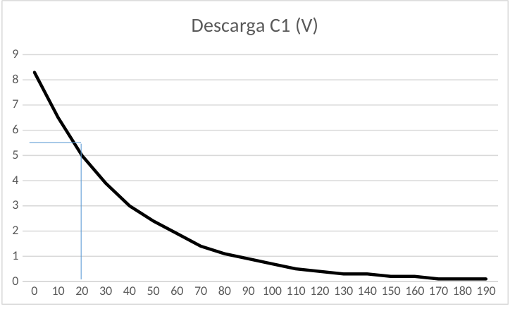

# Circuitos RC — informe del grupo 6: resultados de descarga C1

## Proceso de descarga (C1)

Datos:

Fuente de Alimentación CC: $`8{,}6\,\mathrm V`$.

Resistencia $`R_t:39000`$.

Capcidad $`C_t:1000\,\mu\mathrm F`$.

| Tiempo | Descarga C1 (V) | $`\mathrm{Vr}(t)=1-(\mathrm{Vt}/\mathrm{Vo})`$ | $`\mathrm{Ln}(\mathrm{Vr}(t))`$ |
| -- | -- | -- | -- |
| 0 | 8,3 | 0,035 | -3,356 |
| 10 | 6,5 | 0,244 | -1,410 |
| 20 | 5 | 0,419 | -0,871 |
| 30 | 3,9 | 0,547 | -0,604 |
| 40 | 3 | 0,651 | -0,429 |
| 50 | 2,4 | 0,721 | -0,327 |
| 60 | 1,9 | 0,779 | -0,250 |
| 70 | 1,4 | 0,837 | -0,178 |
| 80 | 1,1 | 0,872 | -0,137 |
| 90 | 0,9 | 0,895 | -0,111 |
| 100 | 0,7 | 0,919 | -0,085 |
| 110 | 0,5 | 0,942 | -0,060 |
| 120 | 0,4 | 0,953 | -0,048 |
| 130 | 0,3 | 0,965 | -0,036 |
| 140 | 0,3 | 0,965 | -0,036 |
| 150 | 0,2 | 0,977 | -0,024 |
| 160 | 0,2 | 0,977 | -0,024 |
| 170 | 0,1 | 0,988 | -0,012 |
| 180 | 0,1 | 0,988 | -0,012 |
| 190 | 0,1 | 0,988 | -0,012 |

## Determinación de La constante de Tiempo (Método Gráfico)


Aproximadamente la abscisa correspondiente a
$`V(t)=V*0{,}37=8{,}6*0{,}37=3{,}182\,\mathrm V`$.se encuentra en 40s.

```math
T_P\approx40\mathrm s.
```

```math
T_T=39\mathrm s
```

## Determinación de la Capacidad

```math
C=T/R\Rightarrow C=40\mathrm s/39000=1.10^{-3}\mathrm F.
```

```math
\Delta R=1950
```

```math
\Delta T=1\mathrm s
```

```math
\Delta C=\Delta T/R+(T*\Delta R)/R^2=1\mathrm s/39000+(39\mathrm s*1950)/(39000)^2=7{,}57*10^{-5}\mathrm F
```

```math
E\%=\Delta C/C*100=0{,}00000757\%
```

## Procedencia y observaciones

- Original: `2015/L3 Capacidad G6 Aprobado.pdf`, página 9 completa y tramo
  inicial de la 10, hasta el cálculo de E%. SHA-256:
  `586d5b26477b67b780929d52df3b218c54dca4ddfe6702e5f6e9d17b0ee5d320`.
- PyMuPDF4LLM y Poppler contrastados con las páginas renderizadas; cotejo de las
  20 filas, encabezados, expresiones y gráfica vectorial original.
- Se conserva «Capcidad» y se mantienen 5 y 3 de la tabla, distintos de 5,0 y
  3,0 de la hoja manuscrita. No se uniforman versiones ni redondeos.
- Se mantienen 40s para la determinación experimental y 39s en la sustitución de
  incertidumbre. El resultado E%=0,00000757% se transcribe tal como aparece, sin
  recomputarlo ni corregir su orden de magnitud.
- El exponente -5 de la incertidumbre se cotejó además en un recorte ampliado
  del PDF, ya que su signo es poco visible en el render reducido.
- Continúa
  [el resultado de carga](circuitos-rc-informe-grupo-6-resultados-carga-c1.md).
  El bloque «Proceso de Carga en Serie» de página 10 está transcrito por
  separado; no se duplica en este apunte.
- El año 2015 corresponde a la carpeta. No consta fecha impresa en este tramo.

## Navegación del informe

[Anterior](circuitos-rc-informe-grupo-6-resultados-carga-c1.md).
[Siguiente](circuitos-rc-informe-grupo-6-resultados-serie.md).

## Versión DOCX «A corregir 2»

Original: `2015/L3 Capacidad G6 A corregir 2.docx`, SHA-256
`a8e1063ebff8c151f9a7a2d6d5dcf798a13ef08c9282a61fdc5bd0985ab184ec`. Se cotejaron
la página 10 y el comienzo de la 11, hasta E%, del PDF normalizado con
LibreOffice de 15 páginas. No se incluye aquí el comienzo del proceso en serie.
Esta paginación corresponde a la copia de revisión.

Coinciden las 20 filas y cuatro columnas de la tabla de descarga, los datos de
la fuente de alimentación y la capacidad. El título «Proceso de descarga (C1)»
aparece en negrita, cursiva y subrayado. Se conserva «Capcidad». El DOCX agrega
la unidad literal ꭥ (U+AB65) a la resistencia:

```math
R_t:39000\,\text{ꭥ}
```

### Determinación de La constante de Tiempo (Método Gráfico)



La figura se conserva mediante un recorte de la representación de la gráfica
nativa del DOCX en LibreOffice. No se recalculan ni redibujan sus datos.

Aproximadamente la abscisa correspondiente a

```math
V(t)=V*0{,}63=8{,}6*0{,}63=5{,}41
```

se encuentra en 19s.

**Para la descarga corresponde el 37% , no el 63% (este valor es para la
carga)**

En el DOCX aparece en rojo y negrita el texto desde «a V(t)» hasta «19s.» y la
advertencia inmediatamente posterior. Se conservan la lectura de 63% y la
advertencia, sin aplicar una corrección silenciosa a los cálculos siguientes.

```math
T_P\approx19\mathrm s.
```

```math
T_T=39\mathrm s
```

### Determinación de la Capacidad

```math
C=T/R\Rightarrow C=19\mathrm s/(39000\text{ꭥ})=4{,}87.10^{-4}\mathrm F.
```

```math
\Delta R=1950\text{ꭥ}
```

```math
\Delta T=20\mathrm s
```

```math
\Delta C=\Delta T/R+(T*\Delta R)/R^2=20\mathrm s/(39000\text{ꭥ})+(19\mathrm s*1950\text{ꭥ})/(39000\text{ꭥ})^2=5{,}37.10^{-4}
```

```math
E\%=\Delta C/C*100=110{,}\,26\%
```

Se conserva el espacio tras la coma en «110, 26%», así como la ausencia de una
unidad final en la expresión de incertidumbre. Estos resultados pertenecen a la
versión a corregir; no sustituyen los valores del PDF aprobado que figuran
arriba ni se recomputan para hacerlos coincidir.
