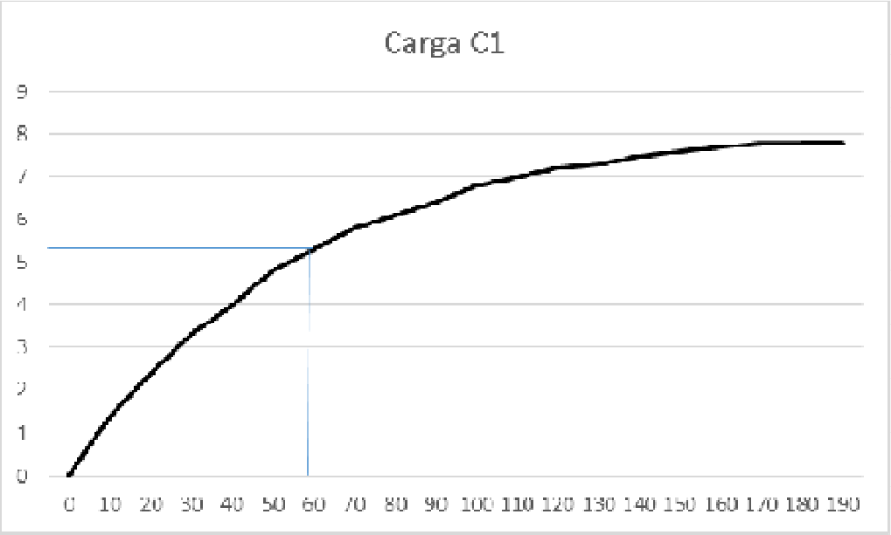
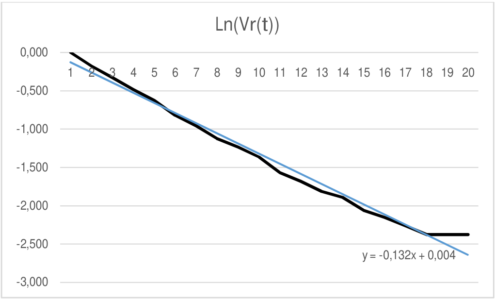

# Circuitos RC — informe del grupo 6: paralelo y conclusión

## Proceso de carga en Paralelo

Datos:

```math
\mathrm{C1}=1000\,\mu\mathrm F
```

```math
\mathrm{C2}=470\,\mu\mathrm F
```

```math
\mathrm{Ceq}=\mathrm{c1}+\mathrm{c2}=1470\,\mu\mathrm F
```

```math
T_T=R.\mathrm{Ceq}=39000*1470\,\mu\mathrm F=57{,}33\mathrm s.
```

| Tiempo | Carga C1 | $`\mathrm{Vr}(t)=1-(\mathrm{Vt}/\mathrm{Vo})`$ | $`\mathrm{Ln}(\mathrm{Vr}(t))`$ |
| -- | -- | -- | -- |
| 0 | 0 | 1,000 | 0,000 |
| 10 | 1,4 | 0,837 | -0,178 |
| 20 | 2,4 | 0,721 | -0,327 |
| 30 | 3,3 | 0,616 | -0,484 |
| 40 | 4 | 0,535 | -0,626 |
| 50 | 4,8 | 0,442 | -0,817 |
| 60 | 5,3 | 0,384 | -0,958 |
| 70 | 5,8 | 0,326 | -1,122 |
| 80 | 6,1 | 0,291 | -1,235 |
| 90 | 6,4 | 0,256 | -1,363 |
| 100 | 6,8 | 0,209 | -1,564 |
| 110 | 7 | 0,186 | -1,682 |
| 120 | 7,2 | 0,163 | -1,815 |
| 130 | 7,3 | 0,151 | -1,889 |
| 140 | 7,5 | 0,128 | -2,056 |
| 150 | 7,6 | 0,116 | -2,152 |
| 160 | 7,7 | 0,105 | -2,257 |
| 170 | 7,8 | 0,093 | -2,375 |
| 180 | 7,8 | 0,093 | -2,375 |
| 190 | 7,8 | 0,093 | -2,375 |

## Determinación de la Contante Tiempo (Método Gráfico)



Aproximadamente la abscisa correspondiente a
$`V(t)=V*0{,}63=8{,}6*0{,}63=5{,}41`$ se encuentra en 59 s.

```math
T_p\approx59\mathrm s.
```

```math
C=T/R\Rightarrow C=59\mathrm s/39000=1{,}51*10^{-3}\mathrm F
```

```math
\Delta R=1950
```

```math
\Delta T=1{,}67\mathrm s
```

```math
\Delta C=\Delta T/R+(T*\Delta R)/R^2=1{,}67\mathrm s/39000+(57{,}33\mathrm s*1950)/39000^2=1{,}16*10^{-4}\mathrm F
```

```math
E\%=\Delta C/C*100=(1{,}16*10^{-4}/1{,}51*10^{-3})*100=7{,}68\%
```



Rótulo del ajuste en la gráfica:

```math
y=-0{,}132x+0{,}004
```

```math
m=-1/(R*C)\Rightarrow C=-1/(R*m)=-1/(39000*-0{,}1321)=1{,}94*10^{-4}\mathrm F
```

## Conclusión

Después de realizar una serie de mediciones sobre los circuitos RC, podemos
verificar que la carga de condensadores en serie es más rápida que la carga en
paralelo. También sucede que el condensador se descarga con mayor velocidad que
al cargarse el mismo.

Además, pudimos comprobar que, al descargarse, la carga del condensador nunca se
anula en su totalidad.

## Procedencia y observaciones

- Original: `2015/L3 Capacidad G6 Aprobado.pdf`, página 12 desde «Proceso de
  carga en Paralelo» y páginas 13–14 completas, con la omisión de la marca de
  calificación al final. SHA-256:
  `586d5b26477b67b780929d52df3b218c54dca4ddfe6702e5f6e9d17b0ee5d320`.
- PyMuPDF4LLM contrastado con Poppler y todas las páginas del tramo
  renderizadas. Cotejo visual de las 20 filas, cada fórmula, ambas gráficas
  originales y la conclusión completa. La primera gráfica está dividida en
  bandas de imagen en el PDF; se conserva renderizando su rectángulo completo.
- Se conserva «Contante», C1 como título de la columna y de la gráfica, c1/c2 en
  la suma, 57,33s en la incertidumbre frente a 59s en la determinación
  experimental y todos los redondeos de la tabla.
- Se preservan las abscisas 1–20 del ajuste, -0,132 de su rótulo y -0,1321 del
  cálculo. Las expresiones con barras y asteriscos conservan su forma original;
  no se recalculan ni se corrigen resultados.
- La conclusión se transcribe como declaración de sus autores, sin añadir
  resultados ni sustituirla por una interpretación nueva.
- Continúa
  [la asociación en serie](circuitos-rc-informe-grupo-6-resultados-serie.md). La
  primera fórmula de página 12 corresponde a ese apunte y no se duplica aquí.
- El año 2015 corresponde a la carpeta. La fecha verificable de la hoja de datos
  del mismo informe es 19/05/2016; estas páginas no tienen fecha impresa.

## Navegación del informe

[Anterior](circuitos-rc-informe-grupo-6-resultados-serie.md).

## Versión DOCX «A corregir 2»

Original: `2015/L3 Capacidad G6 A corregir 2.docx`, SHA-256
`a8e1063ebff8c151f9a7a2d6d5dcf798a13ef08c9282a61fdc5bd0985ab184ec`.

Se cotejó desde «Proceso de carga en Paralelo» de la página 13 hasta el final de
la 15 del PDF normalizado con LibreOffice de 15 páginas. La paginación pertenece
a esa copia de revisión. Coinciden los datos de C1/C2/Ceq, las 20 filas y cuatro
columnas de la tabla, la lectura de 59s, la incertidumbre de 1,67s, el error de
7,68% y ambos párrafos completos de la conclusión. Se conservan «Contante»,
Carga C1 como encabezado y los ceros finales. El título del proceso aparece en
negrita, cursiva y subrayado; el DOCX no contiene la marca final «APROBADO» del
PDF.

Las expresiones siguientes añaden la unidad literal ꭥ (U+AB65); pertenecen al
DOCX y no sustituyen las expresiones del PDF aprobado. Se conservan las barras,
asteriscos y la posición del exponente del denominador de incertidumbre:

```math
T_T=R.C_{\mathrm{eq}}=39000\text{ꭥ}*1470\,\mu\mathrm F=57{,}33\mathrm s.
```

```math
C=T/R\Rightarrow C=59\mathrm s/(39000\text{ꭥ})=1{,}51*10^{-3}\mathrm F
```

```math
\Delta R=1950\text{ꭥ}
```

```math
\Delta C=\Delta T/R+(T*\Delta R)/R^2=1{,}67\mathrm s/(39000\text{ꭥ})+(57{,}33\mathrm s*1950\text{ꭥ})/39000\text{ꭥ}^2=1{,}16*10^{-4}\mathrm F
```

```math
m=-1/(R*C)\Rightarrow C=-1/(R*m)=-1/(39000\text{ꭥ}*-0{,}1321)=1{,}94*10^{-4}\mathrm F
```

La primera gráfica es la imagen incorporada `image42.png`, con tiempos 0–190 y
auxiliares azules; se cotejó con la figura conservada del PDF aprobado. La
segunda es una gráfica nativa con 20 valores en su caché XML, categorías
ordinales 1–20 y formato vertical `0.000`. Su ajuste lineal tiene rótulo
dinámico `General`: LibreOffice muestra «f(x) = −0.132113765284121 x +
0.00466195699632555». Ese texto describe la representación de la copia
normalizada, no una ecuación literal fija del DOCX ni un reemplazo del rótulo
que consta en el PDF aprobado. No se recalculan los resultados.
