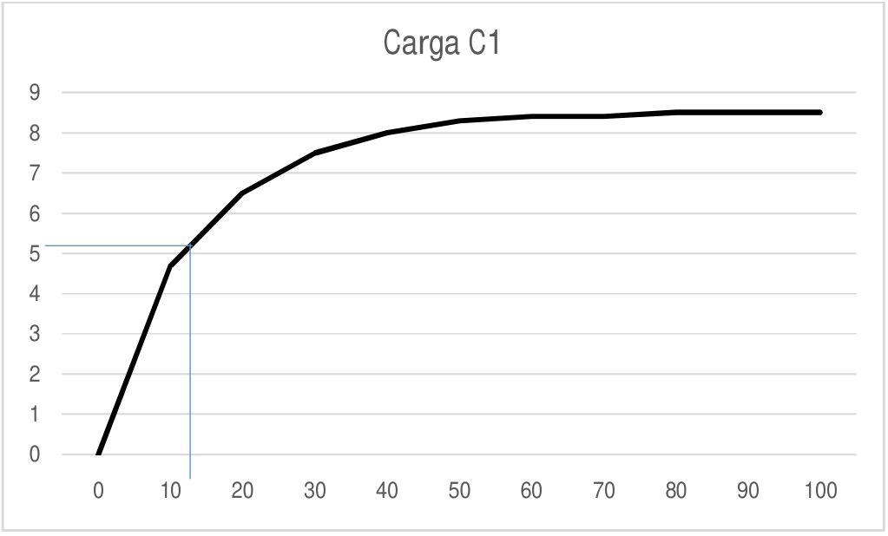
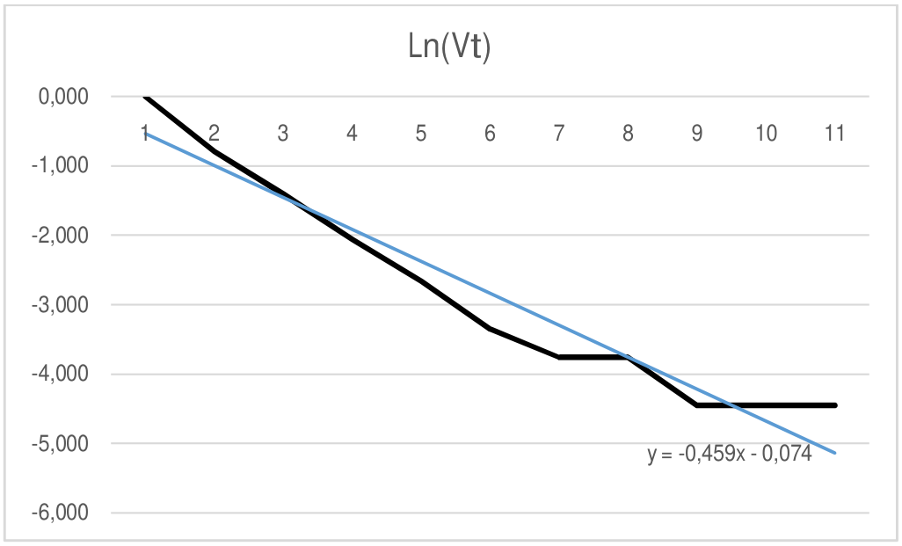

# Circuitos RC — informe del grupo 6: resultados de carga en serie

## Proceso de Carga en Serie

Datos

```math
\mathrm{C1}=1000\,\mu\mathrm F
```

```math
\mathrm{C2}=470\,\mu\mathrm F
```

```math
\mathrm{Ceq}=(1/\mathrm{c1}+1/\mathrm{c2}=)^{-1}=319{,}7\,\mu\mathrm F
```

```math
T_T=R.\mathrm{Ceq}=39000*319{,}7\,\mu\mathrm F=12{,}46\mathrm s.
```

| Tiempo | Carga C1 | $`\mathrm{Vr}(t)=1-\mathrm{Vt}/\mathrm{Vo}`$ | $`\mathrm{Ln}(\mathrm{Vt})`$ |
| -- | -- | -- | -- |
| 0 | 0 | 1 | 0,000 |
| 10 | 4,7 | 0,453 | -0,791 |
| 20 | 6,5 | 0,244 | -1,410 |
| 30 | 7,5 | 0,128 | -2,056 |
| 40 | 8 | 0,070 | -2,663 |
| 50 | 8,3 | 0,035 | -3,356 |
| 60 | 8,4 | 0,023 | -3,761 |
| 70 | 8,4 | 0,023 | -3,761 |
| 80 | 8,5 | 0,012 | -4,454 |
| 90 | 8,5 | 0,012 | -4,454 |
| 100 | 8,5 | 0,012 | -4,454 |

## Determinación de la constante tiempo (Método Gráfico)



Aproximadamente la abscisa correspondiente a
$`V(t)=V*0{,}63=8{,}6*0{,}63=5{,}41`$ se encuentra en 13s.

```math
T_P\approx13\mathrm s.
```

```math
C=T_p/R\Rightarrow C=13\mathrm s/39000=3{,}3*10^{-4}\mathrm F
```

```math
\Delta T=0{,}54\mathrm s.
```

```math
\Delta R=1950
```

```math
\Delta C=\Delta T/R+(T*\Delta R)/R^2=0.54\mathrm s/39000+(13\mathrm s*1950)/(39000)^2=30{,}5\,\mu\mathrm F
```

```math
E\%=\Delta C/C*100=23{,}46\%
```



Rótulo del ajuste en la gráfica:

```math
y=-0{,}459x-0{,}074
```

```math
m=-1/(R*C)\Rightarrow C=-1/(R*m)=-1/(39000*-0{,}4597)=5{,}57*10^{-5}\mathrm F
```

## Procedencia y observaciones

- Original: `2015/L3 Capacidad G6 Aprobado.pdf`, desde «Proceso de Carga en
  Serie» en página 10, página 11 completa y primera fórmula de página 12.
  SHA-256: `586d5b26477b67b780929d52df3b218c54dca4ddfe6702e5f6e9d17b0ee5d320`.
- PyMuPDF4LLM contrastado con Poppler y las páginas renderizadas; cotejo de las
  11 filas, fórmulas y ambas gráficas vectoriales originales.
- Se conserva el signo igual adicional dentro del paréntesis de Ceq. Los datos
  usan C1/C2, su fórmula c1/c2 y la tabla «Carga C1», aunque el bloque se titule
  carga en serie. No se uniforman los rótulos.
- La tabla y la gráfica dicen Ln(Vt), no Ln(Vr(t)); se mantienen. Las abscisas
  del ajuste van de 1 a 11; no se sustituyen por tiempos.
- Se conservan 0,54 de la línea de incertidumbre y 0.54 en su sustitución;
  también 30,5 µF, 23,46% y las pendientes -0,459 de la figura frente a -0,4597
  del cálculo. No se recalculan ni corrigen resultados.
- Continúa
  [la descarga C1](circuitos-rc-informe-grupo-6-resultados-descarga-c1.md). La
  página 10 se comparte sin duplicar el bloque de descarga. El bloque paralelo
  de página 12 y las páginas 13–14 están transcritos en el siguiente apunte.
- El año 2015 corresponde a la carpeta; no consta fecha impresa en este tramo.

## Navegación del informe

[Anterior](circuitos-rc-informe-grupo-6-resultados-descarga-c1.md).
[Siguiente](circuitos-rc-informe-grupo-6-resultados-paralelo-conclusion.md).
