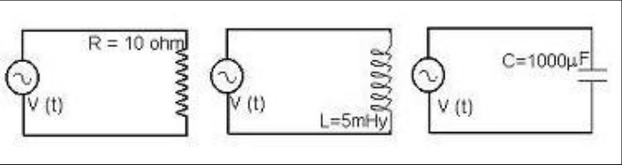
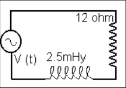
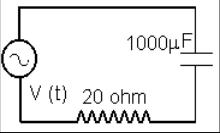
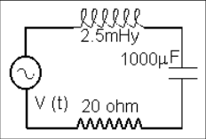
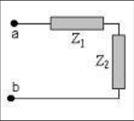
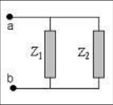
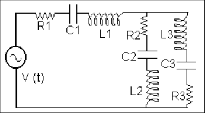

# Guía de problemas: corriente alterna

Fuente: `2015/GUIA DE PROBLEMAS PROPUESTOS 2da parte.pdf`, sección de páginas
10–11 de 13. SHA-256:
`e2452f4b287c4401d9902c425f82a9caaab0bb7dd7c877c724934eb2bed5a9fa`.

Extracción pdftotext y cotejo visual de ambas páginas; fórmulas de valor eficaz
recuperadas desde el original. Diez preguntas, ocho problemas y siete figuras,
la primera con tres circuitos.

## Cuestionario

**1.** Corriente alterna y sinusoidal son lo mismo?.¿Cuál es el valor medio de
una sinusoidal ?.

**2.** Demuestre que si
$`i(t)=I_o\mathop{\mathrm{sen}}\nolimits(\omega t+\phi)`$ entonces el valor
eficaz es $`I_{ef}=I_o/\sqrt2`$.

**3.** Es necesario que i(t) sea sinusoidal para que su valor eficaz
$`I_o/\sqrt2`$ ?.¿La recíproca es válida ?

**4.** ¿Qué significa físicamente el valor eficaz de la corriente alterna?.

**5.** ¿Qué interpretación y unidades se le asigna la impedancia?. Escriba la
impedancia para un circuito serie : a) RC; b) RL; c) CL ; d) RLC. Demuestre que
la unidad de XL y XC es el ohm.

**6.** ¿Qué significa que la corriente se atrasa con respecto a la diferencia de
potencial en una inductancia y se adelanta respecto a la diferencia de potencial
en un capacitor?

**7.** Haga un diagrama vectorial de las diferencias de potencial para un
circuito serie RLC: a) inductivo; b) capacitivo.

**8.** Para un circuito serie a RLC determine la frecuencia de resonancia.

**9.** En un circuito de CA se tiene dos impedancia $`Z_1`$ y $`Z_2`$ : a) en
serie; b) en paralelo; en cada caso obtenga la expresión de la impedancia
equivalente $`Z_e`$.

**10.** ¿Qué importancia tiene el factor de potencia?.

## Problemas

### Problema 1

En los circuitos de la figura 1P se emplea la misma fuente
$`V(t)=V_o\cos(2\pi ft)`$, donde Vo =20 V y f = 50 Hz. Determine, en cada caso,
la corriente del circuito y haga una representación gráfica de V(t) e i(t) y
analice el desfasaje entre ellas.

### Problema 2

Determine la corriente del circuito y diferencia de potencial sobre el elemento
inductivo, cuando está alimentado por una $`V(t)=20\cos(2\pi ft)`$, con f = 50
Hz. Figura 2P

### Problema 3

Determine la corriente del circuito y diferencia de potencial sobre el elemento
capacitivo, cuando está alimentado por una $`V(t)=20\cos(2\pi ft)`$, con f = 50
Hz. Figura 3P

### Problema 4

Para el circuito de la figura 4P calcule: a)las reactancias inductivas y
capacitivas, b) la impedancia, c) la corriente y su desfasaje con la fem de la
fuente, d) la diferencia de potencial sobre cada elemento, e) las potencias
activa y reactiva del circuito, f) la frecuencia de resonancia. La expresión de
$`V(t)=20\cos(2\pi ft)`$ con f = 50 Hz.

### Problema 5

Con las siguientes mediciones de valores eficaces de $`V_L`$ = 8V, $`V_C`$ = 4V,
e i =3 A y la fem de la fuente de 5 V y con una frecuencia de 250 Hz, se desea
conocer los elementos R, L y C que están conectados en serie y además el
desfasaje correspondiente

### Problema 6

Estudie la variación de la corriente del circuito RLC serie en función de la
frecuencia. Emplee los elementos de circuito del problema 3.

### Problema 7

Para los circuitos de las figuras 5P y 6P determine la impedancia equivalente si
$`Z_1=(10+6i)\,\Omega`$ y $`Z_2=(8-4i)\,\Omega`$

### Problema 8

En el circuito de la figura determine la diferencia de potencial sobre la
capacidad $`C_1`$. La fem $`V(t)=100\cos(2\pi ft)`$ con f = 50Hz (ver figura 7P)

Datos impresos en el original:

- $`f:=50\cdot\mathrm{Hz}`$
- $`R_1:=10\cdot\mathrm{ohm}`$, $`R_2:=15\cdot\mathrm{ohm}`$,
  $`R_3:=20\cdot\mathrm{ohm}`$
- $`L_1:=0.01\cdot\mathrm{henry}`$, $`L_2:=0.02\cdot\mathrm{henry}`$,
  $`L_3:=0.015\cdot\mathrm{henry}`$
- $`C_1:=50\cdot\mu\mathrm F`$, $`C_2:=150\cdot\mu\mathrm F`$,
  $`C_3:=100\cdot\mu\mathrm F`$
- $`\omega:=2\cdot\pi\cdot f`$, $`\omega=314.159\,\mathrm{s^{-1}}`$

## Observaciones de fidelidad

- La pregunta 3 imprime el cociente sin signo igual ni verbo adicional; se
  conserva.
- El problema 6 remite a elementos del problema 3; no se cambia esa referencia
  por otro circuito.
- Los datos y el valor de ω del problema 8 están impresos; se transcriben sin
  calcular soluciones.
