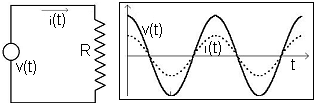
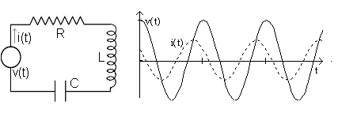
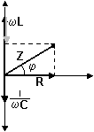
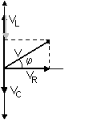
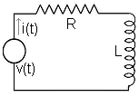
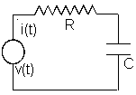
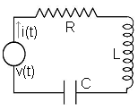
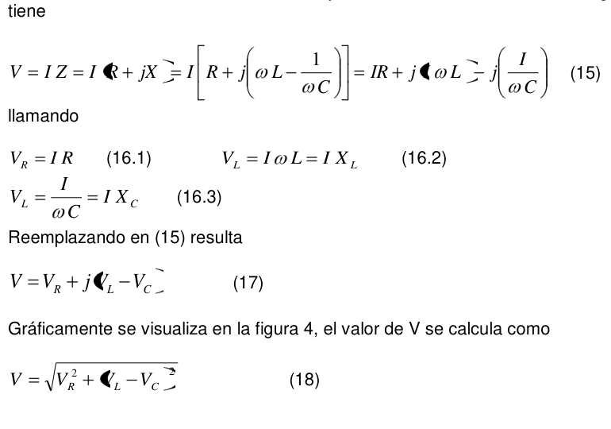

# Trabajo de laboratorio Nº 10: Circuito de corriente alterna - serie

Universidad Tecnologica Nacional. Facultad Regional Resistencia. Cátedra: Física
II.

TEMA: CIRCUITO DE CORRIENTE ALTERNA - SERIE

## Objetivo

- Estudiar los circuitos en serie RL, RC y RCL en corriente alterna
- Aplicación al cálculo de L y C

## Fundamentos teoricos

Cuando a los bornes de una resistencia óhmica se aplica una diferencia de
potencial alterna, $`v(t)=V_m\cos(\omega t)`$, la intensidad de la corriente que
se origina se deduce a partir de la ley de Ohm. Se tiene

```math
i(t)=\frac{v(t)}{R}=\frac{V_m}{R}\cos(\omega t) \tag{1}
```

la intensidad que resulta varía armónicamente con el tiempo, como muestra la
figura 1, con la misma frecuencia que el potencial aplicado, y su valor máximo
vale

```math
i_m=\frac{V_m}{R} \tag{2}
```



Por lo tanto, cuando un circuito solo contiene resistencia óhmica, la intensidad
de la corriente no presenta diferencia de fase respecto del potencial aplicado
que la origina (figura l).

En general, en los circuitos de corriente alterna figuran otros elementos junto
a las resistencias óhmicas. Si existen conectados en serie una resistencia R,
una bobina con autoinducción L y un condensador con capacidad C.

Al aplicar una diferencia de potencial alterno a los bornes de dicho circuito en
serie se establece, una vez desaparecidos los efectos transitorios de corta
duración, una corriente permanente, que viene expresada por

```math
i(t)=I_o\cos(\omega t+\varphi) \tag{3}
```



en la que se pone claramente de manifiesto que la frecuencia angular
$`\omega=2\pi f'`$ de la intensidad es la misma que la correspondiente al
potencial, pero que la intensidad está desfasada en un ángulo $`\varphi`$
(ángulo de fase) respecto del potencial.

Los valores instantáneos de una intensidad de corriente o de la diferencia de
potencial alterno varían de un modo continuo desde un valor máximo en un
sentido, pasando por cero hasta un valor mínimo en el sentido opuesto y así,
sucesivamente el comportamiento de un determinado circuito en serie queda
expresado por los valores máximo de intensidad y del potencial (pero es mucho
más interesante estudiar los circuitos do corriente alterna en función de los
valoras eficaces $`I_{ef}`$ y $`V_{ef}`$ en lugar de los valores máximos. La
razón es que los valores que se miden con los instrumentos voltímetros y
amperímetros de c. a. son precisamente los eficaces.

La intensidad eficaz de una corriente alterna se define como el valor de la
intensidad de una corriente continua que desarrolla la misma cantidad de calor
en el mismo tiempo y en la misma resistencia. se demuestra que

```math
I_{ef}=\frac{I_m}{\sqrt2} \tag{4}
```

análogamente

```math
V_{ef}=\frac{V_m}{\sqrt2} \tag{5}
```

De ahora en adelante, se interpretará que las letras I y V sin subíndices hacen
referencia a los valores eficaces de las magnitudes correspondientes.

La intensidad máxima $`I_m`$ está relacionada con el potencial máximo $`V_m`$
por una expresión que tiene la misma forma que la que expresa la ley de Ohm para
corriente continua.

```math
I_m=\frac{V_m}{Z} \tag{7}
```

Denominándose la magnitud Z **impedancia** del circuito, que corresponde a la
resistencia R de la ley de Ohm en corriente continua. Para los valores eficaces
será

```math
I=\frac{V}{Z} \tag{8}
```

La relaci6n que existo entre la impedancia Z del circuito en serie RLC y las
características R, L y C de los tres elementos considerados es

```math
|Z|=\sqrt{R^2+\left(\omega L-\frac1{\omega C}\right)^2} \tag{9}
```

introduciendo las siguientes simplificaciones

```math
X_L=\omega L\qquad X_C=\frac1{\omega C}\qquad X=X_L-X_C \tag{10}
```

se escribe

```math
|Z|=\sqrt{R^2+X^2} \tag{11}
```

El ángulo de desfase $`\varphi`$ viene dado por

```math
\varphi=\mathop{\mathrm{arctg}}\nolimits\left(\frac XR\right) \tag{12}
```

La magnitud X recibe el nombre de reactancia, $`X_L`$ y $`X_C`$ son la
reactancia inductiva y capacitiva respectivamente. La impedancia y todas las
reactancias se miden en ohm.

La impedancia se puede escribir en forma de número complejo, esto es

```math
Z=R+jX=R+j\left(\omega L-\frac1{\omega C}\right) \tag{13}
```

o bien

```math
Z=|Z|e^{j\varphi}=|Z|(\cos\varphi+j\mathop{\mathrm{sen}}\nolimits\varphi) \tag{14}
```

En la figura 3 se hace una representación vectorial de (13), sobre el eje
horizontal se grafica la componente real ( resistencia) y sobre el eje vertical
la componente imaginaria ( reactancia total, de acuerdo con su signo, las
reactancia inductiva y capacitiva )



Si se analizan las diferencia de potencial sobre el circuito de la figura 2, se
tiene

```math
V=IZ=I(R+jX)=I\left[R+j\left(\omega L-\frac1{\omega C}\right)\right]=IR+jI\omega L-j\left(\frac I{\omega C}\right) \tag{15}
```

llamando

```math
V_R=IR \tag{16.1}
```

```math
V_L=I\omega L=IX_L \tag{16.2}
```

```math
V_L=\frac I{\omega C}=IX_C \tag{16.3}
```

Reemplazando en (15) resulta

```math
V=V_R+j(V_L-V_C) \tag{17}
```

Gráficamente se visualiza en la figura 4, el valor de V se calcula como

```math
V=\sqrt{V_R^2+(V_L-V_C)^2} \tag{18}
```



## Técnica operativa

### 1.- Circuito serie RL



1. Mida con el óhmetro la resistencia R del resistor suministrado. Anote el
   valor obtenido.
1. Mida con el óhmetro la resistencia óhmica de la bobina $`R_L`$. Anote el
   valor obtenido y registre también el valor de la inductancia L.
1. Arme el circuito de la figura 4. Conecte la fuente previa autorización del
   JPT.
1. Mida el valor de la corriente con el amperímetro I.
1. Con el voltímetro mídase las diferencias de potencial entre los bornes de la
   resistencia $`V_R`$, de la inductancia $`V_L`$ y del conjunto V. Anótese los
   resultados
1. Calcule la impedancia del circuito empleando la expresión $`Z=V/I`$
1. Con el valor de impedancia calcular la inductancia L de la bobina.
1. Calcular el ángulo de desfase $`\varphi`$ entre la diferencia de potencial y
   la corriente.
1. Dibujar los diagramas vectoriales de impedancia y de diferencia de potencial.
1. Compare el valor experimental de L con el registrado en 2.

### 2.- Circuito serie RC



1. Mida con el óhmetro la resistencia R del resistor suministrado. Anote el
   valor obtenido.
1. Registre el valor de la capacidad C del condensador empleado
1. Arme el circuito de la figura 5. Conecte la fuente previa autorización del
   JPT.
1. Mida el valor de la corriente con el amperímetro I.
1. Con el voltímetro mídase las diferencias de potencial entre los extremos de
   la resistencia $`V_R`$, del condensador $`V_C`$ y del conjunto V. Anótese los
   resultados
1. Calcule la impedancia del circuito empleando la expresión $`Z=V/I`$
1. Empleando la expresión (9) calcular la impedancia del circuito.
1. Con el valor de impedancia calcular la capacidad C del condensador.
1. Calcular el ángulo de desfase $`\varphi`$ entre la diferencia de potencial y
   la corriente.
1. Dibujar los diagramas vectoriales de impedancia y de diferencia de potencial.
1. Compare el valor experimental de C con el registrado en 2.

### 3.- Circuito serie RLC



1. Arme el circuito de la figura 6. Conecte la fuente previa autorización del
   JPT.
1. Mida el valor de la corriente con el amperímetro I.
1. Con el voltímetro mídase las diferencias de potencial entre los extremos de
   la resistencia, $`V_R`$, del condensador, $`V_C`$ y de la inductancia $`V_L`$
   y del conjunto V. Anótese los resultados
1. Calcule los valores de R, L y C. Determine a partir de estos Z.
1. Calcule el modulo de la impedancia del circuito empleando la expresión
   $`Z=V/I`$
1. Calcular el ángulo de desfase $`\varphi`$ entre la diferencia de potencial y
   la corriente.
1. Dibujar los diagramas vectoriales de impedancia y de diferencia de potencial.
1. Compare los valores obtenidos experimentalmente con los calculados.

## Trabajo de laboratorio Nº 10: Hoja de datos

TEMA: CIRCUITO DE CORRIENTE ALTERNA -SERIE

OBJETIVO:

- Estudiar los circuitos en serie RL, RC y RCL en corriente alterna
- Aplicación al cálculo de L y C

<table>
<tr><th rowspan="5">CURSO</th><th rowspan="5">FECHA</th><th>INTEGRANTES</th></tr>
<tr><td>1.-</td></tr>
<tr><td>2.-</td></tr>
<tr><td>3.-</td></tr>
<tr><td>4.-</td></tr>
</table>

### 1.- Circuito serie RL: datos

```math
\omega=2\pi f=
```

$`R=`$  $`R_L=`$  $`I=`$  $`V_R=`$  $`V_L=`$  $`V=`$

Valores calculados

```math
R_T=R+R_L=
```

```math
Z=V/I=
```

```math
L=\frac{\sqrt{Z^2-R_T^2}}\omega=
```

```math
\varphi=\arctan\left(\frac{V_L}{V_R}\right)=
```

Dibujar los diagramas vectoriales de impedancia y de diferencia de potencial en
un papel milimetrado, en una escala adecuada.

### 2.- Circuito serie RC: datos

```math
\omega=2\pi f=
```

$`R=`$  $`I=`$  $`V_R=`$  $`V_C=`$  $`V=`$

Valores calculados

```math
Z=V/I=
```

```math
C=\frac1{\omega\sqrt{Z^2-R^2}}=
```

```math
\varphi=\arctan\left(\frac{V_C}{V_R}\right)=
```

Dibujar los diagramas vectoriales de impedancia y de diferencia de potencial en
un papel milimetrado, en una escala adecuada.

### 3.- Circuito serie RLC: datos

```math
\omega=2\pi f=
```

$`R=`$  $`I=`$  $`V_R=`$  $`V_C=`$  $`V_L=`$  $`V=`$

Valores calculados

```math
Z=V/I=
```

```math
R=\frac{V_C}I=
```

```math
L=\frac{V_L}{\omega I}=
```

```math
C=\frac I{\omega V_C}=
```

```math
\varphi=\arctan\left(\frac{V_L-V_C}{V_R}\right)=
```

Dibujar los diagramas vectoriales de impedancia y de diferencia de potencial en
un papel milimetrado, en una escala adecuada.

## Procedencia y transcripción

Fuente: `2015/FISICA II - EXPERIENCIAS DE LABORATORIOS.pdf`, páginas 58–64,
cotejadas completas. Se conservan siete figuras (incluidos rótulos repetidos),
los 10 pasos de RL, 11 de RC y 8 de RLC, y la hoja de datos de dos páginas sin
completar. Véase [el inventario de fuentes](../../../resources/2015/fuentes.md).

Se mantienen RCL en los objetivos, el salto de numeración (5) a (7), «relaci6n
que existo», el subíndice L en el miembro izquierdo de (16.3), la fórmula R =
VC/I de la última hoja y el signo positivo del ángulo de RC. No se aplican
correcciones físicas. Las figuras de potenciales y RL comparten Nº4; RC y RLC
comparten Nº5, aunque el texto llama figura6 al circuito RLC.

En (15), (17) y (18), delimitadores del PDF se superponen sobre símbolos. Los
componentes VL y VC constan en la capa textual y se cotejaron con la expresión y
figura de potenciales; se conserva el recorte original como evidencia del
defecto gráfico, junto con la transcripción matemática:


