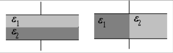
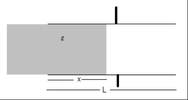

# Dieléctricos: guía identificada como 2011

Fuente: `2015/guia de problemas 2011.pdf`, páginas 14–15 de 31. SHA-256:
`5a5ae8ac33a7a3d14d854623015ef14bc0af3dae1651c013aed06567e28a8bca`.

Extracción pdftotext y cotejo visual de ambas páginas, con ampliación de
símbolos bitmap. Doce preguntas, once problemas y dos figuras, la primera con
dos disposiciones. El año 2011 pertenece al nombre del archivo.

## Cuestionario

**1.** ¿Cuál es la diferencia entre un conductor y un dieléctrico? ¿Y cuando se
sumergen en un campo eléctrico?

**2.** En el caso de un dieléctrico con dipolos eléctricos permanentes, la
presencia de un campo eléctrico ¿qué provoca?

**3.** En un campo eléctrico no uniforme un cuerpo dieléctrico, sin exceso de
carga, experimenta una fuerza neta ¿por qué?

**4.** ¿Cómo se define el vector polarización? ¿Qué relación tiene con el campo
eléctrico aplicado en un dieléctrico?

**5.** ¿Qué representa la componente normal de P a la superficie del
dieléctrico?

**6.** ¿Qué son las cargas de polarización?

**7.** ¿Cómo se define el vector desplazamiento eléctrico D? ¿Qué representa su
componente normal?

**8.** ¿Cómo se encuentra la relación $`\vec D=\varepsilon_o\vec E+\vec P`$ ?.
Indique cuáles son los argumentos que usa.

**9.** Si se tiene en cuenta la relación de la pregunta 5 ¿Cómo puede escribirse
D?

**10.** ¿Cuál sería la permitividad eléctrica del medio? ¿y la relativa? ¿es
siempre mayor que 1?

**11.** Explique porqué un dieléctrico aumenta el valor de la diferencia de
potencial de operación de un condensador sin cambiar la geometría del mismo.

**12.** Describa un condensador electrolítico

## Problemas

### Problema 1

Una placa plana de dieléctrico ($`\varepsilon_r`$ = 5) es colocada perpendicular
a un campo uniforme con una intensidad de E = 1N/C. Si la placa ocupa un volumen
de 0.1 $`\mathrm{m^3}`$ y está uniformemente polarizada. Determine la intensidad
del vector polarización en la placa y el momento dipolar total de la placa.

### Problema 2

Una placa delgada de material ($`\varepsilon_r`$ = 4) es colocada perpendicular
a un campo eléctrico uniforme. Si la densidad superficial de carga de
polarización es $`\sigma_P=0.5\,\mathrm{C/m^2}`$, determine a) La intensidad del
vector polarización b) La intensidad del vector desplazamiento D en la placa y
fuera de ella c) La intensidad del campo eléctrico E en la placa y fuera de
ella.

### Problema 3

Un condensador de placas paralelas dispuesto horizontalmente se llena la mitad
derecha con un dieléctrico de permitividad $`\varepsilon`$ mientras que la mitad
izquierda se llena con aire ($`\varepsilon_o`$). La separación entre las placas
es d = 10 mm y está a una diferencia de potencial de 100 voltios. Hallar E, D y
P en ambas mitades, suponer que $`\varepsilon=3\varepsilon_o`$.

### Problema 4

Un condensador de placas paralelas dispuesto horizontalmente tiene una
separación entre las placas igual a 10 mm y está a una diferencia de potencial
de 100 voltios. En su interior hay un dieléctrico de permitividad
$`\varepsilon`$ y con un espesor igual a 5 mm apoyado en la placa inferior. El
espacio de arriba está lleno de aire. a) Determine el valor de E, D y P en el
espacio lleno de aire y en el medio dieléctrico. b) Hallar la diferencia de
potencial como una función de la distancia entre las placas. Suponer que
$`\varepsilon=3\varepsilon_o`$.

### Problema 5

¿Cuál es la intensidad de E, D y P a una distancia r = 100 mm de una carga
puntual de Q = 1 $`\mu\mathrm C`$ en un medio infinito de a) aire. b) un
dieléctrico con que $`\varepsilon_r`$ = 9 ? .

### Problema 6

Una carga puntual (q =1 $`\mu\mathrm C`$) está en el centro de una esfera
dieléctrica ($`\varepsilon_r`$ = 9) de radio R = 1cm, la que a su vez se halla
rodeada por otro medio dieléctrico ($`\varepsilon_r`$ = 4). Determine la
intensidad de E, D y P para $`r\lt R`$ y $`r\gt R`$.

### Problema 7

En un condensador de placas paralelas se colocan dos medios dieléctricos
($`\varepsilon_1`$ y $`\varepsilon_2`$) como muestra la figura 1P. Determine el
valor de la capacidad en cada caso.

Figura 1P.

### Problema 8

Si se tiene un mol de tetracloruro de carbono – $`\mathrm{CCl}_4`$ -
($`\varepsilon_r`$ = 2.24 a 20 ºC, $`\delta`$ = 1.6 $`\mathrm{g/cm^3}`$) en un
campo eléctrico de $`10^7`$ V/m. a) Determine el momento dipolar eléctrico de
una molécula simple. b) Calcule la distancia media entre los centros de cargas.

### Problema 9

La molécula de agua tiene un momento dipolar permanente p = $`6.2\cdot10^{-30}`$
C.m. a) Determine la distancia media entre los centros de cargas b) Si se tiene
$`10^{-3}`$mol de agua con todos sus dipolos orientados en la dirección del
campo eléctrico de intensidad E= $`3\cdot10^5`$ N/C. ¿Cuál es el trabajo
necesario para rotar los dipolos 90º?

### Problema 10

Un cable coaxial tiene un conductor externo de diámetro interno 0.9 cm y está
lleno de polietileno ($`\varepsilon_r`$ = 2.2) ¿Cuál es el diámetro del
conductor interno?

### Problema 11

En un condensador plano de placas cuadradas de lado L y separación d, se
introduce una placa de dieléctrico de constante $`\varepsilon`$ una distancia x
dentro del mismo. Como muestra la figura 2P. a) Encuentre la capacidad
equivalente. b) Calcule la energía almacenada en el condensador si la diferencia
de potencial es V. c) Encuentre la magnitud y sentido de la fuerza ejercida
sobre el dieléctrico, suponiendo que la diferencia de potencia se mantuvo
constante y no se tiene en cuenta los efectos de los extremos.

Figura 2P.

## Observaciones de fidelidad

- Se recuperan ε, μ, σ y la ecuación vectorial de la pregunta 8, ausentes o
  incompletas en el texto extraído.
- El problema 10 no proporciona una capacidad por unidad de longitud; no se
  añade el dato de otra versión.
- Se conserva «diferencia de potencia» del problema 11. Los datos y las figuras
  no se armonizan ni se resuelven ejercicios.
