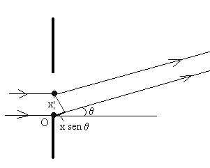
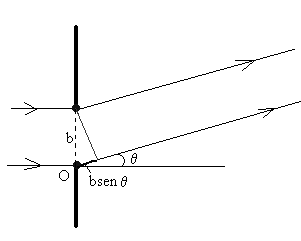
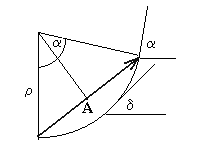
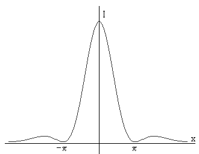
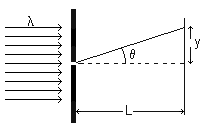
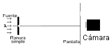

<!-- markdownlint-disable MD060 -->

# Trabajo práctico Nº 13: Estudio del fenómeno de difracción

Universidad Tecnologica Nacional. Facultad Regional Resistencia. Cátedra: Física
II.

TEMA: ESTUDIO DEL FENÓMENO DE DIFRACCIÓN

## Objeto de la experiencia

Estudiar el fenómeno de difracción de la luz por una rendija

Determinación del patrón de difracción producido por una rendija.

## Consideraciones teóricas

La difracción es junto con la interferencia un fenómeno típicamente ondulatorio.
La difracción se observa cuando se distorsiona un frente de onda por un
obstáculo cuyas dimensiones son comparables a la longitud de onda.

### Difracción por una rendija

El caso más sencillo corresponde a la difracción Fraunhofer, donde el obstáculo
es una rendija estrecha y larga, de modo que podemos ignorar los efectos de los
extremos del obstáculo. Supondremos que las ondas incidentes son normales al
plano de la rendija, y que el observador se encuentra a una distancia grande en
comparación con la anchura de la misma.





Sea b el ancho de la rendija, y consideremos que las infinitas fuentes
secundarias de ondas están distribuidas a lo largo de la rendija.

- La diferencia de caminos entre la fuente de la fuente secundaria ubicada el
  origen O y la que está en el punto x es,
  $`x\mathop{\mathrm{sen}}\nolimits\theta`$.
- La diferencia de caminos entre la fuente situada en el origen y la situada en
  el otro extremo de la rendija será
  $`b\cdot\mathop{\mathrm{sen}}\nolimits\theta`$.

El estado del punto P es la superposición de infinitos M.A.S. La suma de los
infinitos vectores de amplitud infinitesimal produce un arco de circunferencia,
cuya cuerda es la resultante $`\psi_0`$.

El ángulo $`\delta`$ que forma el vector situado en x con la horizontal vale
$`kx\cdot\mathop{\mathrm{sen}}\nolimits\theta`$.

El ángulo a que forma el vector situado en x = b con la horizontal vale,
$`kb\cdot\mathop{\mathrm{sen}}\nolimits\theta=2p\,b\cdot\mathop{\mathrm{sen}}\nolimits\theta/l`$.
Este ángulo es el mismo que el que subtiende el arco de la circunferencia de
radio r.



Calculamos la longitud de la cuerda, es decir, la resultante.

cuerda

```math
A=2\rho\mathop{\mathrm{sen}}\nolimits\frac12\alpha=2\rho\mathop{\mathrm{sen}}\nolimits\frac{\pi b\mathop{\mathrm{sen}}\nolimits\theta}{\lambda}
```

arco

```math
A_0=\rho\alpha=\rho\frac{2\pi b\mathop{\mathrm{sen}}\nolimits\theta}{\lambda}
```

Eliminando el radio $`\rho`$, queda

```math
A=A_0\left(\frac{\mathop{\mathrm{sen}}\nolimits\frac{\pi b\mathop{\mathrm{sen}}\nolimits\theta}{\lambda}}{\frac{\pi b\mathop{\mathrm{sen}}\nolimits\theta}{\lambda}}\right)
```

y como las intensidades son proporcionales a los cuadrados de las amplitudes

```math
I=I_o\left(\frac{\mathop{\mathrm{sen}}\nolimits\left[\frac{\pi b\mathop{\mathrm{sen}}\nolimits\theta}{\lambda}\right]}{\frac{\pi b\mathop{\mathrm{sen}}\nolimits\theta}{\lambda}}\right)^2 \tag{1}
```

El máximo de la difracción se produce cuando el argumento del seno es cero, ya
que

```math
\lim_{x\to0}\left(\frac{\mathop{\mathrm{sen}}\nolimits x}{x}\right)=1
```

Para que dicho argumento sea cero, el ángulo $`\theta`$ debe ser cero. Tenemos
un máximo de intensidad en el origen, en la dirección perpendicular al plano de
la rendija.



### Mínimos de intensidad

Los mínimos de intensidad se producen cuando el argumento del seno es un
múltiplo entero de $`\pi`$, es decir, cuando

```math
\frac{\pi b\mathop{\mathrm{sen}}\nolimits\theta}{\lambda}=n\pi \tag{2}
```

o bien, cuando

```math
\mathop{\mathrm{sen}}\nolimits\theta=n\frac\lambda b\qquad(n=1,2\ldots) \tag{3}
```

mínimos de intensidad

Esta es la fórmula que describe el fenómeno de la difracción Fraunhofer
producido por una rendija estrecha.

Si se considera el montaje de la figura. La función sen se puede escribir

```math
\mathop{\mathrm{sen}}\nolimits\theta=\frac{y}{\sqrt{L^2+y^2}}
```

si $`L\gg y`$ se puede aproximar

```math
\mathop{\mathrm{sen}}\nolimits\theta=\frac{y}{\sqrt{L^2+y^2}}\approx\frac yL
```



entonces la ( 3 ) se puede reescribir

```math
\frac yL=\frac{n\lambda}b \tag{4}
```



## Elementos empleados

Ranura, laser HeNe, regla graduada en mm, cámara digital y software Image J para
registrar datos.

## Técnica operatoria

1. Montar el Laser Ne He en un extremo del banco óptico.
1. Colocar la ranura en un soporte, asegurando el centrado de todo el sistema.
1. Registrar con la cámara el espectro de difracción y la distancia L de la
   ranura a la pantalla.
1. Calcular la abertura de la ranura, empleando la expresión 4 para el primer
   mínimo.
1. Cambie la ranura, observe el patrón de difracción en la pantalla y explique
   lo que ocurre.
1. Sustituya la ranura por un orificio circular, observe el patrón de difracción
   en la pantalla y explique lo que ocurre.

## Trabajo de laboratorio Nº 13: Hoja de datos

TEMA: ESTUDIO DEL FENÓMENO DE DIFRACCIÓN

OBJETO DE LA EXPERIENCIA:

- Estudiar el fenómeno de difracción de la luz por una rendija
- Determinación del patrón de difracción producido por una rendija.
- Determinar el ancho de la rendija.

<table>
<tr><th rowspan="5">CURSO</th><th rowspan="5">FECHA</th><th>INTEGRANTES</th></tr>
<tr><td>1.-</td></tr>
<tr><td>2.-</td></tr>
<tr><td>3.-</td></tr>
<tr><td>4.-</td></tr>
</table>

6. Longitud de onda del laser NeNe=
1. Registrar el espectro de difracción con la cámara digital y empleando el
   programa ImageJ hacer una representación gráfica del espectro.

| Distancia x | Intensidad I |
| -- | -- |
|  |  |
|  |  |
|  |  |
|  |  |
|  |  |
|  |  |
|  |  |
|  |  |
|  |  |
|  |  |
|  |  |
|  |  |

3 La separación entre la ranura y la pantalla L =

4 La distancia entre el máximo central y el primer mínimo $`y_{\mathrm{min}}=`$

5 La ancho de la ranuras

```math
b=\frac{\lambda L}{y_{\mathrm{min}}}=
```

6 Cambie la ranura y observe el patrón de difracción

7 Coloque un orificio circular y describa el patrón de difracción

## Procedencia y transcripción

Fuente: `2015/FISICA II - EXPERIENCIAS DE LABORATORIOS.pdf`, páginas 74–77,
cotejadas completas. Se conservan seis figuras, cuatro ecuaciones numeradas, las
expresiones auxiliares, seis pasos de técnica y doce filas de mediciones vacías.
Véase [el inventario de fuentes](../../../resources/2015/fuentes.md).

Se preservan «fuente de la fuente», «ubicada el origen», a/p/l en el párrafo del
ángulo frente a α/π/λ en las fórmulas y r frente a ρ para el radio. HeNe, Ne He
y NeNe se mantienen en sus secciones respectivas. La hoja añade un tercer
objetivo y enumera 6,7,3,4,5,6,7; se conserva sin renumerar. No se completan
resultados ni se sustituyen las ecuaciones por imágenes.
