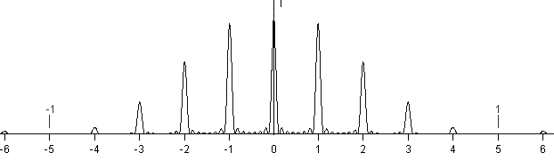
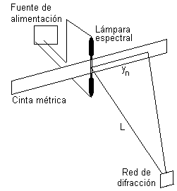

# Trabajo práctico Nº 14: Espectrómetro de red de difracción

Universidad Tecnologica Nacional. Facultad Regional Resistencia. Cátedra: Física
II.

TEMA: ESPECTRÓMETRO DE RED DE DIFRACCIÓN

## Objeto de la experiencia

- Estudiar el fenómeno de difracción de la luz por una red de difracción
- Determinar longitudes de onda de distintas fuentes luminosas.

## Consideraciones teóricas

### Red de difracción

La red de difracción consiste en un gran número de aberturas rectangulares que
se pueden obtener grabando una serie de líneas paralelas sobre una película
transparente, las líneas hacen las veces de espacios opacos entre rendijas (red
por transmisión). También pueden obtenerse grabando con una punta de diamante
sobre una superficie metálica pulida ( redes de reflexión).

Cada rendija origina un haz difractado en el que la distribución de intensidades
es función del ancho de la ranura(ver difracción por una rendija), y estos haces
difractados interfieren entre sí para producir la figura final.

Una red de difracción está caracterizada por el número de líneas o franjas por
unidad de longitud, por lo tanto, la separación a de la rendijas es igual al
inverso de este número.

Entonces el diagrama de difracción producido por varias rendijas paralelas de
igual ancho b, espaciadas regularmente una distancia a, en la dirección
correspondiente al ángulo $`\theta`$ es el producto de dos términos:

- la intensidad de la difracción producida por una rendija de anchura b,
- la intensidad debida a la interferencia de N fuentes separadas una distancia
  a.

```math
I=I_o\left(\frac{\mathop{\mathrm{sen}}\nolimits\left(\frac{\pi b\mathop{\mathrm{sen}}\nolimits\theta}{\lambda}\right)}{\frac{\pi b\mathop{\mathrm{sen}}\nolimits\theta}{\lambda}}\right)^2\left(\frac{\mathop{\mathrm{sen}}\nolimits\left(\frac{N\pi a\mathop{\mathrm{sen}}\nolimits\theta}{\lambda}\right)}{\frac{N\pi a\mathop{\mathrm{sen}}\nolimits\theta}{\lambda}}\right)^2
```

El diagrama consistirá en una serie de franjas brillantes, correspondientes a
los máximos principales de la interferencia de N fuentes dada por

```math
a\cdot\mathop{\mathrm{sen}}\nolimits\theta/\lambda=n\qquad\text{con }n=0,\pm1,\pm2,\ldots
```

o

```math
\mathop{\mathrm{sen}}\nolimits\theta=n\lambda/a
```

Según el valor de n los máximos principales se denominan primero, segundo,
tercero, etc orden de difracción. Pero los valores de estos máximos estarán
modulados por el diagrama de difracción, tal como puede verse en la figura. Para
determinar la longitud de onda se tiene

```math
\lambda=\frac{a\mathop{\mathrm{sen}}\nolimits\theta}{n}=\frac an\frac{y_n}{\sqrt{L^2+y_n^2}}
```

(1)

donde a es la separación entre ranuras n el número de orden e $`y_n`$ es la
distancia del orden cero a l orden n en la pantalla



La dispersión de la red se define como

Si $`\lambda_1`$ y $`\lambda_2`$ son dos longitudes de ondas casi iguales de tal
manera que la red apenas puede distinguirlas, entonces el poder de resolución de
una red se define como

```math
R=\frac\lambda{\lambda_2-\lambda_1}
```

## Elementos a emplear

Red de difracción de 5276 líneas/cm, lámparas espectrales, regla graduada en mm.
Cámara digital

## Técnica operatoria



1. Montar el dispositivo de la figura
1. Colocar la red orientada de manera que los rayos que salen de la lámpara
   espectral incidan sobre ella perpendicularmente
1. Determinar las separaciones angulares para los diversos máximos.
1. Conocida la separación entre ranuras, calcular la longitud de onda buscada
   empleando el máximo del primer orden..
1. Repetir la operación con otras lámparas espectrales.

## Trabajo práctico Nº 14: Hoja de datos

TEMA: ESPECTRÓMETRO DE RED DE DIFRACCIÓN

OBJETO DE LA EXPERIENCIA:

- Estudiar el fenómeno de difracción de la luz por una red de difracción
- Determinar longitudes de onda de distintas fuentes luminosas.

<table>
<tr><th rowspan="5">CURSO</th><th rowspan="5">FECHA</th><th>INTEGRANTES</th></tr>
<tr><td>1.-</td></tr>
<tr><td>2.-</td></tr>
<tr><td>3.-</td></tr>
<tr><td>4.-</td></tr>
</table>

<!-- markdownlint-disable MD029 -->

8. Haga un esquema del dispositivo empleado
1. Separación entre ranuras $`a=(1/600)\,\mathrm{mm}`$ (verificar la que usa)
1. Longitud entre la red de difracción y la lámpara espectral L =
1. Distancia entre el orden central (n = 0) y el primer máximo $`y_1=`$
1. Calcule las longitudes de onda de la lámpara espectral empleando (1)
1. Registre el espectro con la cámara digital
1. Repita 2, 3 y 4 para otra lámpara espectral

<!-- markdownlint-enable MD029 -->

## Procedencia y transcripción

Fuente: `2015/FISICA II - EXPERIENCIAS DE LABORATORIOS.pdf`, páginas 78–80,
cotejadas completas. Se conservan dos figuras, cinco pasos de técnica y la hoja
vacía con numeración 8–14. Véase
[el inventario de fuentes](../../../resources/2015/fuentes.md).

Se conserva N tanto en el argumento del seno como en el denominador del segundo
factor de intensidad. El enunciado «La dispersión de la red se define como» no
tiene una ecuación de dispersión a continuación; no se agrega. También se
mantienen «de la rendijas», «a l orden», el doble punto de «primer orden..» y
las especificaciones distintas: 5276 líneas/cm y a=(1/600) mm con la aclaración
«verificar la que usa». La remisión final a2,3,4 se conserva aunque la lista de
esa hoja empieza en8. No se corrigen ni se completan datos.
