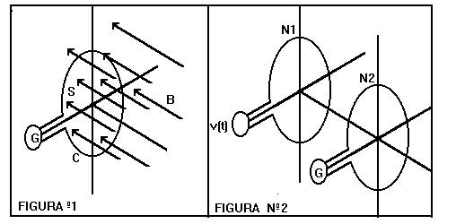
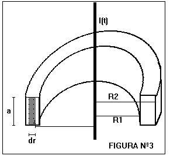
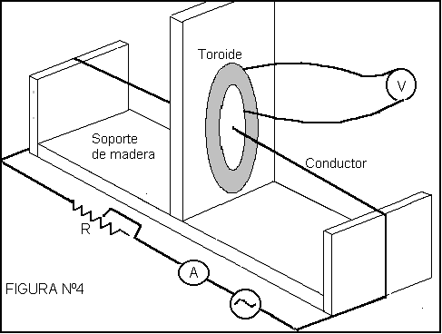

<!-- markdownlint-disable MD060 -->

# Trabajo de laboratorio Nº 9: Ley de Faraday. Coeficiente de induccion

Universidad Tecnologica Nacional. Facultad Regional Resistencia. Cátedra: Física
II.

( Se desarrolla Nº9 bis)

TEMA: LEY DE FARADAY. COEFICIENTE DE INDUCCION

**OBJETIVOS:** Verificar la ley de Faraday y calcular el coeficiente de
inducción de un toroide con nucleo de ferrite y la permeabilidad magnética.

## Resumen

Se presenta una experiencia que permite verificar la ley de Faraday y calcular
el coeficiente de inducción y la permeabilidad magnética de un material. A
partir de la ley de Faraday, se hace la fundamentación teórica que justifica la
proporcionalidad entre la corriente de excitación y la fem inducida, en el
modelo empleado, siendo la constante de proporcionalidad el coeficiente de
inducción, si se conoce la geometría es posible determinar la permeabilidad
magnética de un material.

La verificación experimental se logra haciendo circular una corriente alterna,
con frecuencia de línea, por un conductor, que atravesará el area concatenada
por un toroide con nucleo de ferrite, cuya salida es medida en un voltímetro.
Variando la intensidad de corriente con un reostato, se observa la variación
proporcional de la fem inducida en el toroide.

## Equipamiento necesario

Para una estación de trabajo

- 1 tranformador de 220/12 voltios - 3 amp
- 1 conductor de 1m de longitud.
- 1 toroide con nucleo de ferrite
- 1 reostato de 11 ohm 2 amp
- 1 amperimetro de CA ( lectura máx 2 amp)
- 1 voltimetro.

Para hacer el cálculo de errores

- 1 PC más con utilitario tipo planilla de cálculo.

## Fundamentos teoricos

La ley de Faraday establece que las variación del flujo magnético en el tiempo,
a través de una espira es igual a la fuerza electromotriz generada en ella con
signo contrario, es decir

```math
E=-\frac{d\phi}{dt} \tag{1}
```

desarrollando analíticamente

```math
\oint\vec E\,d\vec l=-\frac{d}{dt}\iint_S\vec B\,d\vec S \tag{2}
```

donde C es la curva que representa la espira y S es el área limitada por ella.



Consideremos dos bobinas de forma circular, la bobina #1 conectada a una fuente
de corriente alterna y la otra, #2, a un galvanómetro, como muestra la figura 1.
El flujo magnético en la bobina #2 varía porque la corriente en la bobina #1
varía entonces

```math
E=-\frac{d\phi_{21}}{dt}=-\frac{d\phi_{21}}{dI_1}\frac{dI_1}{dt} \tag{3}
```

donde $`M=\frac{d\phi_{21}}{dI_1}`$ [henry] es el coeficiente de inducción mutua
y representa la variación en la bobina #2 debido al cambio en la intensidad de
corriente de la bobina #1. Si se tratará de espiras de una misma bobina se
denomina autoinducción $`L=\frac{d\phi_{11}}{dI_1}`$ [henry].

Considere un hilo conductor recto que transporta una intensidad de corriente
i(t) y pasa por el centro de un toroide de radio interior R1 y exterior R2 y
altura a, como muestra la figura Nº3, Vamos a calcular el coeficiente de
inducción mutua, para ello, determinemos el flujo del campo B creado por el hilo
conductor a través de la sección del toroide, el vector campo y el vector
elemento de superficie son paralelos, entonces

```math
d\phi=\vec B\cdot d\vec S=N.B.a.dr
```

con

```math
B=\frac{\mu.I(t)}{2.\pi.r}
```

siendo N el número de espiras del toroide

```math
d\phi=\frac{N.\mu.I(t).a.dr}{2.\pi.r} \tag{4}
```



integrando entre los dos radios R1 y R2 resulta

```math
\phi=\int_{R_1}^{R_2}\frac{N\mu I(t)a\,dr}{2\pi r}=\frac{N\mu I(t)a}{2\pi}\ln(R_2/R_1) \tag{5}
```

Calculemos la fem inducida en el toroide

```math
E=-\frac{d\phi}{dt}=-\frac{N.\mu.a}{2.\pi}\ln(R2/R1).\frac{dI(t)}{dt} \tag{6}
```

El coeficiente de inducción mutua es

```math
M=\frac{N.\mu.a}{2.\pi}\ln(R2/R1) \tag{7}
```

depende de los parámentros geométricos y del material.

Si la intensidad de la corriente es de la forma

```math
I(t)=I_o.\mathop{\mathrm{sen}}\nolimits(\omega.t)
```

su derivada será

```math
\frac{dI(t)}{dt}=-I_o.\omega.\cos(\omega.t) \tag{8}
```

reemplazando en (6) las ecuaciones (7) y (8) resulta

```math
E(t)=-M\{-I_o.\omega.\cos(\omega.t)\} \tag{9}
```

tomando el valor eficaz en la (9) se tiene

```math
E_{ef}=M.\omega.I_{ef} \tag{10}
```

Donde $`E_{ef}`$ y $`I_{ef}`$ representan los valores eficaces de la fem
inducida en el toroide y la intensidad de corriente en el conductor recto.

## Descripcion del dispositivo

Un toroide con nucleo de ferrite, se monta como se muestra en la figura Nº4. Por
el centro del toroide, pasa un conductor que se conecta en serie con un
amperímetro, un reostato (0 Ω a 11 Ω, 4 A) y una fuente de corriente alterna de
12 V y 3 A.

Los bornes del toroide se conectan a un voltímetro digital ( alta impedancia).

El soporte empleado es de madera.



## Marcha de la experiencia

De la teoría desarrollada, la fuerza electromotriz inducida eficaz en el toroide
medida por el voltimetro está dada por

```math
E_{ef}=M.\omega.I_{ef} \tag{10}
```

donde M es la inductancia mutua, $`\omega=2.\pi.f`$, siendo f = 50 hz la
frecuencia de línea, $`I_{ef}`$ es la intensidad de corriente eficaz en el
conductor recto medida por el amperímetro.

Variando el valor del reostato, de valores mínimos a valores máximos, cuidando
que los valores de intensidad y fem permanezcan dentro de la escala de los
respectivos instrumentos, se puede obtener los datos para completar la siguiente
tabla, para el toroide bajo test

| Nº | $`I_{ef}`$ | $`E_{ef}`$ | $`I_{ef}.\omega`$ |
| -- | -- | -- | -- |
| 1 |  |  |  |
| 2 |  |  |  |
| . |  |  |  |
| . |  |  |  |
| . |  |  |  |
| 10 |  |  |  |

## Procesamiento de datos

a) Haga una representación gráfica con los datos de la columna de
$`I_{ef}\,\omega`$ en el eje horizontal y con los de la columna $`E_{ef}`$ en el
eje vertical. Determine gráficamente la pendiente, si esla gráfica corresponde a
una recta

b) Realice un ajuste de curva, (por ejemplo emplee el método de cuadrados
mínimos si la gráfica se corresponde con una recta) con los mismos datos.

```math
A=\frac{N\sum_i x_i y_i-\sum_i x_i\sum_i y_i}{N\sum_i x_i^2-\left(\sum_i x_i\right)^2}
```

```math
B=\frac{\sum_i x_i^2\sum_i y_i-\sum_i x_i\sum_i x_i y_i}{N\sum_i x_i^2-\left(\sum_i x_i\right)^2}
```

donde

```math
y(x)=Ax+B
```

c) Compare las pendientes de ambos métodos, indicando su significado.

d) Cuál es el valor del coeficiente de inducción del toroide y que error
asociado tiene, este resultado puede contrastarse con el medido por un
inductímetro, en el caso de disponer.

e) Determinar la permeabilidad magnética del nucleo del toroide empleando la
fórmula (7).

## Conclusiones

Explique si los resultados experimentales se corresponden con la fórmula (10),
en caso afirmativo, exponga los resultados

## Bibliografía

Física - Fundamentos y Aplicaciones.R.M.Eisberg y L.S.Lerner.McGraw Hill. 1988

Electromagnetism. I.S. Grant - W.R.Phillips. 2da Edición.Wiley. 1990.

## Trabajo de laboratorio Nº 9: Hoja de datos

**OBJETIVOS:** Verificar la ley de Faraday y calcular el coeficiente de
inducción de un toroide con nucleo de ferrite y la permeabilidad magnética.

<table>
<tr><th rowspan="5">CURSO</th><th rowspan="5">FECHA</th><th>INTEGRANTES</th></tr>
<tr><td>1.-</td></tr>
<tr><td>2.-</td></tr>
<tr><td></td></tr>
<tr><td></td></tr>
</table>

1.- Recolección de datos

| TABLA 1 | Radio interior = | Radio exterior = |
| -- | -- | -- |
| $`\omega`$ = | Altura a = | Nro de espiras = |

TABLA 2

| Nº | $`I_{ef}`$ | $`E_{ef}`$ | $`I_{ef}.\omega`$ |
| -- | -- | -- | -- |
| 1 |  |  |  |
| 2 |  |  |  |
| 3 |  |  |  |
| 4 |  |  |  |
| 5 |  |  |  |
| 6 |  |  |  |
| 7 |  |  |  |
| 8 |  |  |  |
| 9 |  |  |  |
| 10 |  |  |  |

a) Representación gráfica en papel milimetrado.

Cálculo de la pendiente

```math
A=\frac{\Delta y}{\Delta x}=\frac{\Delta E_{ef}}{\omega\Delta I_{ef}}=
```

b) Ajuste de curva ( emplee algún utilitario –excel o mathcad ) o bien las
fórmulas de cuadrados minimos

Calculo de A = Calculo de B=

c) Valor de M =

d) Valor de $`\mu`$ =

## Procedencia y transcripción

Fuente: `2015/FISICA II - EXPERIENCIAS DE LABORATORIOS.pdf`, páginas 52–56,
cotejadas completas. Se conservan las cuatro figuras en tres archivos (1 y 2
forman un solo bitmap), ambas tablas de lecturas y la hoja de datos vacía. Véase
[el inventario de fuentes](../../../resources/2015/fuentes.md).

Se preservan el aviso «Se desarrolla Nº9 bis», la referencia del texto a figura
1 para las dos bobinas rotuladas Nº2, el signo menos de la derivada (8) y el
doble signo menos en (9), la numeración (10) repetida, así como las intensidades
distintas del reostato (2 amp en equipamiento y 4 A en descripción). Son
particularidades del original; no se corrigen ni se resuelven los espacios
vacíos.
