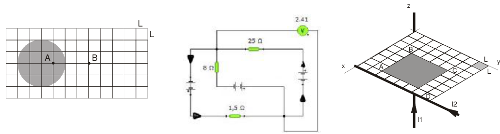

# Examen final de Física II — 17/12/09

APELLIDO Y NOMBRE: \_\_\_\_\_\_\_\_\_\_\_\_\_\_\_\_\_\_\_\_

## Problema 1

Una distribución esférica de carga $`\rho(r)=A/r^2`$ posee una carga total Q =
$`8.85\times10^{-12}`$ coul. (L = 1cm) Calcular a) El valor de la constante A b)
El campo eléctrico en el punto A c) El campo eléctrico en el punto B d) La
gráfica del campo eléctrico e) La diferencia de potencial entre A y B f) En qué
lugar se deberá ubicar una carga Q = $`8.85\times10^{-12}`$ coul para que el
campo en B se anule.

## Problema 2

Sabiendo que la corriente que circula por la resistencia de 1.5 Ω es de 390.8 mA
y la corriente que circula por la resistencia de 25 Ω es de 276,6 mA, calcular
el valor de la corriente que circula por la resistencia de 8 Ω y los valores de
las fuentes que alimentan el circuito

## Problema 3

Dos hilos ubicados perpendicularmente llevan corrientes iguales y variables con
el tiempo $`I1=I2=i(t)=0.5\sin(2.\pi.t)`$ (donde t en segundos, i(t) en
amperios). Calcular: a) El campo magnético total en el punto B cuando t = 0.25
seg. b) Graficar los vectores en ese punto c) La FEM máxima inducida en la
espira ABCD si la resistencia es de 10 Ω. L = 1cm

## Figuras originales

## Procedencia y observaciones de transcripción

- Original:
  `2015/480938-Modelos de parcial FISICA II actualizado 060813(0).pdf`, páginas
  25\.
- SHA-256: `1555e295ed06e6a3872614be84854c0e0af3e8455048ca7e5bcbc4383490653e`.
- Compilación: Sampallo Guillermo, Rodríguez Ulises y Cleva Mario; versión 1.1,
  04/08/2010 en carátula. Se conserva la fecha e identificación propias de cada
  examen.
- Herramientas: extracción textual PyMuPDF y Poppler, cotejo visual de todos los
  enunciados, datos, expresiones y figuras. Diagramas originales por render
  PyMuPDF. No se resuelven ejercicios ni se completan campos.
- El dibujo del circuito conserva el indicador verde2.41 visible en el original:
  no se interpreta como una solución agregada por la transcripción.
