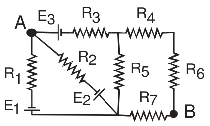

# Examen final de Física II — marzo de 2010

APELLIDO Y NOMBRE: \_\_\_\_\_\_\_\_\_\_\_\_\_\_\_\_\_\_\_\_

## Problema 1

En un vaso calorimétrico de cobre, cuya masa es 40 g, se ponen 380 gramos de
alcohol. El conjunto está a una temperatura de 8 °C. Se introduce en el alcohol
un trozo de cobre de 122 gramos a la temperatura de 50 °C. La temperatura de
equilibrio es 10 °C. Calcular el calor específico del alcohol. Suponer que no
hay pérdidas de calor a través de las paredes del vaso calorimétrico. Calor
específico del cobre: 0.095 cal/g.K

## Problema 2

Una esfera sólida de radio R = 5cm tiene una densidad volumétrica de carga
$`\rho(r)=A.r^2`$ con A = $`8.85.10^{-12}`$ (las unidades de A están expresadas
en el sistema internacional). Determinar el campo a 2 cm del centro y a 8 cm del
centro y la diferencia de potencial entre estos puntos.

## Problema 3

Hallar las corrientes que circulan a través de cada resistencia y la diferencia
de potencial entre A y B R1 = R3 = R5 = R7 = 1 kΩ R2 = R4 = R6 = 2 kΩ E1 = 10 V
E2 = 15 V E3 = 5 V

## Problema 4

Por un conductor cilíndrico macizo, de radio R = 1 mm, circula una densidad de
corriente $`J=C.r\ (\mathrm{A/m^2})`$ con $`0\lt r\lt R`$. Determinar a) el
valor y las unidades de la constante C si la corriente total que transporta el
conductor es 0,3 A. b) el campo de inducción magnética en el interior y el
exterior del conductor.

## Figuras originales

## Procedencia y observaciones de transcripción

- Original:
  `2015/480938-Modelos de parcial FISICA II actualizado 060813(0).pdf`, páginas
  25\.
- SHA-256: `1555e295ed06e6a3872614be84854c0e0af3e8455048ca7e5bcbc4383490653e`.
- Compilación: Sampallo Guillermo, Rodríguez Ulises y Cleva Mario; versión 1.1,
  04/08/2010 en carátula. Se conserva la fecha e identificación propias de cada
  examen.
- Herramientas: extracción textual PyMuPDF y Poppler, cotejo visual de todos los
  enunciados, datos, expresiones y figuras. Diagramas originales por render
  PyMuPDF. No se resuelven ejercicios ni se completan campos.
