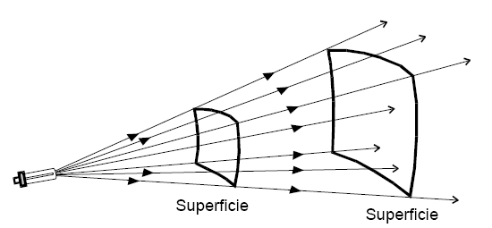
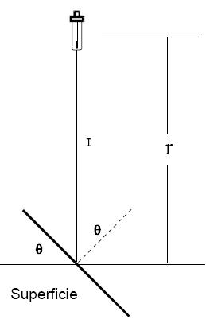
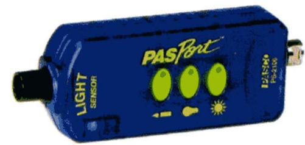
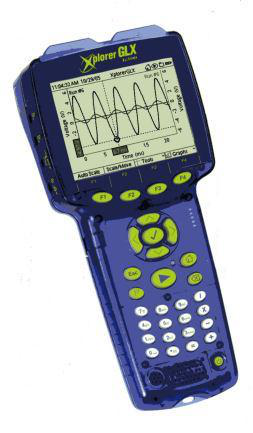

<!-- markdownlint-disable MD060 -->

# Trabajo de laboratorio Nº 11: Fotometria

Universidad Tecnologica Nacional. Facultad Regional Resistencia. Cátedra: Física
II.

TEMA: FOTOMETRIA: verificación de la ley de la inversa del cuadrado de la
distancia y su dependencia con la orientación

## Objetivo

El propósito de esta experiencia es mostrar que la intensidad de la luz recibida
desde una fuente puntual es inversamente proporcional al cuadrado de la
distancia entre esta y el punto de medición y si la fuente no es puntual también
depende de la orientación..

## Equipamiento necesario

- Banco Óptico (OS 8518)
- Fotómetro (PS2106)
- Datalogger
- Fuente de Luz

## Fundamentos teoricos

La **Iluminancia (E)**, deriva de la **Irradiancia (I)**, se define como el
flujo luminoso que incide por unidad de área de una superficie dada. Se mide en
lux. Su aplicación práctica es cuantificar la cantidad de luz que llega a una
superficie y por la simplicidad de su medición es la magnitud que más se usa. La
iluminancia sigue la ley inversa de los cuadrados, que en el caso de una fuente
puntual toma la forma:

```math
E=I/r^2
```

donde r es la distancia desde la fuente luminosa a la superficie a la que llega
el flujo luminoso y la superficie es perpendicular a la dirección de propagación
de la radiación incidente



Cuando la superficie no es perpendicular a la dirección de propagación del flujo
luminoso (Figura 4b) la ecuación debe ser modificada y se obtiene

```math
E=(I/r^2)\cos(\theta)
```

donde $`\theta`$ es el ángulo de inclinación de la superficie







## Preparación

1. Coloque el fotómetro conectado al Datalogger en el banco óptico. Configure el
   Datalogger como medidor digital.
1. Coloque una fuente de luz puntual en un extremo del banco óptico.

NOTA: Una de las fuentes de luz de esta experiencia, no necesita ser puntual, y
puede ser reemplazada por cualquier fuente de luz estable, que no varíe en el
tiempo (linterna, velador, tubo fluorescente, etc).

## Procedimiento 1

Observe el indicador del fotómetro y mueva de fuente de luz, a lo largo del
banco óptico.

Anote la distancia (r en m) de la fuente de luz al fotómetro empleando la escala
del banco óptico y el valor de la intensidad promedio (E en lux) registrada la
tabla del datalogger.

Construya una tabla r, $`1/r^2`$, E

### Análisis del procedimiento 1

Empleando una planilla de cálculo grafique los datos en el eje horizontal las
distancias y en el vertical la intensidad.

Repita la grafica ahora en el eje horizontal las inversas de las distancias al
cuadrado ($`1/r^2`$) y en el vertical la intensidad. Obtenga por ajuste numérico
la función $`E(1/r^2)`$ de mejor ajuste.

## Procedimiento 2

Con la fuente de luz fija mueva el fotómetro a una distancia fija (R) variando
el ángulo $`\theta`$ la orientación del fotómetro respecto de la fuente de luz

Registre la distancia R y anote $`\theta`$ y el valor de la intensidad (E en
lux) registrada en el medidor digital del datalogger.

Construya una tabla Para R Constante $`\theta`$, E

### Análisis del procedimiento 2

Empleando una planilla de cálculo grafique en una gráfico polar $`\theta`$, E

## Trabajo de laboratorio Nº11: Hoja de datos

TEMA: FOTOMETRIA: verificación de la ley de la inversa del cuadrado de la
distancia y su dependencia con la orientación

<table>
<tr><th rowspan="5">CURSO</th><th rowspan="5">FECHA</th><th>INTEGRANTES</th></tr>
<tr><td>1.-</td></tr>
<tr><td>2.-</td></tr>
<tr><td>3.-</td></tr>
<tr><td>4.-</td></tr>
</table>

### TABLA r, 1/r² E

| Nro. de lectura | r (cm) | $`1/r^2`$ | E (lux) |
| -- | -- | -- | -- |
| 1 | 2 |  |  |
| 2 | 4 |  |  |
| 3 | 6 |  |  |
| 4 | 8 |  |  |
| 5 | 10 |  |  |
| 6 | 12 |  |  |
| 7 | 14 |  |  |
| 8 | 16 |  |  |
| 9 | 18 |  |  |
| 10 | 20 |  |  |

a) Grafique los datos en el eje horizontal las distancias y en el vertical la
intensidad.

b) Grafique ahora en el eje horizontal las inversas de las distancias al
cuadrado ($`1/r^2`$) y en el vertical la intensidad. Obtenga por ajuste numérico
la función $`E(1/r^2)`$ de mejor ajuste.

### TABLA R=20 cm, θ, E

| Nro. de lectura | $`\theta`$° | E (lux) |
| -- | -- | -- |
| 1 | -90 |  |
| 2 | -70 |  |
| 3 | -50 |  |
| 4 | -30 |  |
| 5 | -10 |  |
| 6 | 0 |  |
| 7 | 10 |  |
| 8 | 30 |  |
| 9 | 50 |  |
| 10 | 70 |  |
| 11 | 90 |  |

Haga un gráfico polar $`\theta`$, E

## Procedencia y transcripción

Fuente: `2015/FISICA II - EXPERIENCIAS DE LABORATORIOS.pdf`, páginas 65–69,
cotejadas completas. Se conservan cuatro imágenes, la nota sobre fuentes
estables y las dos tablas con diez y once lecturas. Los inversos y mediciones no
se completan. Véase
[el inventario de fuentes](../../../resources/2015/fuentes.md).

Se conservan «Irradiancia (I)», el doble punto final del objetivo, «mueva de
fuente de luz», «registrada la tabla», «una gráfico», la referencia a Figura4b
sin rótulo correspondiente y r en m en el procedimiento frente a r (cm) en la
tabla. No se corrigen silenciosamente las expresiones ni las unidades del
original.
