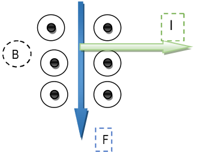
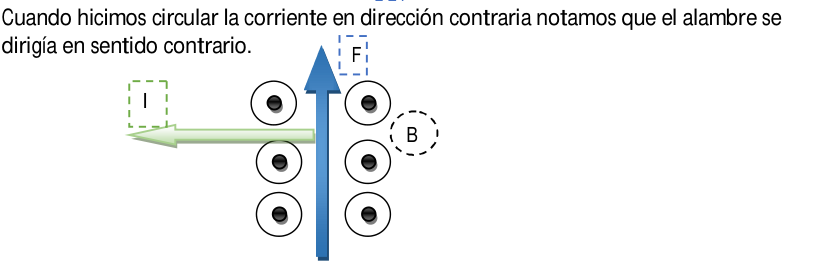
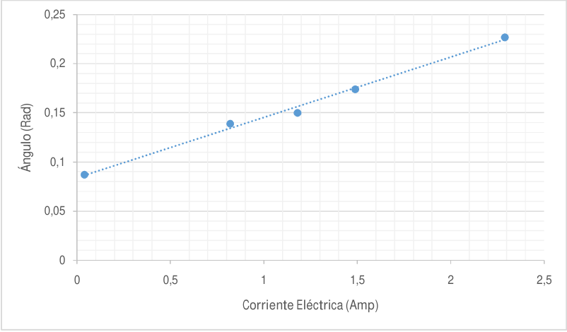

# Fuerza Magnética sobre elementos de corriente — informe del grupo 6: experiencias y resultados

## Experiencias

### Comprobación vectorial de la formula

```math
d\vec{F}=I\,\overrightarrow{dl}\wedge\vec{B}\qquad(1)
```

La experiencia consistía en colocar un imán que generaba un campo magnético (B)
y una barra de cobre en el cual hicimos circular una corriente positiva y luego
una negativa y generaba una Fuerza (F) que dependía del tipo de corriente.

Primero, colocamos un cable con corriente negativa de manera fija en uno de los
electrodos y aplicamos un pulso de corriente positiva al otro electrodo, y
pudimos observar que el alambre se movió hacia una dirección (F).



Cuando hicimos circular la corriente en dirección contraria notamos que el
alambre se dirigía en sentido contrario.



Por lo tanto, pudimos comprobar de manera experimental la formula

```math
d\vec{F}=I\,\overrightarrow{dl}\wedge\vec{B}
```

### Determinación del campo magnético de un imán natural

Medidas de la espira:

```math
a=0{,}065\mathrm m\qquad b=0{,}1\mathrm m
```

```math
\mathrm{Longitud}=0.23\mathrm m
```

```math
\mathrm{Masa}=0.007498\mathrm{kg}
```

```math
\mathrm{Densidad}=0.0326\mathrm{kg/m}
```

| Corrientes Eléctrica (A) | Angulo (Rad) |
| -- | -- |
| 0.04 | 0.087 |
| 0.82 | 0.139 |
| 1.18 | 0.15 |
| 1.49 | 0.174 |
| 2.29 | 0.227 |



## Conclusión

En este laboratorio, verificar en lo teórico y en lo práctico, que a medida que
se aumenta la corriente que pasa por el alambre mayor es la fuerza con la que se
desplaza el mismo, y lo vemos demostrado en la gráfica, respecto al ángulo que
forma al aplicar distintas corrientes.

## Procedencia y observaciones

- Original: `2015/L8 Fza sobre elemento de cte G6 Aprobado.pdf`, páginas 8–9
  completas, con omisión explícita de la calificación final. SHA-256:
  `fb2be56c4577a2058d5334daff09c1974e826f2fa3023bd5e6da74dcbca6a701`.
- PyMuPDF4LLM/Poppler cotejados con ambas páginas renderizadas, incluidos
  diagramas, expresiones, cinco filas de datos y gráfica completa. Los tres
  recortes conservan los originales, sin redibujar ni recalcular.
- Se mantienen «formula», «barra de cobre» aunque la técnica indique aluminio,
  «corriente positiva/negativa», «Corrientes Eléctrica» y «Angulo» sin tilde.
  Las afirmaciones y conclusión pertenecen a los autores del informe.
- Se conservan coma en a/b y puntos en longitud, masa, densidad y tabla, con sus
  cifras originales. No se recalculan ángulos a partir de la hoja manuscrita ni
  se uniforman sus redondeos. La recta no tiene ecuación ni pendientes
  rotuladas: no se agregan ajustes nuevos ni el campo magnético calculado.
- Se omite la marca final «APROBADO», preservando el original íntegro. El año
  impreso en la portada del informe es 2016; la carpeta es 2015.

[Teoría y técnica](fuerza-corriente-informe-grupo-6-teoria-tecnica.md).
