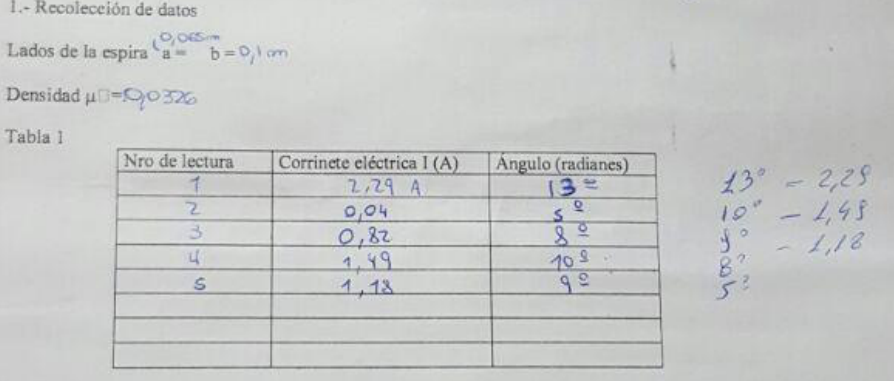
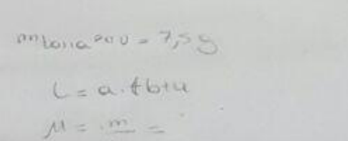

# Fuerza Magnética sobre elementos de corriente — informe del grupo 6: hoja manuscrita

UNIVERSIDAD TECNOLÓGICA NACIONAL

FACULTAD REGIONAL RESISTENCIA

CÁTEDRA: FÍSICA II

TRABAJO DE LABORATORIO N° 8

OBJETIVO: Análisis y verificación de la fuerza magnética sobre elementos de
corriente

## HOJA DE DATOS

CURSO: ISI A

FECHA: 16/06/16

## 1.- Recolección de datos

Lados de la espira:

```math
a=0{,}065\mathrm m\qquad b=0{,}1\mathrm{cm}
```

Densidad μ [símbolo no representado] = 0,0326

Tabla 1

<table>
<thead>
<tr><th>Nro de lectura</th><th>Corrinete eléctrica I (A)</th><th>Ángulo (radianes)</th></tr>
</thead>
<tbody>
<tr><td>1</td><td>2,29 A</td><td>13°</td></tr>
<tr><td>2</td><td>0,04</td><td>5°</td></tr>
<tr><td>3</td><td>0,82</td><td>8°</td></tr>
<tr><td>4</td><td>1,49</td><td>10°</td></tr>
<tr><td>5</td><td>1,18</td><td>9°</td></tr>
<tr><td></td><td></td><td></td></tr>
<tr><td></td><td></td><td></td></tr>
<tr><td></td><td></td><td></td></tr>
</tbody>
</table>

Anotaciones al margen derecho, en su orden original:

- 13° — 2,29
- 10° — 1,49
- 9° — 1,18
- 8°
- 5°



Anotación inferior de masa \[rótulo parcialmente ilegible\]: 7,5 g

```math
L=a+b+a
```

```math
\mu=\frac mL=
```



## Procedencia y límites de lectura

- Original: `2015/L8 Fza sobre elemento de cte G6 Aprobado.pdf`, página 7 de
  nueve. SHA-256:
  `fb2be56c4577a2058d5334daff09c1974e826f2fa3023bd5e6da74dcbca6a701`.
- OCRmyPDF en español sobre una copia y cotejo visual de todos los campos, tabla
  y anotaciones en la fotografía ampliada. El OCR no recupera fielmente la
  escritura: no se usa para sustituir cifras por las de páginas 8–9.
- Ocho filas de mediciones: cinco completadas y tres vacías. El encabezado
  imprime «Corrinete» y «Ángulo (radianes)», pero los datos manuscritos tienen
  signos de grado: se conserva la discrepancia y no se convierten a radianes.
- En los lados de la espira se conserva la unidad «cm» que aparece junto a b,
  distinta de «m» de los resultados mecanografiados. Densidad no tiene unidad
  manuscrita al final; no se agrega kg/m. El pequeño recuadro junto a μ en la
  plantilla no permite identificar otro símbolo: queda señalado.
- Se preserva el orden de lecturas, el «A» de la primera corriente y las
  anotaciones marginales, sin ordenarlas según la tabla posterior. La cuenta de
  densidad termina en igual, sin resultado: no se completa.
- El rótulo de la anotación de masa inferior no se distingue completamente; se
  registra su valor legible y el recorte sin adivinar el resto del rótulo. Esta
  lectura parcial permanece pendiente de una imagen más nítida.
- Fecha del campo 16/06/16; al pie consta 16/6/2016. Se omiten explícitamente
  nombres y firmas manuscritos de integrantes y la firma docente. Los recortes
  publicados solo contienen mediciones y cálculos. El original se conserva.
- El número 1 al pie pertenece a la hoja fotografiada, no a la página 7 del
  informe. El año impreso de portada es 2016; la carpeta es 2015.

[Experiencias y resultados mecanografiados](fuerza-corriente-informe-grupo-6-experiencias-resultados.md).
