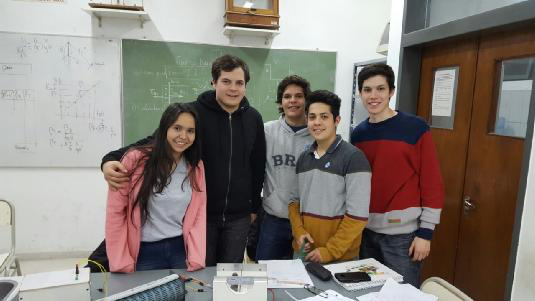

# Fuerza Magnética sobre elementos de corriente — informe del grupo 6: objetivo y resumen

LABORATORIO N°8:

Fuerza Magnética sobre elementos de corriente

CARRERA: INGENIERIA EN SISTEMAS DE LA INFORMACIÓN

CATEDRA: FISICA II

GRUPO N°: 6

INTEGRANTES:

- CARDOZO, Edgar Oscar
- DIEZ, Gabriel Fernando
- FERREYRA, Eduardo
- MATIJASEVIC, Emerson Gabriel
- PEREZ, Milagros

AÑO: 2016

## OBJETIVO

Análisis y verificación de la fuerza magnética sobre elementos de corriente.

## RESUMEN

Empleando un montaje sencillo y de bajo costo se estudia en forma cualitativa
ycuantitativa la expresión de la fuerza sobre conductores que transportan
corriente eléctrica en un campo magnético. Se desarrolla la teoría para obtener
las expresiones que predicen el movimiento del conductor bajo la acción de la
fuerza magnética.

La comprobación experimental consiste en colocar un conductor recto, de sección
circular, simplemente apoyado sobre dos electrodos planos, en una región donde
existe un campo magnético, cambiando el sentido de la corriente en el conductor
y luego el sentido del campo se observa que el conductor se rueda en sentido
contrario cumpliendo la expresión vectorial de la fuerza.

En cuanto, a la verificación de la intensidad de la fuerza, se sustituye el
conductor recto por uno en forma

cuyos extremos se apoyan en los electrodos, la parte horizontal se coloca en un
campo magnético, cuando circula corriente por el conductor se desvía un ángulo
respecto de la vertical, que aumenta al aumentar la corriente, la relación que
surge es concordante con lo predicho en el modelo desarrollado.

## EQUIPAMIENTO NECESARIO

Para una estación de trabajo.

1 fuente de alimentación de CC 12 voltios 5 amp. 1 Imán en forma de U.

1 amperímetro (max lectura posible durante la experiencia 4 amp). 1 reóstato
11ohm 5 amp.

1 Barra de aluminio sección circular.

1 Espira de aluminio de forma
.

2 Electrones planos.

Conectores.

## Procedencia y observaciones

- Original: `2015/L8 Fza sobre elemento de cte G6 Aprobado.pdf`, páginas 1–2
  completas de nueve. SHA-256:
  `fb2be56c4577a2058d5334daff09c1974e826f2fa3023bd5e6da74dcbca6a701`.
- PyMuPDF4LLM y Poppler contrastados con ambas páginas renderizadas. Fotografía
  extraída del PDF; forma de la espira cotejada y referenciada al medio original
  ya conservado con la guía, sin duplicarlo.
- El año 2016 está impreso en portada; la carpeta del archivo es 2015. Se
  preservan PEREZ sin tilde, «ycuantitativa», «se rueda» y «Electrones planos».
  No se sustituye este último término por electrodos.
- Tras «se desvía un ángulo» no hay un símbolo visible antes de «respecto de»;
  no se añade θ por deducción. Las medidas y capacidades del equipamiento se
  transcriben tal como están, sin convertir unidades.
- Restan páginas 3–9: teoría, técnica, hoja manuscrita y resultados del grupo.
