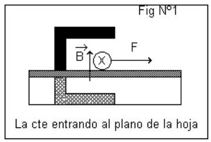
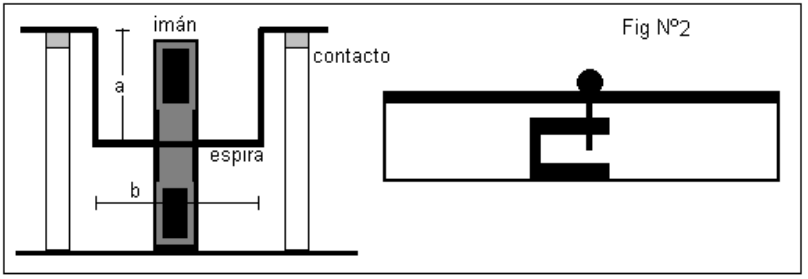
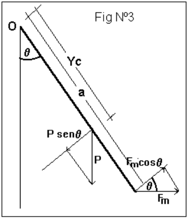
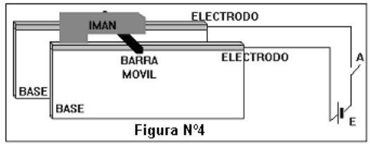
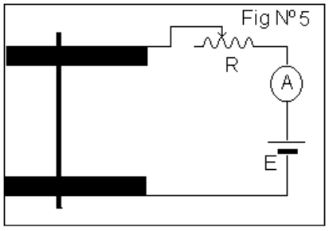

<!-- markdownlint-disable MD060 -->

# Trabajo de laboratorio Nº 8: Fuerza magnetica sobre elementos de corriente

Universidad Tecnologica Nacional. Facultad Regional Resistencia. Cátedra: Física
II.

**OBJETIVO:** Análisis y verificación de la fuerza magnética sobre elementos de
corriente.

**RESUMEN:** Empleando un montaje sencillo y de bajo costo se estudia en forma
cualitativa y cuantitativa la expresión de la fuerza sobre conductores que
transportan corriente eléctrica en un campo magnético. Se desarrolla la teoría
para obtener las expresiones que predicen el movimiento del conductor bajo la
acción de la fuerza magnética.

La comprobación experimental consiste en colocar un conductor recto,de sección
circular, simplemente apoyado sobre dos electrodos planos, en una región donde
existe un campo magnético, cambiando el sentido de la corriente en el conductor
y luego el sentido del campo se observa que el conductor se rueda en sentido
contrario cumpliendo la expresión vectorial de la fuerza.

En cuanto, a la verificación de la intensidad de la fuerza, se sustituye el
conductor recto por

uno en forma

cuyos extremos se apoyan en los electrodos, la parte horizontal se coloca en un
campo magnético, cuando circula corriente por el conductor se desvía un ángulo
$`\theta`$ [símbolo no representado en la fuente] respecto de la vertical, que
aumenta al aumentar la corriente, la relación que surge es concordante con lo
predicho en el modelo desarrollado.

## EQUIPAMIENTO NECESARIO

Para una estación de trabajo 1 fuente de alimentación de CC 12 voltios 5 amp.

1 Imán en forma de U

1 amperimetro (max lectura posible durante la experiencia 4 amp).

1 reostato 11ohm 5 amp.

1 Barra de aluminio sección circular


1 Espira de aluminio de forma

2 Electrodos planos

Conectores

## INTRODUCCION TEORICA

Sobre un elemento de corriente $`I\,\overrightarrow{dl}`$, que está colocado en
una región donde existe un

campo magnético $`\vec B`$ se produce una fuerza elemental dada por

```math
d\vec F=I\,\overrightarrow{dl}\wedge\vec B
```

(1)

1.- Vamos a usar la expresiön (1) en el dispositivo de la figura Nº1, que
representa una barra recta conductora colocada en un campo



magnético suministrado por un imán en forma de **U** . Cuando se hace circular
corriente por la barra aparece una fuerza de intensidad

```math
F=ILB
```

(2)

Siendo L el ancho de la región donde existe campo.

Esta fuerza actua mientras la barra se halla en el campo, si la intensidad de
esta fuerza es suficiente para vencer el rozamiento, la barra se desplaza.

2.- Consideremos ahora el dispositivo de la figura Nº2, cuando circula corriente
por la espira de lados a y b actua una fuerza que la aparta de la posición
vertical, haciendo que forme un ángulo,





para encontrar la forma este ángulo depende de los otros paramétros que están
involucrados, estudiemos el diagrama de fuerzas de la figura N º3.

De la cual, se desprende la condición de equilibrio

```math
M(O,P)+M(O,Fm)=0
```

(3)

donde

```math
P=\mu(2a+b)g
```

(4)

siendo $`\mu`$ la densidad de masa por unidad de longitud y

```math
Fm=ILB
```

(5)

la (3) puede rescribirse

```math
Yc\,P\mathop{\mathrm{sen}}\nolimits\theta-a\,Fm\cos\theta=0
```

(6)

donde Yc es la distancia del eje de suspención al centro de masa de la espira y
viene dada por

```math
Yc=\frac{a(a+b)}{2a+b}
```

(7)

reeplazando (4), (5) y la (7) en la (6) resulta

```math
\mathop{\mathrm{tg}}\nolimits\theta=\frac{ILB}{(a+b)a\mu g}
```

(8)

para ángulos pequeños resulta

```math
\theta\approx\frac{ILB}{(a+b)a\mu g}
```

(9)

De la (9) se desprende que como la geometría (a, b y L), la masa por unidad de
longitud L y los campos ( g y B) son constantes existe una relación lineal entre
el ángulo de inclinación de la espira respecto de la normal $`\theta`$ y la
coriente que circula por la misma, siendo este el principio de funcionamiento de
los instrumentos eléctricos de medida de aguja.

## DESCRIPCIÓN DEL DISPOSITIVO

Para hacer la verificación experimental de la fórmula (1), emplearemos el
dispositivo de la figura Nº4, que representa dos bases de madera que tienen cada
uno en la parte superior dos



barras metálicas que actuarán de electrodos planos, estos están conectados a
través del interruptor A con una fuente de corriente continua.

Sobre los electrodos planos se apoya una barra de aluminio, recta y de sección
cílindrica y se coloca un imán en forma de **U** entre las bases y de modo que,
la barra de alumnio se ubique en el centro del "gap" del imán.

Para el análisis de la intensidad de la fuerza se reemplaza la barra recta de
aluminio y se reemplaza por una espira de lados a y b de la forma

y se emplea el circuito de la figura Nº5.



Sobre el lado interno de una de las bases está pegado un semicirculo graduado
que permite medir el ángulo de inclinación de la espira respecto de la
horizontal.

## MARCHA DE LA EXPERIENCIA

### 1. Comprobación vectorial de la expresión (1)

1.1.- Haga el montaje de la figura Nº4

## PRECAUCIONES

En el montaje de la figura Nº4, debe tenerse presente que el valor de la
intensidad de corriente no debe superar el valor máximo de operación de la
fuente, de modo que **basta dar pulsos (encendido y apagado)** para comprobar
que la barra de aluminio se desplaza.

1.2.- Haga circular la corriente en un sentido, luego en otro: ¿Qué observa?
Dibuje los vectores correspondientes. ¿Cuales son sus conclusiones?

1.3.-Haga circular la corriente en un sentido, y luego invertir los polos del
imán. ¿ Qué observa?. Dibuje los vectores correspondientes. ¿Cuáles son sus
conclusiones?

## **Determinación del campo magnético de un imán natural**

- 2.1 Haga el montaje de la figura Nº 5.

2.2 Mida las longitudes de la varilla segúnindica la figura Nº2

2.3 Pese la varilla y determine su densidad lineal $`\mu`$

2.4 Variando el valor de la resistencia R del circuito de la figura Nº5, cambia
la intensidad de corriente que se registra en el amperímetro y la inclinación
[dos símbolos no representados en la fuente] de la espira respecto de la
vertical empleando el semicírculo del montaje, podemos confeccionar entonces la
tabla de datos 1.

Tabla 1

| Corriente eléctrica I (A) | Ángulo (radianes) |
| -- | -- |
|  |  |
|  |  |
|  |  |
|  |  |
|  |  |

2.5 Realice un ajuste de curva, (por ejemplo emplee el método de cuadrados
mínimos si la gráfica se corresponde con una recta) con los mismos datos.

```math
A=\frac{N\sum_i x_i y_i-\sum_i x_i\sum_i y_i}{N\sum_i x_i^2-\left(\sum_i x_i\right)^2}
```

```math
B=\frac{\sum_i x_i^2\sum_i y_i-\sum_i x_i\sum_i y_i}{N\sum_i x_i^2-\left(\sum_i x_i\right)^2}
```

donde $`y(x)=Ax+B`$

2.6 Compare las pendientes de ambos métodos, indicando su significado.

## CONCLUSIÓN

Durante la primera parte de la experiencia el desplazamiento de la barra de
aluminio, en un campo magnetico cuando por ella circula una corriente, ¿verifica
la expresión vectorial de la fuerza (1)?¿cómo lo comprueba?.

Cuando se estudia la espira en el campo, que tipo de relación existe entre el
ángulo de

inclinación [tres símbolos no representados en la fuente] y la intensidad I, ¿es
compatible con el desarrollo teórico?

## BIBLIOGRAFÍA

Física - Fundamentos y Aplicaciones.R.M.Eisberg y L.S.Lerner.McGraw Hill. 1988
[símbolo no representado en la fuente]

Electromagnetism. I.S. Grant - W.R.Phillips. 2da Edición.Wiley. 1990.

## Trabajo de laboratorio Nº 8: Hoja de datos

**OBJETIVO** : Análisis y verificación de la fuerza magnética sobre elementos de
corriente

## HOJA DE DATOS

| CURSO | FECHA | INTEGRANTES |
| -- | -- | -- |
|  |  | 1.- |
|  |  | 2.- |
|  |  | 3.- |
|  |  | 4.- |

1.- Recolección de datos

Lados de la espira a = b =

Densidad $`\mu`$ [símbolo no representado en la fuente] =.

Tabla 1

| Nro de lectura | Corrinete eléctrica I (A) | Ángulo (radianes) |
| -- | -- | -- |
|  |  |  |
|  |  |  |
|  |  |  |
|  |  |  |
|  |  |  |
|  |  |  |
|  |  |  |
|  |  |  |

## Nota de transcripción

Se conservan los recuadros de símbolos ausentes en la propia fuente sin adivinar
su contenido, la notación de los momentos, los denominadores (8)/(9) y la
referencia a L como masa por unidad de longitud en el párrafo. Las filas vacías
de la tabla del cuerpo incluyen su continuación de página 5. No se resuelven las
preguntas ni se corrige Corrinete.

[Procedencia y comprobaciones](../../../resources/2015/fuentes.md).

## Copia con idéntico render

El archivo `2015/FISICA II - EXPERIENCIAS DE LABORATORIOS 2015- TP N° 8.pdf.pdf`
tiene distinto SHA-256 binario, pero todas sus páginas tienen dimensiones y
píxeles idénticos a los de la referencia transcrita, al renderizar en gris
a72dpi. Se conserva esta nota sin duplicarla; la
[evidencia por página](../../../resources/common/duplicados-render.json)
registra los hashes y el alcance de la comparación. Esta comprobación no agrega
páginas a la cuenta de revisión visual manual.
