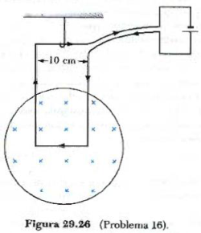
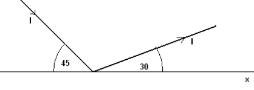
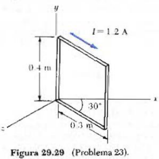
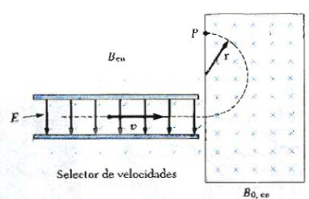
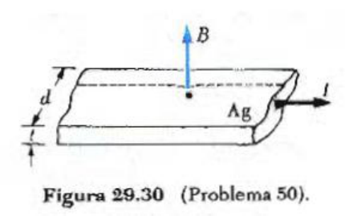
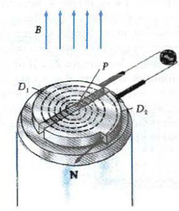

# Campo magnético: fuerzas sobre cargas en movimiento

Fuente: `2015/GUIA DE PROBLEMAS PROPUESTOS 2da parte.pdf`, páginas 1–3 de 13.
SHA-256: `e2452f4b287c4401d9902c425f82a9caaab0bb7dd7c877c724934eb2bed5a9fa`.

Extracción pdftotext, recuperación visual de vectores y cotejo de las tres
páginas. Quince preguntas, catorce problemas con numeración discontinua del
Serway y seis figuras.

## Cuestionario

**1.** ¿Qué experimenta una carga que se mueve en un campo de inducción
magnética? ¿Cómo se manifiesta?

**2.** Un electrón en reposo, si se lo somete a un campo de inducción magnética
¿se mueve?

**3.** En una región del espacio donde no hay campo eléctrico pero sí campo
magnético, se lanza una partícula cargada (masa m, carga q), con velocidad
$`\vec v`$: a) $`\vec v\parallel\vec B`$, b) $`\vec v\perp\vec B`$, c)
$`\vec v`$ forma un ángulo $`\theta`$ con $`\vec B`$. Indique en cada caso la
fuerza que actúa sobre la partícula. ¿Existe alguna una operación matemática que
involucre los tres casos? ¿Cuál?.

**4.** Si un electrón no se desvía al pasar por cierta región del espacio,
¿podemos estar seguros de que no hay ningún campo magnético en la región?

**5.** Dos partículas cargadas ingresan en una región donde existe un campo de
inducción magnética, si las partículas son desviadas en direcciones opuestas
¿qué conclusiones se puede sacar de los atributos de ellas?

**6.** En la ecuación $`\vec F=q\vec v\wedge\vec B`$ ¿Qué pares de vectores son
siempre perpendiculares? ¿Cuáles pueden formar ángulos cualesquiera entre sí ?

**7.** ¿Puede emplearse una espira de corriente para determinar la presencia y
la orientación de un campo de inducción magnética?

**8.** Defina las unidades de $`\vec B`$ en el sistema MKS y cgs.

**9.** En una región del espacio donde coexisten los campos $`\vec E`$ y
$`\vec B`$ se mueve una partícula cargada, qué fuerza actuará sobre ella?

**10.** ¿Qué significa un elemento de corriente? Tiene existencia real?

**11.** A partir de $`\vec F=q\vec v\wedge\vec B`$, obtenga la fuerza sobre un
elemento de corriente.

**12.** Haga un esquema del ciclotrón y establezca la frecuencia de resonancia.

**13.** Establezca las diferencias entre las fuerzas eléctricas y magnética

**14.** Demuestre que la fuerza total sobre una espira por la que circula
corriente, colocada en un campo magnético uniforme, es cero.

**15.** Defina momento dipolar magnético y exprese sus unidades.

## Problemas

### Problema 1

Si una partícula con carga positiva y velocidad $`\vec v`$ ingresa en un campo
de inducción magnética uniforme $`\vec B`$, demostrar que: a) describe una
circunferencia si $`\vec v`$ es perpendicular a $`\vec B`$. b) describe una
hélice cilíndrica si $`\vec v`$ forma una ángulo con $`\vec B`$.

### Problema 2

Un electrón que se mueve a lo largo del eje x perpendicularmente a un campo
magnético experimenta una desviación magnética en la dirección del eje y. ¿Cuál
es la dirección del campo magnético en esta región?

### Problema 3

Una partícula alfa (que es un núcleo del átomo de helio) se mueve hacia el norte
con una velocidad de $`3.8\times10^5`$ m/s en una región donde el campo
magnético es 1.0 T y está apuntando horizontalmente hacia el este. ¿Cuál es la
magnitud y la dirección de la fuerza magnética sobre esta partícula alfa?

### Problema 4

El campo magnético sobre cierta región está dado por
$`\vec B=(4\vec i-11\vec j)`$ T. Un electrón se mueve en el campo con una
velocidad $`\vec v=(-2\vec j+3\vec j-7\vec k)`$ m/s. Escriba en notación
vectorial cuál sería la fuerza ejercida sobre el electrón por el campo magnético

### Problema 11

Demuestre que el trabajo realizado por la fuerza magnética sobre una partícula
cargada moviéndose en un campo magnético es cero para cualquier desplazamiento
de la partícula.

### Problema 13

Un alambre lleva una corriente estacionaria de 2.4 A. Un tramo recto de alambre
a lo largo del eje x, con longitud de 0.75 m se encuentra dentro de un campo
magnético uniforme $`\vec B=(1.6\vec k)`$ T. Si la corriente fluye en la
dirección del eje +x, ¿cuál es la fuerza magnética sobre el tramo del alambre?

### Problema 16

Una espira rectangular cuyas dimensiones son 10 cm X 20 cm está suspendida por
una cuerda y la parte horizontal inferior de la espira está inmersa en un campo
magnético confinado a una región circular (Fig. 29.26). Si una corriente de 3 A
se mantiene en la espira en la dirección mostrada, ¿cuál es la dirección y Ia
magnitud del campo magnético requerido para producir una tensión de
$`4\times10^{-2}`$ N en la cuerda que lo soporta? (Desprecie la masa de la
espira.)

### Problema 18

El segmento de conductor de la figura 29.27 Ileva una corriente I=0.2 A el tramo
corto del segmento tiene 0.80 m de longitud, y el tramo largo tiene 1.6 m de
longitud. Determine la magnitud y la dirección de la fuerza magnética sobre el
conductor si existe un campo magnético uniforme dado por B=1.9T en esa región.

### Problema 23

Una espira rectangular que consta de 100 vueltas, tiene dimensiones de 0.4 m x
0,3 m. La espira esta articulada a lo largo del eje y y el plano de la bobina
forma un ángulo de 30° con el eje x (Fig. 20.29). ¿Cuál es la magnitud del
momento ejercido sobre la espira por un campo magnético de 0.8 T dirigido a lo
largo del eje x cuando la corriente en las espiras tiene un valor de 1.2 A en la
dirección mostrada. ¿En qué dirección se espera que gire la espira?

### Problema 28

En cierto lugar el campo magnético de la Tierra está dirigido verticalmente
hacia abajo y tiene una magnitud de $`0.5\times10^{-4}`$ T. un protón se mueve
horizontalmente hacia el oeste hacia el oeste en este campo con una velocidad de
$`6.2\times10^6`$ m/s. a) ¿Cuál es la magnitud y la dirección de la fuerza
magnética ejercida por el campo sobre la carga? b) cuál es el radio del arco
circular seguido por el protón?

### Problema 43

Considere el espectrómetro de masas que se muestra esquemáticamente en la figura
29.19. El campo eléctrico entre las placas del selector de velocidades es de 950
V/m y el campo rnagnético tanto en el selector de velocidades como en la cámara
de desviación tiene una magnitud de 0.93 T. Calcule el radio de la trayectoria
en el sistema para un ion simplemente cargado con masa m =
$`2.18\times10^{-26}`$ kg.

### Problema 50

Una placa de plata de espesor t = 0.20 rnm se utiliza para medir e1 efecto Hall
de un campo magnético uniforme que es perpendicular a la placa, como se muestra
en la figura 29.30. El coeficiente Hall para la plata es $`R_H`$ =
$`-0.84\times10^{-10}\text{-}\mathrm{m^3/C}`$. a) cuál es la densidad efectiva
de los portadores de carga n, en la plata. b) Si una corriente I = 20 A produce
un voltaje Hall $`V_H`$ =15µV ¿cuál es la magnitud del campo magnético aplicado?

### Problema 47

Un ciclotrón diseñado para acelerar protones está provisto de un campo magnético
de 0.45 T y tiene un radio de 1.2m. a) ¿Cuál es la frecuencia del ciclotr6n? b)
¿cuál es la máxima rapidez adquirida por los protones?

### Problema 59

Una carga positiva q = $`3.2\times10^{-19}`$ C se mueve con una velocidad
$`\vec v=(2\vec i+3\vec j-\vec k)`$ m/s a través de una región donde existen
tanto campo magnético como eléctrico, a) Calcule la fuerza total sobre la carga
en movimiento (en notación vectorial) si $`\vec B=(2\vec i+4\vec j+\vec k)`$ T y
$`\vec E=(4\vec i-\vec j-2\vec k)`$ V/m. b) ¿Qué ángulo forma la fuerza con el
eje x?

Nota: los nros de los problemas son del Serway

## Observaciones de fidelidad

- Se conservan los números 1,2,3,4,11,13,16,18,23,28,43,50,47,59 en ese orden,
  incluida la nota que atribuye la numeración al Serway.
- La velocidad del problema 4 repite el versor j; no se cambia el primero por i.
- El problema 18 da I=0.2A y B=1.9T; el original no declara en ese enunciado la
  dirección del campo. No se añade una dirección.
- Se conserva «hacia el oeste hacia el oeste», «ciclotr6n» y el guion entre la
  potencia y m³/C del coeficiente Hall.
