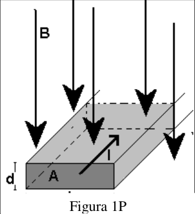
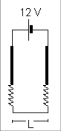
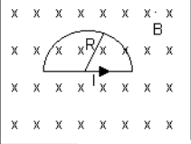

# Fuerzas magnéticas sobre cargas: guía identificada como 2011

Fuente: `2015/guia de problemas 2011.pdf`, páginas 20–21 de 31. SHA-256:
`5a5ae8ac33a7a3d14d854623015ef14bc0af3dae1651c013aed06567e28a8bca`.

Extracción pdftotext y cotejo visual de ambas páginas, con recuperación de
vectores, fórmula y μV. Quince preguntas, catorce problemas y tres figuras. El
año 2011 pertenece al nombre del archivo.

## Cuestionario

**1.** ¿Qué experimenta una carga que se mueve en un campo de inducción
magnética? ¿Cómo se manifiesta?

**2.** Un electrón en reposo, si se lo somete a un campo de inducción magnética
¿se mueve?

**3.** En una región del espacio donde no hay campo eléctrico pero sí campo
magnético, se lanza una partícula cargada (masa m, carga q), con velocidad
$`\vec v`$: a) $`\vec v\parallel\vec B`$, b) $`\vec v\perp\vec B`$, c)
$`\vec v`$ forma un ángulo $`\theta`$ con $`\vec B`$. Indique en cada caso la
fuerza que actúa sobre la partícula. ¿Existe alguna una operación matemática que
involucre los tres casos? ¿Cuál?.

**4.** Si un electrón no se desvía al pasar por cierta región del espacio,
¿podemos estar seguros de que no hay ningún campo magnético en la región?

**5.** Dos partículas cargadas ingresan en una región donde existe un campo de
inducción magnética, si las partículas son desviadas en direcciones opuestas
¿qué conclusiones se puede sacar de los atributos de ellas?

**6.** En la ecuación $`\vec F=q\vec v\wedge\vec B`$ ¿Qué pares de vectores son
siempre perpendiculares? ¿Cuáles pueden formar ángulos cualesquiera entre sí ?

**7.** ¿Puede emplearse una espira de corriente para determinar la presencia y
la orientación de un campo de inducción magnética?

**8.** Defina las unidades de $`\vec B`$ en el sistema MKS y cgs.

**9.** En una región del espacio donde coexisten los campos $`\vec E`$ y
$`\vec B`$ se mueve una partícula cargada, qué fuerza actuará sobre ella?

**10.** ¿Qué significa un elemento de corriente? Tiene existencia real?

**11.** A partir de $`\vec F=q\vec v\wedge\vec B`$, obtenga la fuerza sobre un
elemento de corriente.

**12.** Haga un esquema del ciclotrón y establezca la frecuencia de resonancia.

**13.** Establezca las diferencias entre las fuerzas eléctricas y magnética

**14.** Demuestre que la fuerza total sobre una espira por la que circula
corriente, colocada en un campo magnético uniforme, es cero.

**15.** Defina momento dipolar magnético y exprese sus unidades.

## Problemas

### Problema 1

Si una partícula con carga positiva y velocidad $`\vec v`$ ingresa en un campo
de inducción magnética uniforme $`\vec B`$, demostrar que: a) describe una
circunferencia si $`\vec v`$ es perpendicular a $`\vec B`$. b) describe una
hélice cilíndrica si $`\vec v`$ forma una ángulo con $`\vec B`$.

### Problema 2

Dado un haz de electrones cuya distribución de velocidades es al azar, encontrar
un método para seleccionar los electrones con una velocidad determinada

### Problema 3

Un electrón cuya velocidad es el 1 % de la velocidad de la luz en el vacío,
penetra en un campo inducción magnética uniforme, formando su velocidad un
ángulo recto con el campo B. a)¿Cuál es el valor de B si el electrón se mueve
con una órbita de radio 10 cm? b)¿Cuál es el período del electrón en su órbita?

### Problema 4

Un ciclotrón acelera protones a velocidades no relativistas. El imán del
ciclotrón posee una intensidad de campo de 1 T. ¿A qué frecuencia orbitan los
protones en el acelerador? masa del protón = $`1{,}67\cdot10^{-27}`$ kg.

### Problema 5

Un protón orbita en un ciclotrón cuyo campo magnético es de 2 tesla. a)¿Cuál
debe ser la frecuencia del campo eléctrico oscilante en el ciclotrón? b)
Demuestre que la cantidad de movimiento del protón para un valor del radio está
dada por:

```math
m_p\cdot v_o=B_o\cdot Q_p\cdot\rho.
```

c)¿Cuál es la energía cinética del protón si el radio de la órbita es: i)10 cm,
ii) 100 cm.

### Problema 6

El espectrógrafo de masas es un instrumento ideado para determinar la relación
carga - masa de las partículas. a) Haga un esquema del dispositivo, indicando
claramente la región donde se halla el campo magnético. b) Exprese la relación
q/m de las partículas en términos de los parámetros que se manejan en el
espectrógrafo. c) Para un haz de partículas de igual carga y distinta masa el
dispositivo dispersa el haz, ¿por qué?

### Problema 7

En un espectrógrafo de masas se estudian los isótopos de un elemento simplemente
ionizados. En su selector de velocidades actúan un campo B = 0,01 T y un campo E
= 200 V/cm. En la cámara de deflexión existe un campo magnético uniforme de 1 T;
los iones impresionan una película fotográfica dejando trazas separadas 8,28 cm.
El radio menor de las órbitas es 60,17 cm. ¿Cuál es la masa en gramos de cada
isótopo?

### Problema 8

Por un conductor de sección A y número de portadores de carga por unidad de
volumen n, circula una corriente I. Al conductor se lo coloca en un campo
magnético como muestra la figura.1P Determine la diferencia de potencial
generada a través del conductor, conocida como voltaje Hall.



Figura 1P.

### Problema 9

Un conductor de 0.5 cm de espesor se utiliza como espécimen en la medida del
efecto Hall si un voltaje Hall de 35 $`\mu\mathrm V`$ es medido para una
corriente de 21 A. En un campo magnético de 1.8 T. Calcule el coeficiente Hall
para el conductor

### Problema 10

Suponga que una hoja de plata lleva una corriente de 5 A. Si la corriente está
dirigida perpendicular a un campo magnético de 1.5 T ¿cuál debe ser el espesor
de la hoja para producir un voltaje de Hall de :a) 1V y b) 1 mV.

### Problema 11

Un alambre recto de 10 g y 5 cm se suspende con dos resortes idénticos de tal
manera que forman el circuito mostrado en la figura 2P. La resistencia del mismo
es de 12 ohm. Los resortes está alargados debido al peso en 0.5 cm. ¿Cuál es la
magnitud y sentido del campo magnético que se requiere para eliminar el
alargamiento de los resortes?



Figura 2P.

### Problema 12

Para el circuito de la figura 3P determine la fuerza de origen magnético en la
espira semicircular de la figura.



Figura 3P.

### Problema 13

Un enrollamiento circular de radio R y N vueltas por el que circula una
corriente i, está en un campo de inducción magnética constante B ¿ qué cantidad
de trabajo se requiere para cambiar de la orientación donde forma un ángulo 0º
respecto del campo hasta otra en la cual forma un ángulo igual a 180º? N = 500,
a = 7 cm, i = 1 amp y B = 0.7 T

### Problema 14

Una espira rectangular está colocada en una región donde existe un campo
magnético uniforme y transporta una corriente de 50 $`\mu\mathrm A`$. a)
Calcular las fuerzas magnéticas sobre cada lado si la normal de la espira forma
un ángulo de 30° con la dirección del campo. b) Encontrar el par que experimenta
la espira indicando cuánto vale el momento dipolar magnético.

## Observaciones de fidelidad

- Las quince preguntas coinciden con la otra guía cotejada; los catorce
  problemas son de esta versión y mantienen su numeración consecutiva.
- El problema 9 imprime 35μV; se recupera μ ausente del texto extraído. El 13
  usa R en el enunciado y a=7cm en los datos.
- El problema 14 no proporciona dimensiones de la espira rectangular; no se
  completan valores de otra versión ni se resuelven ejercicios.
