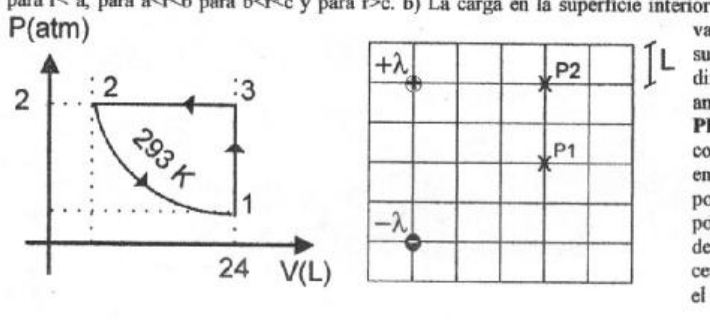

# IEM 2009: recuperatorio primer parcial — calor molar cinco medios

Apellido y Nombre: \_\_\_\_\_\_\_\_\_\_\_\_\_\_\_\_\_\_\_\_

## Problema 1

Para un mol de gas ideal ($`cv=(5/2).R`$) que sigue las transformaciones de la
figura hallar: a) El resto de las coordenadas termodinámicas, b) Q, W y Δ U para
cada uno de los procesos y para el ciclo completo en unidades MKS.

## Problema 2

Representar gráficamente el campo eléctrico creado por cada distribución lineal
de carga con densidad lineal λ de la figura y el campo total en el punto P1.
Hallar el módulo, la dirección y el sentido del campo en el mismo punto. Cuál es
el valor de la densidad lineal de carga ubicada en P2 para que el campo en P1
sea nulo?

## Problema 3

Una esfera de radio a=1.5 cm tiene distribuida uniformemente una carga total
$`Q=2\times10^{-9}\ \mathrm{coul}`$. Rodeando a ésta se encuentra un casquete
esférico de radio interior b=3 cm y radio exterior c=3.5 cm. Dicho casquete se
encuentra conectado a un potencial V=300 voltios. Hallar a) La expresión del
campo eléctrico para $`r\lt a`$, para $`a\lt r\lt b`$, para $`b\lt r\lt c`$ y
para $`r\gt c`$. b) La carga en la superficie interior y exterior del casquete.
c) El campo eléctrico en la superficie de cada esfera. d) La diferencia de
potencial entre ambos casquetes.

## Problema 4

Una esfera conductora de radio 3 cm se encuentra conectada a un potencial Vo. Si
la diferencia de potencial entre un punto a 1 cm del centro y otro a 5 cm del
centro es de 10 voltios, calcular el valor del potencial Vo.

## Procedencia y observaciones de transcripción

- Original:
  `2015/480938-Modelos de parcial FISICA II actualizado 060813(0).pdf`, página
  7, examen inferior «IEM 2009 - RECUPERATORIO PRIMER PARCIAL DE FISICA II». Se
  diferencia por el calor molar impreso; no se inventa número de tema.
- SHA-256: `1555e295ed06e6a3872614be84854c0e0af3e8455048ca7e5bcbc4383490653e`.
- Compilación: Sampallo Guillermo, Rodríguez Ulises y Cleva Mario; versión 1.1,
  04/08/2010 en carátula.
- Herramientas: OCRmyPDF español sobre copia con `--force-ocr`, PyMuPDF4LLM,
  Poppler y cotejo visual de los cuatro enunciados, expresiones y diagramas.
  Figuras originales por render PyMuPDF. No se resuelven ejercicios ni se
  completan campos.
- Se conserva la consigna de densidad lineal ubicada en P2 y la mención final a
  «ambos casquetes», sin reinterpretarlas.
