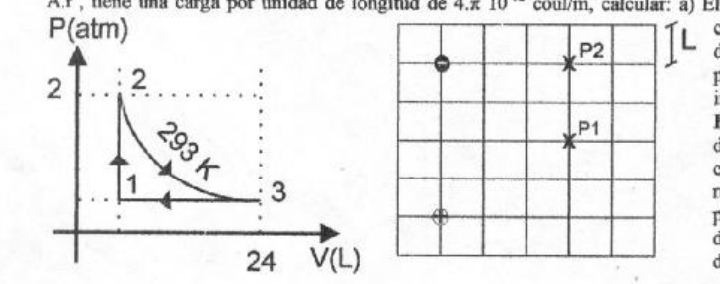

# IEM 2009: recuperatorio primer parcial — calor molar tres medios

Apellido y Nombre: \_\_\_\_\_\_\_\_\_\_\_\_\_\_\_\_\_\_\_\_

## Problema 1

Para un mol de gas ideal ($`cv=(3/2).R`$) que sigue las transformaciones de la
figura hallar: a) El resto de las coordenadas termodinámicas, b) Q, W y Δ U para
cada uno de los procesos y para el ciclo completo en unidades MKS.

## Problema 2

Representar gráficamente el campo eléctrico creado por cada campo del dipolo de
la figura y el campo total en el punto P1. Hallar el módulo, la dirección y el
sentido del campo en el mismo punto. ¿Qué valor debería tener una carga puntual
en P2 para que el campo en P1 sea nulo?

## Problema 3

Un cilindro no conductor infinito de radio 2 cm, con una densidad volumétrica de
carga $`\rho(r)=A.r^4`$, tiene una carga por unidad de longitud de
$`4.\pi\times10^{-12}\ \mathrm{coul/m}`$, calcular: a) El valor de la constante
A. b) El campo eléctrico a 1 cm y a 3 cm del eje del cilindro. c) La diferencia
de potencial entre los radios del inciso b.

## Problema 4

Calcular la distribución volumétrica de carga uniforme de una esfera de radio 3
cm, si la diferencia de potencial entre un punto a 1 cm del centro y otro a 5 cm
del centro es de 10 voltios.

## Procedencia y observaciones de transcripción

- Original:
  `2015/480938-Modelos de parcial FISICA II actualizado 060813(0).pdf`, página
  8, examen superior «IEM 2009 - RECUPERATORIO PRIMER PARCIAL DE FISICA II». Se
  diferencia por el calor molar impreso; no se inventa número de tema.
- SHA-256: `1555e295ed06e6a3872614be84854c0e0af3e8455048ca7e5bcbc4383490653e`.
- Compilación: Sampallo Guillermo, Rodríguez Ulises y Cleva Mario; versión 1.1,
  04/08/2010 en carátula.
- Herramientas: OCRmyPDF español sobre copia con `--force-ocr`, PyMuPDF4LLM,
  Poppler y cotejo visual de los cuatro enunciados, expresiones y diagramas.
  Figuras originales por render PyMuPDF. No se resuelven ejercicios ni se
  completan campos.
- Se conserva «creado por cada campo del dipolo», la potencia cuarta de r y la
  diferencia de potencial del inciso b); no se sustituyen por las distribuciones
  de la otra versión.
