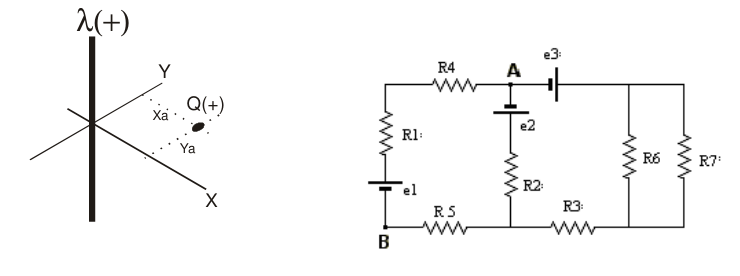

# Recuperatorio extraordinario 2do parcial IEM 2010 — cargas y calor

APELLIDO Y NOMBRE: \_\_\_\_\_\_\_\_\_\_\_\_\_\_\_\_\_\_\_\_

## Problema 1

Dada las distribuciones de carga de la figura 1, hallar a) La expresión del
campo eléctrico en cualquier punto de un plano que contenga a la carga y sea
perpendicular al hilo. b) El punto del plano definido en a) donde el campo
eléctrico se anula. c) Representar gráficamente los vectores campo eléctrico
producidos por el hilo y la carga puntual en un punto cualquiera del plano
definido en a). DATOS: $`\lambda=1.77\times10^{-11}\ \mathrm{coul/m}`$,
$`Q=9\times10^{-14}\ \mathrm{coul}`$, xa = 4cm , ya = 3cm.

## Problema 2

Una esfera metálica de radio a = 3 cm posee una carga total
$`Q1=2\times10^{-9}\ \mathrm{coul}`$. Rodeando a esta se encuentra un casquete
esférico de radio interior b = 4 cm y exterior c = 4.5 cm el cual tiene una
carga $`Q2=-3\times10^{-9}\ \mathrm{coul}`$. Calcular a) el campo eléctrico para
r = 2 cm, r = 3.5 cm, r = 4.2 cm y r = 5 cm b) la carga interior y exterior del
casquete c) La diferencia de potencial entre r = 4.2 cm y r = 3.5 cm

## Problema 3

Calcular las corrientes eléctricas que circulan (Fig. 2) y la diferencia de
potencial entre los puntos a y b. Datos: R1 = R3 = R5 = 1 ohm; R2 = R4 = R6 = R7
= 2 ohm E1 = 10 V. ; E2 = 8 V. ; E3 = 6 V.

## Problema 4

Calcular la temperatura de equilibrio si se mezclan en un calorímetro 500 gramos
de agua a 100 C con 200 gramos de hielo a 0 C. Datos adicionales: Calor
específico del agua = 1 cal/(g.K) - Calor específico del vapor de agua = 0.48
cal/(g.K) - Calor específico del hielo = 0.5 cal(g.K) - Calor latente de fusión
del agua a la presión atmosférica = 80 cal/g - Calor latente de vaporización del
agua a la presión atmosférica = 536 cal/g.

## Procedencia y observaciones de transcripción

- Original:
  `2015/480938-Modelos de parcial FISICA II actualizado 060813(0).pdf`, página9,
  examen inferior. Se conserva «2DO PARCIAL» del título, aunque los contenidos
  sean electrostática y calor.
- SHA-256: `1555e295ed06e6a3872614be84854c0e0af3e8455048ca7e5bcbc4383490653e`.
- Compilación: Sampallo Guillermo, Rodríguez Ulises y Cleva Mario; versión1.1,
  04/08/2010 en carátula.
- Herramientas: extracción textual PyMuPDF y Poppler y cotejo visual de
  enunciados, datos y figuras; diagramas originales por render PyMuPDF.
- Se conserva «Dada las distribuciones», 100 C y0 C sin símbolo de grado y
  cal(g.K) sin barra para el calor específico del hielo. No se resuelven
  ejercicios ni se completan campos.
