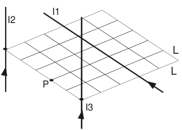
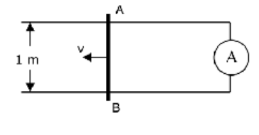

# Recuperatorio extraordinario 2do parcial IEM 2010

APELLIDO Y NOMBRE: \_\_\_\_\_\_\_\_\_\_\_\_\_\_\_\_\_\_\_\_

## Problema 1

Dada la distribución de conductores de corrientes de la figura, a) Graficar el
campo magnético que cada conductor genera en el punto P. b) Calcular el campo
magnético total (módulo, dirección y sentido). Datos: I1 = 1 amp, I2 = 2 amp, I3
= 3 amp. L = 1 cm

## Problema 2

El conductor móvil AB de la figura se mueve con una velocidad de 5 m/s sobre
otros dos paralelos, en el seno de un campo magnético B de 0,2 T, perpendicular
al plano de la figura y saliendo de él. La resistencia del circuito formado es
de 0,2 Ω a) Calcula el valor de la intensidad que pasa por el amperímetro (A) b)
Calcula la fuerza que se necesita, en la condiciones del problema, para mantener
constante la velocidad v con que se mueve el conductor AB.

## Problema 3

La densidad de corriente en un conductor cilíndrico de radio R = 10 cm., es
$`J=3/r`$ donde J se mide en Amp/m2 y r en m. Calcular: a) la corriente total
que circula por el mismo; b) el Campo Magnético (Módulo, dirección y sentido) en
puntos interiores y exteriores a dicho conductor.

## Problema 4

Con las siguientes mediciones de valores eficaces de VL= 18 V, VC = 14 V e I =
0.5 amp y la fem de la fuente de 5 V con una frecuencia de 250 Hz, se desea
conocer los valores de los elementos R, L y C que están conectados en serie y
además el desfasaje entre la corriente y la ddp correspondiente

## Figuras originales

## Procedencia y observaciones de transcripción

- Original:
  `2015/480938-Modelos de parcial FISICA II actualizado 060813(0).pdf`, página
  22\.
- SHA-256: `1555e295ed06e6a3872614be84854c0e0af3e8455048ca7e5bcbc4383490653e`.
- Compilación: Sampallo Guillermo, Rodríguez Ulises y Cleva Mario; versión 1.1,
  04/08/2010 en carátula. Se conserva la identificación y fecha del examen.
- Herramientas: extracción textual PyMuPDF y Poppler, cotejo visual de
  enunciados, datos, expresiones y figuras; diagramas originales por render
  PyMuPDF. No se completan campos ni se resuelven ejercicios.
- Se conserva «en la condiciones» y «se desea conocer». La primera figura
  incluye L=1 cm y la segunda 1 m; son datos de problemas diferentes.
