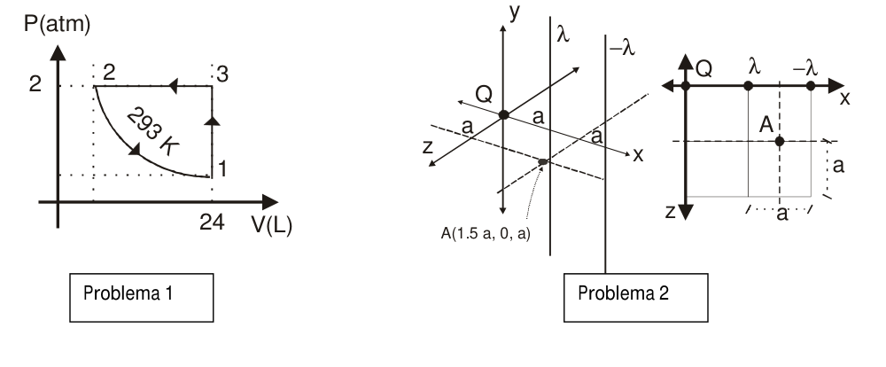
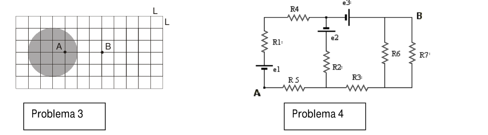

# Física II IEM (2010): recuperatorio 1er parcial, tema 2

APELLIDO Y NOMBRE: \_\_\_\_\_\_\_\_\_\_\_\_\_\_\_\_\_\_\_\_

## Problema 1

Para un mol de gas ideal ($`cv=(5/2).R`$) que sigue las transformaciones de la
figura hallar: a) El resto de las coordenadas termodinámicas. b) Q, W y Δ U para
cada uno de los procesos y para el ciclo completo.

Datos adicionales: $`1\ \mathrm{atm}=1{,}013\times10^{15}\ \mathrm{Pa}`$,
$`1\ \mathrm{L}=0.001\ \mathrm{m^3}`$,
$`R=0{,}082\ \mathrm{L.atm/(mol.K)}=8{,}31\ \mathrm{J/(mol.K)}`$. Puntaje a) 1
punto b) 1,5 puntos

## Problema 2

Para la siguiente distribución de carga, a) Calcular el campo eléctrico en el
punto A. b) Representar gráficamente a escala los campos producidos por cada
distribución de carga en el punto A, hallar el campo total resultante y
verificar con el obtenido en el punto a).

Datos: $`\lambda=5{,}56\times10^{-11}\ \mathrm{coul/m}`$,
$`Q=1{,}112\times10^{-10}\ \mathrm{coul}`$, $`a=1\ \mathrm{m}`$,
$`A(1.5\ a,0,a)`$.

Puntaje: a) 1,5 puntos, b) 1 punto.

## Problema 3

Una distribución esférica de carga $`\rho(r)=A/r`$ posee una carga total
$`Q=8.85\times10^{-12}\ \mathrm{coul}`$. ($`L=1\ \mathrm{cm}`$) Calcular a) El
campo eléctrico en el punto A b) El campo eléctrico en el punto B c) La
diferencia de potencial entre A y B c) En qué lugar se deberá ubicar una carga
$`Q=8.85\times10^{-12}\ \mathrm{coul}`$ para que el campo en B se anule.

Puntaje a) 0,5 puntos, b) 0,5 puntos c) 1 punto d) 1 punto.

## Problema 4

Calcular a) las corrientes eléctricas que circulan por cada resistencia y b) la
diferencia de potencial entre los puntos A y B.

Datos: $`R1=R3=R5=1\ \mathrm{k\Omega}`$ $`R2=R4=R6=R7=2\ \mathrm{k\Omega}`$
$`e1=5\ \mathrm{V}`$, $`e2=8\ \mathrm{V}`$, $`e3=6\ \mathrm{V}`$.

Puntaje a) 1 punto b) 1 punto.

## Figuras originales

## Procedencia y observaciones de transcripción

- Original:
  `2015/480938-Modelos de parcial FISICA II actualizado 060813(0).pdf`, páginas
  11–12 (página 12: solo las figuras 3–4 superiores). Compilación: Sampallo
  Guillermo, Rodríguez Ulises y Cleva Mario; versión 1.1, 04/08/2010 en
  carátula. Se conserva la identificación IEM del examen.
- SHA-256: `1555e295ed06e6a3872614be84854c0e0af3e8455048ca7e5bcbc4383490653e`.
- Herramientas: capa textual PyMuPDF y Poppler; figuras extraídas por render
  PyMuPDF del original; cotejo visual del enunciado y todos los diagramas.
- Se conserva el exponente **15** de la equivalencia atm/Pa impresa, sin
  corregirlo. También se conserva la repetición del inciso c) del problema 3,
  aunque el puntaje enumera d). El campo de nombre permanece vacío; los puntajes
  son los del enunciado.
