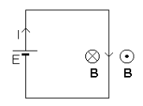
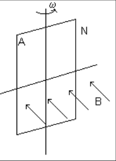
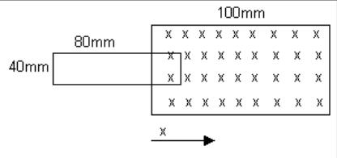
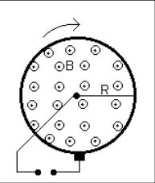
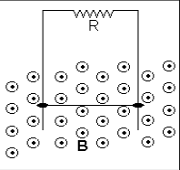
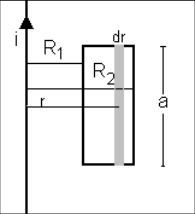
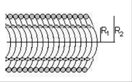
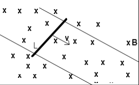
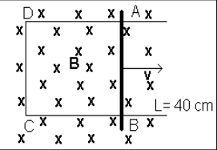
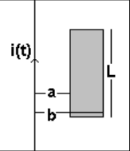

# Inducción electromagnética: guía identificada como 2011

Fuente: `2015/guia de problemas 2011.pdf`, sección de páginas 24–26 de 31, hasta
el final del problema 12 antes de magnetismo en medios materiales. SHA-256:
`5a5ae8ac33a7a3d14d854623015ef14bc0af3dae1651c013aed06567e28a8bca`.

Extracción pdftotext, recuperación visual de símbolos/unidades y cotejo de las
tres páginas. Once preguntas, doce problemas y diez archivos gráficos, incluida
la figura del cuestionario. El año 2011 pertenece al nombre del archivo.

## Cuestionario

**1.** ¿Cuál es la expresión del flujo magnético a través de una superficie: a)
cerrada? b) abierta?

**2.** ¿Cuáles son las posibilidades de variar el flujo magnético a través de
una espira conductora?.

**3.** Enuncie la Ley de Faraday. Exprésela si la causa de la variación del
flujo es: a) el campo; ejemplo. b) el área; ejemplo. c)La orientación del área
respecto del campo; ejemplo.

**4.** Justifique la Ley de Lenz.

**5.** ¿Puede existir fem inducida en un circuito abierto? Justifique.

**6.** Es necesario que el circuito donde se genera la fem sea de material, por
ejemplo un alambre metálico?

**7.** La fem inducida, ¿está localizada?

**8.** De acuerdo al convenio: a. Si B es entrante al plano del papel, entonces
el flujo es ........................ b. Si B es saliente al plano del papel,
entonces el flujo es ........................ c. Si la corriente es de sentido
horario, la fem es ....................................... d. Si la corriente es
de sentido antihorario, la fem es .................................

**9.** ¿Qué se entiende por flujo enlazante?

**10.** Si se asocian bobinas de modo que no haya interacción entre ellas,
encuentre la expresión para una asociación : a) en serie, b)en paralelo.

**11.** ¿De dónde proviene la energía que produce el campo magnético alrededor
del conductor por el que circula una corriente I, como se muestra en la figura?.

## Problemas

### Problema 1

a)Una espira de 3 vueltas y área 0,5 $`\mathrm{m^2}`$ situada en el aire, se
halla en un campo magnético uniforme normal al plano de la espira; si la
densidad de flujo cambia 5 mT/s. ¿Cuál es la fem. que aparece entre los
terminales de la espira? b) Si la fem entre los terminales de la espira es 100
mV ¿Cuál es la velocidad de cambio del campo magnético?

### Problema 2

¿Cuántas espiras (ver figura 1P) son requeridas para una espira cuadrada de 100
mm de lado, si se desea desarrollar una fem. máxima de 10 mV, y la espira rota a
30 vueltas/s en el campo magnético terrestre. $`B_t=60\,\mu\mathrm T`$.

Figura 1P.

### Problema 3

Un campo uniforme B de 100 mT se extiende sobre un área cuadrada de 100 mm de
lado, como muestra la figura 2P; con un campo cero fuera de esa zona. Una espira
de alambre, rectangular 40 por 80 mm se mueve en el campo con velocidad 100
mm/s. Hallar la fem. inducida en la espira y graficar los resultados en un
gráfico $`\phi(t)`$ y $`e(t)`$ para el intervalo

correspondiente.

Figura 2P.

### Problema 4

Una espira de alambre de 5 vueltas de 0,5 $`\mathrm{m^2}`$ de área gira con una
frecuencia de 20 Hz. Si en la espira se desarrolla una fem de 100 mV cuando está
orientada para respuesta máxima, hallar la amplitud del campo magnético.

### Problema 5

Un disco con aro conductor y rayo simple rota perpendicular a un campo magnético
uniforme B según la figura 3P. El campo magnético esta confinado a un radio R de
las piezas polares de un imán. Un circuito externo hace contacto con el eje y el
aro a través de escobillas. Si el disco rota con N rev. / seg., Hallar la fem.
inducida en el circuito.

Figura 3P.

### Problema 6

Un conductor de longitud a y masa m puede deslizarse por un par de

guías metálicas conectadas a una resistencia R, como muestra la figura 4P. La
fricción y la resistencia del conductor y de las guías son despreciables. Hay un
campo magnético uniforme y horizontal de intensidad B normal al plano del dibujo
y dirigida hacia fuera. Calcule la velocidad estacionaria final de caída bajo la
acción gravitatoria

Figura 4P.

### Problema 7

Calcule la inducción mutua entre la espira rectangular y el alambre recto de
gran longitud, como se muestra en la figura 5P.

Figura 5P.

### Problema 8

Calcule el coeficiente de autoinducción de un solenoide de radio R= 1 cm, de
longitud Z= 0.2 m y con N = 1000 espiras.

### Problema 9

Dos solenoides coaxiales de radios $`R_1`$ =1 cm y $`R_2`$ = 1.5 cm y longitud
Z=30 cm con densidades de enrollamiento $`n_1`$ =7000 vueltas por metro y
$`n_2`$ = 4000 vueltas por metro. Ver figura 6P. Determine a) la inducción mutua
$`M_{12}`$ y la fem inducida en el solenoide 2, cuando circula una corriente
$`i_1(t)=2\cos(100\pi t)`$ por el solenoide 1.

Figura 6P.

### Problema 10

Una varilla de longitud L se mueve con velocidad v en. dirección perpendicular a
su eje y a un campo de inducción magnética B constante como se indica en la
figura 7P. a) Escribir la expresión y graficar la dirección de la fuerza que
actúa sobre las cargas de la varilla como consecuencia del movimiento de la
misma. b) Indicar magnitud y dirección del vector campo eléctrico E debido a la
redistribución de cargas que el movimiento origina. c) Cuál es la diferencia de
potencial entre los extremos de la varilla ? d) Calcular la fem inducida por el
movimiento según la ley de Faraday y comparar el resultado con el obtenido en el
punto c).

Figura 7P.

### Problema 11

La barra conductora AB de longitud L de la figura 8P hace contacto con las guías
metálicas AD y BC. a) El sistema se encuentra en. un campo magnético uniforme de
densidad de flujo 450 $`\mathrm{mwb/m^2}`$, perpendicular a la figura. Calcular
la magnitud y sentido de la fem inducida en la barra, cuando se mueve hacia la
derecha con una velocidad de 5 rn/seg. b) Idem al item a) para un campo
magnético uniforme de densidad de flujo 500 $`\mathrm{mwb/m^2}`$ saliente al
plano de la gráfica y v = 5 m/s en el mismo sentido que en el Item a). c) Idem a
los puntos a y b) pero, para una velocidad de 4 m/s y de sentido opuesto al
seguido en los items anteriores, es decir, para un campo magnético entrante al
plano de la gráfica y para otro saliente.

Figura 8P.

### Problema 12

Un hilo conductor de longitud infinita lleva una corriente de
$`i(t)=I_o\mathop{\mathrm{sen}}\nolimits(2\pi ft)`$. En la espira rectangular de
la figura 9P, encontrar la corriente I(t) si la misma ofrece una resistencia R.
Datos: $`I_o`$ = 10 A, f = 20/seg., R = 3 Ohm, a = 2 cm b =12 cm L = 30 cm.

Figura 9P.

## Observaciones de fidelidad

- Se conservan los cuatro espacios de respuesta de la pregunta 8. Esta versión
  sí incluye nueve figuras de problemas, diferentes de la otra selección.
- Se recuperan μT del problema 2, φ(t) del 3 y π de las corrientes de 9 y 12.
- Se conserva «mwb/m²», «rn/seg.» y «en.» del problema 11. No se resuelven
  ejercicios ni se cambian unidades por plausibilidad física.
