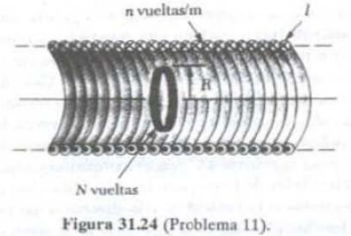
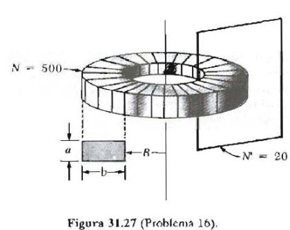
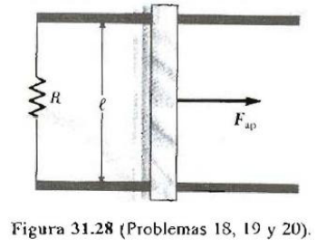

# Guía de problemas: inducción electromagnética

Fuente: `2015/GUIA DE PROBLEMAS PROPUESTOS 2da parte.pdf`, sección de páginas
6–8 de 13, hasta antes de magnetismo en medios materiales. SHA-256:
`e2452f4b287c4401d9902c425f82a9caaab0bb7dd7c877c724934eb2bed5a9fa`.

Extracción pdftotext y cotejo visual de las tres páginas. Once preguntas, once
problemas numerados 1,4,5,7,11,13,16,18,21,26,27 y cuatro figuras, incluida la
del cuestionario.

## Cuestionario

**1.** ¿Cuál es la expresión del flujo magnético a través de una superficie: a)
cerrada? b) abierta?

**2.** ¿Cuáles son las posibilidades de variar el flujo magnético a través de
una espira conductora?.

**3.** Enuncie la Ley de Faraday. Exprésela si la causa de la variación del
flujo es: a) el campo; ejemplo. b) el área; ejemplo. c)La orientación del área
respecto del campo; ejemplo.

**4.** Justifique la Ley de Lenz.

**5.** ¿Puede existir fem inducida en un circuito abierto? Justifique.

**6.** Es necesario que el circuito donde se genera la fem sea de material, por
ejemplo un alambre metálico?

**7.** La fem inducida, ¿está localizada?

**8.** De acuerdo al convenio: a. Si B es entrante al plano del papel, entonces
el flujo es ........................ b. Si B es saliente al plano del papel,
entonces el flujo es ........................ c. Si la corriente es de sentido
horario, la fem es ....................................... d. Si la corriente es
de sentido antihorario, la fem es .................................

**9.** ¿Qué se entiende por flujo enlazante?

**10.** Si se asocian bobinas de modo que no haya interacción entre ellas,
encuentre la expresión para una asociación : a) en serie, b)en paralelo.

**11.** ¿De dónde proviene la energía que produce el campo magnético alrededor
del conductor por el que circula una corriente I, como se muestra en la figura?.

## Problemas

### Problema 1

Una bobina rectangular de 50 vueltas de dimensiones 5 cm X 10 cm se deja "caer'
desde una posición donde el campo magnético B = 0 hasta una nueva posición donde
B = 0.5 T y está dirigido perpendicularmente al plano de la bobina. Calcule la
fem promedio resultante en la bobina si el desplazamiento ocurre en 0.25 s.

### Problema 4

Una espira cuadrada de una sola vuelta de 0.20 m de lado se coloca con su plano
perpendicular a un campo magnético constante. Una fem de 18 mV es inducida en el
alambre cuando el área de la bobina disminuye con una rapidez de 0.1
$`\mathrm{m^2/s}`$. ¿Cuál será la magnitud del campo magnético?

### Problema 5

El plano de una bobina rectangular de dimensiones 5 cm por 8 cm es perpendicular
a la dirección de un campo magnético B. Si la bobina tiene 75 vueltas y una
resistencia total de 8Ω, ¿con qué rapidez debe cambiar la magnitud de B de
manera que la corriente inducida en el alambre sea de 0.1 A?

### Problema 7

Una bobina circular de 30 vueltas de radio 4 cm y resistencia 1Ω se coloca en un
campo magnético dirigido perpendicularmente al plano de la bobina. La magnitud
del campo magnético varia en el tiempo de acuerdo con la expresión
$`B=0.01t+0.04t^2`$, donde t está en s y B está en T .Calcule. la fem inducida
en la bobina para t=5s.

### Problema 11

Un solenoide largo tiene n vueltas por unidad de longitud y lleva una corriente
$`I=I_o(1-e^{-\alpha t})`$ con $`I_o`$=30 A y α=1.6 $`\mathrm{s^{-1}}`$. En el
interior del solenoide y coaxialmente con ella está una espira que tiene un
radio R= 6cm y consta de un total de N vueltas de alambre delgado. ¿Cuál es la
fem inducida en la espira por la corriente variable? Tome n= 400 vueltas/m y N=
250 vueltas (figura 31.24).

### Problema 13

Una bobina formada por 50 vueltas bien apretadas de alambre con forma cuadrada,
está colocada en un campo magnético de tal manera que la normal al plano de la
espira forma un ángulo de 30º con la dirección del campo. Se observa que si el
campo experimenta desde200 µT hasta 600µT en 4s, una fem de 80 mV se induce en
la bobina. Cuál es la longitud total del alambre?

### Problema 16

Un toroide de sección transversal rectangular (a=2cm por b=3cm) y radio interior
R=4cm consta de 500 vueltas de alambre que llevan una corriente
$`I=I_o\mathop{\mathrm{sen}}\nolimits(wt)`$ con $`I_o`$=50ª y una frecuencia
angular $`f=w/2\pi60`$ Hz. Una espira que consta de 20 vueltas de alambre se une
al toroide como se muestra en la figura 31.27. Determine La fem inducida en la
espira por la corriente variable.

### Problema 18

Considere el arreglo de la figura 31.28. Suponga que R= 6 Ω, l = 1.2 m y que un
campo magnético uniforme de 2.5 T está dirigido hacia dentro de la página. ¿Con
qué velocidad debería moverse la barra para producir una corriente de 0.5 A en
la resistencia?

### Problema 21

Sobre una región donde la componente vertical del campo magnético terrestre es
40 µT dirigido hacia abajo, un alambre de 5 m de longitud se coloca a lo largo
de la dirección este-oeste y se mueve horizontalmente hacia el norte con una
rapidez de 10 m/s. Calcule la diferencia de potencial entre los extremos del
alambre y determine cuál es el extremo positivo.

### Problema 26

Una bobina circular de 200 vueltas de radio 10 cm se coloca en un campo
magnético uniforme de 0.8 T de tal manera que el plano de la bobina es
perpendicular a la dirección del campo. La bobina es girada con rapidez
constante (velocidad angular constante) a través de 90° en un tiempo de 1.5 s,
así que el plano de la bobina finalmente es paralelo al campo. a) Calcule la fem
promedio inducida en la bobina como resultado de la rotación, b) ¿Cuál es el
valor instantáneo de la fem en la bobina en el momento en que el plano de la
bobina forma un ángulo de 45° con el campo magnético?

### Problema 27

Utilice la ley de Lenz para dar respuesta a las siguientes preguntas
concernientes a la dirección de corrientes inducidas. a) ¿Cuál es la dirección
de la corriente inducida en la resistencia de la figura 31.29a cuando el imán de
barra se mueve hacia la izquierda? b) ¿Cuál es la dirección de la corriente
inducida en Ia resistencia R precisamente después de que se cierra el
interruptor S en el circuito de la figura 31.29b? c)¿Cuál es la dirección de la
corriente inducida en R cuando I en la figura 31.29c disminuye rápido hasta
cero? d) Una barra de cobre se mueve hacia la derecha mientras su eje se
mantiene perpendicular al campo magnético, como en la figura 31.29d . Si el
extremo superior de la barra es positivo en relación con el inferior, ¿cuál es
la dirección del campo magnético?

## Observaciones de fidelidad

- La pregunta 8 mantiene sus cuatro espacios de respuesta sin completar.
- El problema 16 conserva «50ª» y «f=w/2π60 Hz», sin añadir un signo igual ni
  sustituir la letra elevada por una unidad supuesta.
- El problema 27 remite a figuras 31.29a–d que no aparecen en las páginas 6–8 de
  esta sección. No se inventan esos diagramas ni sus respuestas.
- Se preservan los enunciados y números de la compilación; las figuras
  31.24,31.27 y31.28 se asocian con sus problemas correspondientes.
