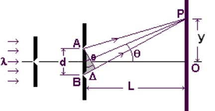
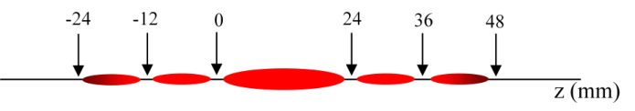
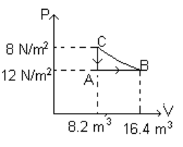

# Problemas de interferencia, difracción, calor y termodinámica

<!-- markdownlint-disable MD060 -->

Universidad Tecnologica Nacional, Facultad Regional Resistencia. Cátedra Física
II.

Fuente: `2015/GUIA DE PROBLEMAS PROPUESTOS  3ra parte.pdf`, cinco páginas.
SHA-256: `9e435dc4dcfe136f2d31bf379dec734d46dec3dc10e330ada029d54b92a038b1`.

Transcripción con PyMuPDF4LLM; cotejo con pdftotext y las cinco páginas
renderizadas. Se conservan enunciados, datos y casillas vacías; no se resuelven
ejercicios.

## GUIA DE PROBLEMAS: INTERFERENCIA

**1.** Superponga dos ondas expresadas como

```math
y_1(x)=E_1\cos(k_1x-\varphi_1)
```

```math
y_2(x)=E_2\cos(k_2x-\varphi_2)
```

Con $`k=\frac{2\pi}{\lambda}`$.

Encuentre la onda resultante si

**a)** Si $`E_1=5,\lambda_1=1`$ y $`\varphi_1=0`$ y Si $`E_2=5,\lambda_2=2`$ y
$`\varphi_2=\pi/4`$

**b)** Si $`E_1=5,\lambda_1=1`$ y $`\varphi_1=0`$ y Si $`E_2=5,\lambda_2=3`$ y
$`\varphi_2=\pi/4`$

**c)** Si $`E_1=5,\lambda_1=1`$ y $`\varphi_1=0`$ y Si $`E_2=-5,\lambda_2=3`$ y
$`\varphi_2=\pi/6`$

**2.** La distribución de intensidad producida en una pantalla a una distancia L
de una fuente de luz compuesta por dos ranuras separadas por d viene dada por

```math
I=I_o\cos^2\left[\frac{\pi d\mathop{\mathrm{sen}}\nolimits(\theta)}{\lambda}\right]
=I_o\cos^2\left[\frac{\pi d y}{\lambda\sqrt{L^2+y^2}}\right]
```



Represente gráficamente la intensidad en función de y

**a)** Si L=1m d=0.001m λ =580 nm Determine los mínimos y máximos.

**b)** Duplique el valor de d y repita el calculo

**c)** Si L=1m d=0.001m λ =400 nm Determine los mínimos y máximos

**3.** Una pantalla se encuentra a 1.2 m de una fuente de luz compuesta por dos
rendijas. La separación entre las rendijas es de 0.03 mm. La posición de las
franjas de orden dos ( m = 2) medida desde la línea central es 4.5 cm. a)
Determine la longitud de onda de la luz. b) Calcule la separación entre franjas
brillantes consecutivas

**4.** Una fuente de luz emite en la región visible con dos longitudes de onda
1=430nm y 2 =510 nm. La fuente se utiliza en un experimento de interferencia con
doble rendija, donde la distancia a pantalla es 1.5 m y la separación entre
rendija es 0.025 mm. Encuéntrese la separación entre las franjas brillantes de
orden tres que corresponden a cada una de estas longitudes de onda.

**5.** Calcúlese el espesor mínimo que debe tener la película de un burbuja de
jabón (n=1.33) para que se observe interferencia constructiva en la luz
reflejada cuando la película se ilumine con una luz de longitud de onda 600nm en
el vacío.

**6.** Analice el experimento de interferencia entre dos ranuras paralelas para
el caso que estén separadas 0.8 mm y a una distancia de 50 cm .La distancia
entre dos mínimos cercanos al centro es de 0.304 mm. ¿Cuál es la longitud de
onda de la luz?

## GUIA DE PROBLEMAS: DIFRACCIÓN

**1.** Construya empleando el principio de Huygens los frentes de ondas para el
caso de una rendija, de ancho igual 1 cm.

**2.** a) Para una solo rendija represéntese gráficamente el patrón de
difracción. Determínese las posiciones de los mínimos de intensidad. Determine
las posiciones de los máximos de intensidad. Datos ancho de la rendija a = 0.5mm
distancia a la pantalla 1m longitud de onda 500nm.

**3.** Una sola ranura de ancho s = 0.1mm se ilumina con una luz de rayos
paralelos de longitud de onda 600 nm En una pantalla que se encuentra a 40 cm se
observan las franjas de difracción. ¿A que distancia se encuentra la tercera
franja oscura de la franja brillante central?

**4.** Una luz roja incide normalmente sobre una rejilla de difracción de 4000
líneas/cm, y la imagen de segundo orden se difracta 34º a partir de la normal.
Calcule la longitud de onda de la luz.

**5.** a) Para dos rendijas represéntese gráficamente el patrón de difracción.
Determínese las oposiciones de los mínimos de intensidad. Determine las
posiciones de los máximos de intensidad. Datos ancho de la rendija a = 0.5mm,
separación entre rendijas 1.5mm y la distancia a la pantalla 1m longitud de onda
500nm.

**6.** Una luz monocromática que se origina en un laser de He Ne (=632.8nm)
incide perpendicularmente sobre una red de difracción que tiene 6000 líneas/cm.
Encuéntrese el ángulo con el cual se observa el máximo de orden uno y el máximo
de orden dos.

**7.** En el esquema adjunto se presenta el patrón de difracción de Fraunhofer
de una rendija estrecha, formado mediante un láser de He-Ne y recogido sobre una
pantalla situada a 160 cm de distancia. Las posiciones de los mínimos de
intensidad se dan en mm, colocando arbitrariamente el cero en el primer mínimo a
la izquierda del máximo principal. La longitud de onda del láser utilizado es
632.8 nm. Determínese la anchura de la rendija, expresando el resultado con su
error correspondiente



**8.** Determine el ancho de la ranura si tiene estos espectros de una fuente de
longitud de onda 650 nm y la altura de las imágenes es 3cm


## GUIA DE PROBLEMAS: TERMOMETRIA Y CALORIMETRIA

**1.** Supongamos que se define la temperatura t como una función cuadrática
$`t=ax^2+b`$, donde x es la longitud de la columna de un líquido tal que x1= 10
cm y x2 = 30 cm corresponden a a las temperaturas T1 = 273 K y T2 = 373 K.
Encuentre los coeficientes de la ley termométrica.

Hallar la longitud en cm entre las temperaturas T = 273K y T = 283K y entre T =
363 K y 373K

**2.** Los termómetros normalmente utilizados para realizar mediciones de
precisión, están basados en la variación que experimenta la resistencia
eléctrica de un circuito con la temperatura. Se ha encontrado que la ecuación
que relaciona la resistencia y temperatura, con toda exactitud es
$`R=R_o(1+\alpha T)`$, siendo T la temperatura medida con un termómetro de gas y
α es una constante. Se mide la resistencia de un cierto elemento, a las
temperaturas de solidificación del agua y de fusión del plomo (327ºC), las
cuales resultan ser 100.00 ohm y 16.35 ohm, respectivamente. Determinar el valor
de las constantes α y Ro.

Cuál es la resistencia que presenta este elemento a la temperatura de ebullición
del agua.

**3.** Se introducen en agua hirviendo diez monedas de cobre con una masa total
de aproximadamente 30g. Después de sacarlas se dejan caer en un vaso con agua a
temperatura ambiente. Si el vaso contiene 100 g de agua, cuya temperatura antes
de introducir las monedas es de 373 K, calcular la temperatura final.

**4.** A temperatura muy baja los calores específicos de algunas sustancias son
directamente proporcionales a la temperatura absoluta. Es decir, que
$`c=c_o\left[\frac{T}{T_o}\right]`$, siendo $`c_o`$ una constante. Calcular la
cantidad de calor que se debe comunicar a una masa m de una de estas sustancias
para que su temperatura pase de To a 2To.

**5.** ¿Qué cantidad de calor se debe comunicar a 0.25Kg de agua para aumentar
su temperatura de 283K a 293K?

**6.** ¿Qué cantidad de calor se debe comunicar a 0.1Kg de hielo a -10ºC para
convertirlo en agua liquida a +10ºC?

**7.** Se introduce en agua hirviendo un trozo de una sustancia desconocida de
masa 50 g. Se saca del agua y se deja caer a continuación en un recipiente de
cobre de masa 100g que contiene 200 g de agua a 20ºC La temperatura final una
vez que el sistema ha alcanzado el equilibrio es 22ºC ¿cuál es el calor
especifico de este material desconocido?

**8.** Un recipiente de Al de masa 100g contiene 200g de hielo a -20C .Se
comunica calor al sistema a razón de 100cal/seg. Representar gráficamente la
temperatura del sistema en función del tiempo.

**9.** El calor específico a temperaturas muy bajas es función de la temperatura
absoluta, en algunos metales presenta el comportamiento $`c=AT^2`$ , donde A es
una constante. a) Si las unidades que intervienen son calorías, kg y K ¿qué
unidades tiene A?. b) ¿Qué cantidad de calor se debe comunicar a una masa m de
esta sustancia para elevar su temperatura de T1 a T2?

## GUIA DE PROBLEMAS: Trabajo y Primer y Segundo Principio de la Termodinámica

**1.** Calcular el trabajo efectuado durante un proceso de expansión si la
presión varía como:

**a)** $`P=P_o`$ constante entre $`V_1`$ y $`V_2`$

**b)** $`P=nRT/V`$ ,isotérmico, entre $`V_1`$ y $`V_2`$

**c)** $`P=k/V^\gamma`$ adiabático

**2.** Un sistema experimenta un determinado proceso en el cual se ceden 27 J de
calor y realiza un trabajo de 8 J.

**a)** ¿Cuál es el cambio en la energía interna del sistema?

**b)** Si la energía interna del sistema es 304 J ¿qué energía interna tiene el
estado final?

**c)** Suponer que el sistema pasa del estado inicial al final a través de
distintos procesos en los cuales se realiza un trabajo de 12 J ¿ cuánto es la
energía interna del proceso final en este caso? y ¿cuánto calor se ha cedido al
sistema?

**3.** Se calienta un mol de oxigeno ( cp = 29,4
$`\mathrm{J\,mol^{-1}\,K^{-1}}`$ , cp = cv + R) de 0ºC a 100ºC

Qué cantidad de calor se le debe suministrar a volumen constante?. A presión
constante P = $`10^5\ \mathrm{N/m^2}`$ ? En cada caso calcule el trabajo que se
realiza.

**4.** 2 moles de un gas perfecto para el cual cv = 3
$`\mathrm{J\,mol^{-1}\,K^{-1}}`$ efectúan el ciclo ABC de la figura. El proceso
AB es una compresión isotérmica. Calcúlese el trabajo realizado por el gas en
cada uno de los procesos del ciclo. Hállese también el calor suministrado y la
variación de energía interna.



**5.** Completar la tabla que aparece a continuación escribiendo los signos (+,
\- , 0) que faltan en las cantidades correspondientes a cada proceso

| **Tipo de proceso** | **Q** | **W** | **ΔU** |
| -- | -- | -- | -- |
| Disminución isocórica de la presión |  |  | - |
| Compresión isobárica de un gas ideal |  |  |  |
| Expansión adiabática |  |  |  |
| Expansión isotérmica de un gas ideal |  |  |  |
| Compresión isotérmica de un gas ideal |  |  |  |
| Expansión libre de un gas |  |  |  |
| Proceso cíclico |  | + |  |

**6.** En un cierto proceso se suministran a un sistema 50000 cal u
simultáneamente el sistema se expande venciendo la presión exterior constante
7,2 $`\mathrm{Kgr/m^2}`$ La energía interna del sistema es la misma al comienzo
que al final del proceso. Calcúlese el incremento de volumen del sistema.

**7.** La temperatura de 2.5 moles de He se eleva desde 275 K hasta 325 K
manteniendo el volumen constante. El estado inicial está a presión atmosférica y
en este rango de temperatura y presiones la cv = 12.5
$`\mathrm{J\,mol^{-1}\,K^{-1}}`$ . Evaluar el cambio de la energía interna de
este gas durante el proceso.

**8.** El volumen ocupado por 1 kg de agua a 100ºC y a presión atmosférica
cambia desde 1 L en fase liquida hasta 1700L en la fase vapor. Calcular la
diferencia entre la energía interna de 1 kg de agua en fase vapor y la de 1 kg
en fase liquida en el punto de ebullición normal

## Observaciones de fidelidad

- Interferencia 4 escribe «1=430nm y 2=510 nm», sin símbolos λ; difracción 6
  escribe «(=632.8nm)». Se conservan esas omisiones.
- Calorimetría 2 da 16.35 ohm; el problema 3 combina «temperatura ambiente» con
  373 K. No se corrigen esos datos.
- El gráfico del ciclo conserva las etiquetas originales 8 N/m² y 12 N/m² en el
  orden mostrado. El problema 6 conserva «u simultáneamente» y Kgr/m².
- Se omiten únicamente los logotipos y encabezados institucionales repetidos.
  Las seis figuras didácticas se conservan como imágenes originales.

## Versión incluida en la primera parte

Los mismos 31 ejercicios, ecuaciones, tabla y seis figuras aparecen en
`2015/GUIA DE PROBLEMAS PROPUESTOS 1ra parte.pdf`, páginas 19–23, con distinta
paginación. Se cotejaron visualmente esas cinco páginas; el texto de ambas
versiones coincide salvo el orden de extracción de la ecuación de calorimetría
4\. SHA-256 de esa fuente:
`efac01b619f48d06286a725a5a7ccc8de7b6baffb2a931515c9dba28ae7e5e5b`.

Esa versión antepone el aviso «GUIAS 7 12 Segundo parcial en construccion»,
impreso en rojo sobre verde. Se conserva aquí como aviso de la fuente, sin
interpretarlo como una guía adicional. La página 24 no contiene ejercicios.
