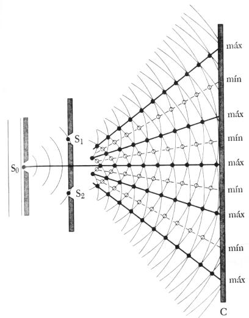
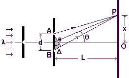
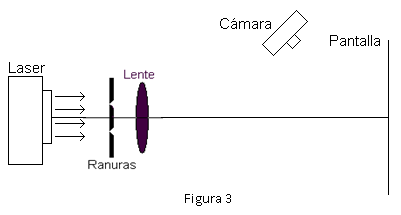
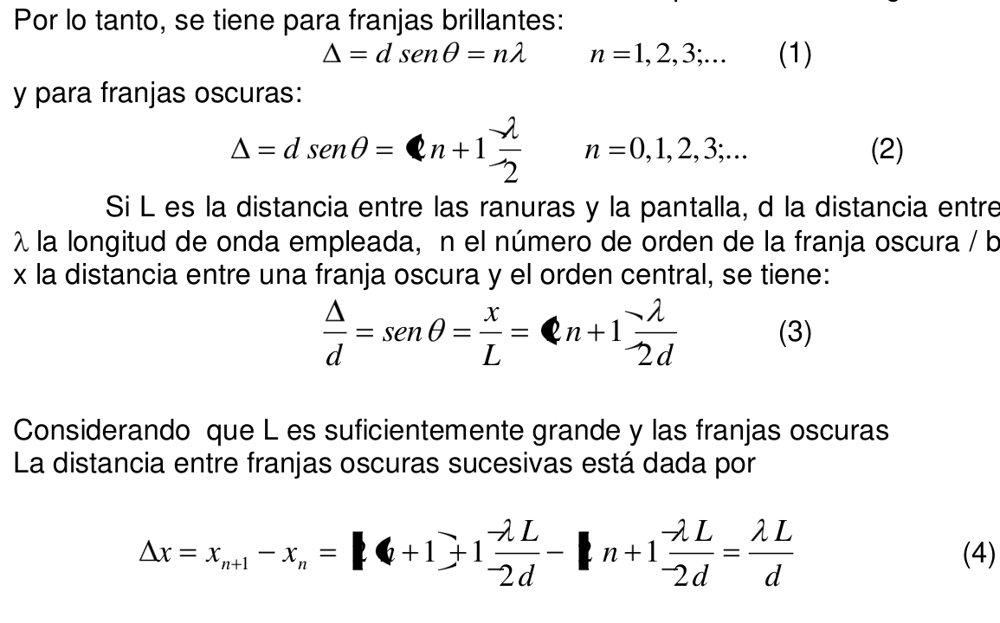

<!-- markdownlint-disable MD060 -->

# Trabajo práctico Nº 12: Estudio del fenómeno de interferencia

Universidad Tecnologica Nacional. Facultad Regional Resistencia. Cátedra: Física
II.

TEMA: ESTUDIO DEL FENÓMENO DE INTERFERENCIA

## Objeto de la experiencia

- Estudiar el fenómeno de interferencia de la luz empleando dos ranuras
- Determinar la separación entre ranuras.
- Calcular longitudes de onda desconocidas.

## Consideraciones teóricas

El fenómeno de interferencia ocurre cuando dos o más tres de ondas coinciden en
el tiempo y en el espacio.

Si se emplean fuentes luminosas, los efectos de interferencia no son fáciles de
observar, porque las longitudes de onda son pequeñas (de orden de
$`4\times10^{-7}\,m`$ a $`7\times10^{-7}\,m`$). Para observar la interferencia
de ondas de luz, deben cumplirse las siguientes s condiciones:

1. Las fuentes deben ser coherentes, es decir, que la diferencia de fase entre
   ellas debe ser constante.
1. Las fuentes deben ser monocromáticas ( una sola longitud de onda)
1. Se debe aplicar el principio de superposición.

Una forma de obtener dos fuentes coherentes y monocromáticas, es hacer un
montaje como el de la figura 1, iluminar la ranura $`S_0`$ con una fuente de luz
monocromática, la ranura deja pasar un haz de rayos que inciden sobre las
ranuras $`S_1`$ y $`S_2`$. Según el principio de Huygens, los puntos de estas
ranuras alcanzadas simultáneamente por la luz, se transforman en centros
emisores de nuevas ondas que tienen la propiedad de estar en fase y cuando estas
ondas alcanzan la pantalla se observa el efecto producido por la superposición
de estas ondas secundarias. No se observa una intensidad uniforme, sino franjas
brillantes y oscuras alternadas.



Es decir que hay puntos de la pantalla en los cuales las ondas provenientes de
ambas ranuras interfieren destructivamente, mientras que en otros puntos hay un
refuerzo, es decir interferencia constructiva. Para poder observar el fenómeno
es necesario que la luz sea coherente, es decir, que las fuentes estén
sincronizadas. En el caso de la experiencia de Young, las fuentes son las dos
ranuras próximas que son alcanzadas simultáneamente por la luz proveniente de
$`S_0`$, luego, las ondas originadas en $`S_1`$ y $`S_2`$, están en concordancia
de fase y el desfasaje que se produce en puntos de la pantalla es el debido a la
diferencia de camino entre el punto considerado y las fuentes $`S_1`$ y $`S_2`$.



La luz de la fuente $`S_0`$ está alejada de las ranuras A y B (ver fig.2), a las
mismas llega un frente de onda prácticamente plano.

En P, por razones de simetría, la diferencia de camino entre las ondas
originadas en A y B es nula, entonces en P se tiene un punto brillante.

Otro punto P´ de la pantalla será también brillante si la diferencia de camino
entre AP´ y BP´ es un número entero de longitudes de onda, mientras que será
oscuro si esa diferencia de camino es un número impar de media longitud de onda.
Por lo tanto, se tiene para franjas brillantes:

```math
\Delta=d\mathop{\mathrm{sen}}\nolimits\theta=n\lambda\qquad n=1,2,3;\ldots \tag{1}
```

y para franjas oscuras:

```math
\Delta=d\mathop{\mathrm{sen}}\nolimits\theta=(2n+1)\frac\lambda2\qquad n=0,1,2,3;\ldots \tag{2}
```

Si L es la distancia entre las ranuras y la pantalla, d la distancia entre
ranuras, $`\lambda`$ la longitud de onda empleada, n el número de orden de la
franja oscura / brillante, y x la distancia entre una franja oscura y el orden
central, se tiene:

```math
\frac\Delta d=\mathop{\mathrm{sen}}\nolimits\theta=\frac xL=(2n+1)\frac\lambda{2d} \tag{3}
```

Considerando que L es suficientemente grande y las franjas oscuras

La distancia entre franjas oscuras sucesivas está dada por

```math
\Delta x=x_{n+1}-x_n=[2(n+1)+1]\frac{\lambda L}{2d}-[2n+1]\frac{\lambda L}{2d}=\frac{\lambda L}{d} \tag{4}
```

La ecuación anterior permite determinar, conocidas x, L y $`\lambda`$, la
distancia entre ranuras d. También puede emplearse para determinar longitudes de
onda desconocidas

## Elementos empleados

Ranuras de distintos d, laser HeNe cámara digital y PC con software Imagen J.

## Técnica operatoria

Montar el Laser en un extremo del banco óptico, expandir el haz con un sistema
óptico. Registrar la longitud de onda de Laser.

Colocar la doble ranura en un soporte y una lente convergente detrás, asegurando
el centrado de todo el sistema.



Registrar la separación entre las ranuras d.

Registrar con la cámara la distribución de intensidad de la pantalla,
incorporando a la escena una regla graduada.

Empleando el software Imagen J (ver tutorial) se procede a

i. Definir una escala:

ii. Obtener de la imagen el perfil de intensidades del patrón de interferencia.

Determinar todas las distancias entre mínimos (máximos) $`\Delta x`$ posibles y
con ellos calcule el promedio.

Calcular la distancia entre la ranura y la pantalla L empleando (4) en forma
adecuada.

Empleando las otras ranuras de la diapositiva con distintas separaciones,
observar cómo se distribuyen las franjas brillantes y oscuras. Repita el
procedimiento.

En el informe discuta las causas de error

## Bibliografía

HECHT-ZAJAC OPTICA FONDO EDUCATIVO INTERAMERICANO S.A.(1977)

SERWAY, R FÍSICA TOMO II (CUARTA EDICIÓN)

JENKINS WHITWE - Fundamentos de Óptica

ROSSI, BRUNO - Fundamentos de Óptica.

## Trabajo de laboratorio Nº 12: Hoja de datos

TEMA: ESTUDIO DEL FENÓMENO DE INTERFERENCIA

OBJETO DE LA EXPERIENCIA:

- Estudiar el fenómeno de interferencia de la luz empleando dos ranuras
- Determinar la distancia de las ranuras a la pantalla..
- Analizar el comportamiento del patrón de interferencia para diferentes
  ranuras.

<table>
<tr><th rowspan="5">CURSO</th><th rowspan="5">FECHA</th><th>INTEGRANTES</th></tr>
<tr><td>1.-</td></tr>
<tr><td>2.-</td></tr>
<tr><td>3.-</td></tr>
<tr><td>4.-</td></tr>
</table>

1. Longitud de onda del laser NeNe=
1. La separación entre las ranuras d =
1. Registrar el patrón de intensidad con una regla graduada en la escena
1. Defina la escala.
1. La separación entre dos franjas oscuras consecutivas.

| Lecturas | $`\Delta x`$ |
| -- | -- |
|  |  |
|  |  |
|  |  |
|  |  |

$`\Delta x_{\mathrm{prom}}=`$

6 La distancia de la ranura a la pantalla

```math
L=\frac{d\,\Delta x_{\mathrm{prom}}}{\lambda}=
```

7 Analice las causas de error

Repetir con las otras ranuras

## Procedencia y transcripción

Fuente: `2015/FISICA II - EXPERIENCIAS DE LABORATORIOS.pdf`, páginas 70–73,
cotejadas completas. Se conservan tres figuras, cuatro ecuaciones numeradas, las
dos listas de objetivos distintas y la hoja vacía. La tabla de lecturas tiene
cuatro filas vacías; su celda combinada para el promedio se presenta como campo
separado. Véase [el inventario de fuentes](../../../resources/2015/fuentes.md).

Se preservan «dos o más tres de ondas», «siguientes s condiciones», la frase
inconclusa después de (3), n desde1 en las franjas brillantes y HeNe/NeNe en las
secciones respectivas. Los delimitadores de (2)–(4) se superponen sobre
coeficientes; los valores2 y1 y los índices constan en la capa textual y se
contrastaron con el original ampliado. Se conserva este recorte para documentar
el defecto gráfico; no se completan mediciones:


