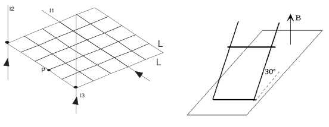

# Física II — IQ 2009, 2D parcial, tema 1

## Problema 1

Dada la distribución de conductores de corrientes de la figura, a) Graficar el
campo magnético que cada conductor genera en el punto P. b) Calcular el campo
magnético total (módulo, dirección y sentido). Datos: I1 = 1 amp, I2 = 2 amp, I3
= 3 amp. L = 1 cm

## Problema 2

Una varilla conductora de masa 10 g desliza sobre carriles paralelos distantes
20 cm y que forman un ángulo de 30º con el plano horizontal. Los carriles se
cierran por la parte inferior, tal como se indica en la figura. En la región
existe un campo magnético uniforme y perpendicular al plano horizontal de
intensidad 1 T. a) Calcular la fem en función de la velocidad constante de la
varilla. b) La intensidad de la corriente inducida si la resistencia del
circuito es de 10 W. c) La(s) fuerza(s) sobre la varilla. d) ¿Cuánto valdrá la
velocidad de la varilla cuando desliza con movimiento uniforme? (se desprecia el
rozamiento).

## Problema 3

Con las siguientes mediciones de valores eficaces de VL= 18 V, VC = 14 V e I =
0.5 amp y la fem de la fuente de 5 V con una frecuencia de 250 Hz, se desea
conocer los valores de los elementos R, L y C que están conectados en serie y
además el desfasaje entre la corriente y la ddp correspondiente

## Laboratorio Nº7 – Campo de Inducción Magnética

1. Indique el objetivo planteado para éste práctico

1. Grafique el circuito utilizado en el laboratorio

1. Indique cuales son los parámetros a medir y cuales los cálculos a realizar
   (referencie la tabla a completar)

1. que gráfico se debe realizar

1. Señale como obtener los resultados propuestos en los objetivos fijados.-

## Figuras originales

## Procedencia y observaciones de transcripción

- Original:
  `2015/480938-Modelos de parcial FISICA II actualizado 060813(0).pdf`, páginas
  26\.
- SHA-256: `1555e295ed06e6a3872614be84854c0e0af3e8455048ca7e5bcbc4383490653e`.
- Compilación: Sampallo Guillermo, Rodríguez Ulises y Cleva Mario; versión 1.1,
  04/08/2010 en carátula. Se conserva la fecha e identificación propias de cada
  examen.
- Herramientas: extracción textual PyMuPDF y Poppler, cotejo visual de todos los
  enunciados, datos, expresiones y figuras. Diagramas originales por render
  PyMuPDF. No se resuelven ejercicios ni se completan campos.
- Se conserva la unidad **W** impresa tras la resistencia de 10 y la consigna de
  velocidad constante junto a la pregunta sobre movimiento uniforme.
