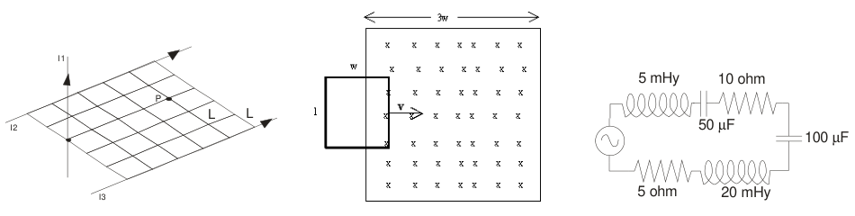

# Física II — IQ 2009, 2D parcial, tema 2

## Problema 1

Dada la distribución de conductores de corrientes de la figura, a) Graficar el
campo magnético que cada conductor genera en el punto P. b) Calcular el campo
magnético total (módulo, dirección y sentido). Datos: I1 = 1 amp, I2 = 2 amp, I3
= 3 amp. L = 1 cm

## Problema 2

Una espira rectangular de dimensiones l = 15 cm y w = 10 cm y resistencia R = 1
ohm, se mueve con velocidad constante v= 20 cm/seg hacia la derecha como se
muestra en la figura, penetra en una región donde hay un campo magnético
uniforme perpendicular al plano del papel y hacia dentro de módulo B = 1 T.
Calcular y hacer un gráfico de: a) El flujo, b) la f.e.m. y c) la fuerza sobre
la espira, en función del tiempo, es decir, cuando la espira se está
introduciendo, está introducida, y está saliendo de la región que contiene el
campo magnético. d) Indique el sentido de circulación de la corriente inducida
en los tres casos citados.

## Problema 3

En el circuito de la figura determine la diferencia de sobre el capacitor 100
µF. La fem $`V(t)=100\cos(2.\pi.f.t)`$ con f = 50 Hz.

## LABOATORIO Nº8 – Fuerza Magnética sobre elementos de corrientes

1. Indique el objetivo planteado para éste práctico

1. Grafique el circuito utilizado en el laboratorio

1. Indique cuales son los parámetros a medir y cuales los cálculos a realizar
   (referencie la tabla a completar)

1. que gráfico se debe realizar

1. Señale como obtener los resultados propuestos en los objetivos fijados.-

## Figuras originales

## Procedencia y observaciones de transcripción

- Original:
  `2015/480938-Modelos de parcial FISICA II actualizado 060813(0).pdf`, páginas
  26,27.
- SHA-256: `1555e295ed06e6a3872614be84854c0e0af3e8455048ca7e5bcbc4383490653e`.
- Compilación: Sampallo Guillermo, Rodríguez Ulises y Cleva Mario; versión 1.1,
  04/08/2010 en carátula. Se conserva la fecha e identificación propias de cada
  examen.
- Herramientas: extracción textual PyMuPDF y Poppler, cotejo visual de todos los
  enunciados, datos, expresiones y figuras. Diagramas originales por render
  PyMuPDF. No se resuelven ejercicios ni se completan campos.
- Se conserva «diferencia de sobre» (frase incompleta) y «LABOATORIO» en la
  continuación de la página27. Sus tres diagramas están al pie de esa página;
  los dos primeros enunciados comienzan en26.
