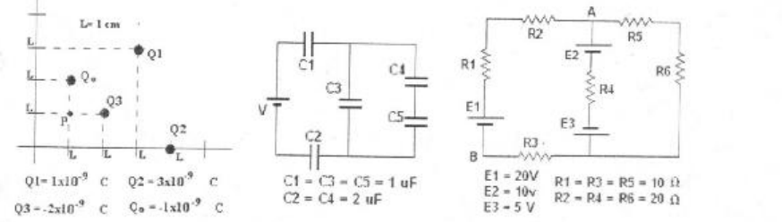
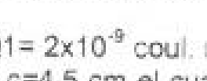

# Recuperatorio 1º Física II — IQ, tema A

NOMBRE Y APELLIDO: \_\_\_\_\_\_\_\_\_\_\_\_\_\_\_\_\_\_\_\_

## Problema Nº 1

Hallar la fuerza sobre la carga Q3 y el potencial en el punto P debido a la
distribución de cargas de la figura.-

## Problema Nº 2

Una esfera metálica de radio a=3 cm posee una carga total
$`Q1=2\times10^{-8}\ \mathrm{coul}`$. rodeando a esta se encuentra un casquete
esférico de radio interior b=4cm y radio exterior c=4,5 cm el cual tiene una
carga Q2=-3x10-9 coul. Calcular el campo eléctrico para r=2 cm, r=3,5 cm, r=4,2
cm y r=5 cm y la carga en la superficie interior y exterior del casquete.-

## Problema Nº 3

Hallar el valor de la fuente de alimentación V si la carga del capacitor C4 es
de $`Q=2.10^{-5}`$ coul

## Problema Nº 4

Hallar la corriente en cada rama y la diferencia de potencial entre los puntos A
y B.-

## Procedencia y observaciones de transcripción

- Original:
  `2015/480938-Modelos de parcial FISICA II actualizado 060813(0).pdf`, página5,
  examen superior temaA «RECUPERATORIO1º FISICAII – IQ». Sin fecha propia
  visible.
- SHA-256: `1555e295ed06e6a3872614be84854c0e0af3e8455048ca7e5bcbc4383490653e`.
- Compilación: Sampallo Guillermo, Rodríguez Ulises y Cleva Mario; versión1.1,
  04/08/2010 en carátula.
- Herramientas: OCRmyPDF español sobre copia con `--force-ocr`, PyMuPDF4LLM,
  Poppler y cotejo visual de enunciados, datos y diagramas. Figuras originales
  por render PyMuPDF.
- Q1 tiene exponente **−8**, cotejado con ampliación del original, frente al −9
  de otros exámenes de esta compilación. Se conserva por separado. Q2 imprime
  «10-9» en la línea de texto: se conserva así, sin convertirlo silenciosamente
  en superíndice.

