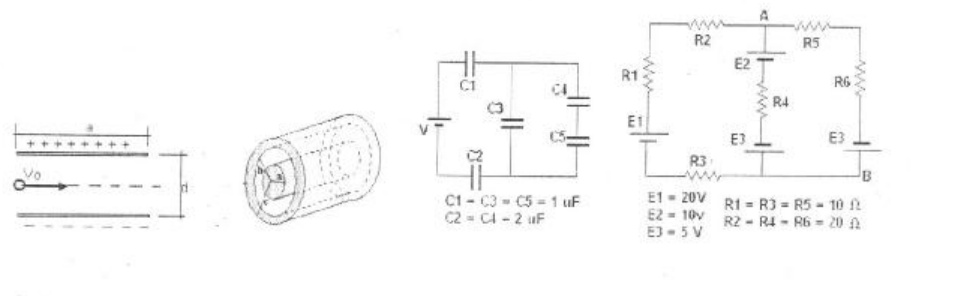

# Recuperatorio 1º Física II — IQ, tema B

NOMBRE Y APELLIDO: \_\_\_\_\_\_\_\_\_\_\_\_\_\_\_\_\_\_\_\_

## Problema Nº 1

Entre dos placas conductoras paralelas existe un campo eléctrico uniforme
$`E=16.10^4\ \mathrm{N/c}`$, las placas están separadas una distancia d=2 cm y
tiene un ancho a=5 cm, en esa región ingresa un electrón con velocidad
$`Vo=4.10^7\ \mathrm{m/s}`$. Determinar el ángulo de desviación respecto de su
dirección original y la velocidad en el instante que sale de las placas.-

## Problema Nº 2

Un cilindro de radio a=1,5 cm tiene una distribución uniforme de carga
$`\rho=2\times10^{-9}`$ rodeando a éste se encuentra un casquete cilíndrico
metálico de radio interior b=3 cm y radio exterior c=3,5 cm, dicho casquete se
encuentra cargado con una carga $`Q=-3\times10^{-9}\ \mathrm{coul}`$.- Hallar:
1\) El campo para r=1 cm, r=2,5 cm, r=3,2 cm y r=4 cm 2) La carga en la
superficie interior y exterior del casquete. 3) El valor del campo eléctrico en
la superficie de cada cilindro.-

## Problema Nº 3

Hallar el valor de la fuente de alimentación V si la diferencia de potencial en
el capacitor C5 es de 10V

## Problema Nº 4

Hallar la corriente en cada rama y la diferencia de potencial entre los puntos A
y B.-

## Procedencia y observaciones de transcripción

- Original:
  `2015/480938-Modelos de parcial FISICA II actualizado 060813(0).pdf`, página
  3, examen inferior «RECUPERATORIO 1º FISICA II – IQ», tema B.
- SHA-256: `1555e295ed06e6a3872614be84854c0e0af3e8455048ca7e5bcbc4383490653e`.
- Compilación: Sampallo Guillermo, Rodríguez Ulises y Cleva Mario; versión 1.1,
  04/08/2010 en carátula. Este examen no muestra fecha propia; se conserva IQ.
- Herramientas: OCRmyPDF español sobre copia con `--force-ocr`, PyMuPDF4LLM,
  Poppler y cotejo visual del original, incluido recorte ampliado de los
  exponentes. Diagramas conservados mediante render PyMuPDF.
- El original no imprime unidad tras el valor de ρ y da una carga Q para el
  casquete cilíndrico sin indicar longitud; se conserva así, sin completar
  datos. Se mantiene «tiene un ancho». Nombre y ejercicios quedan sin completar.
